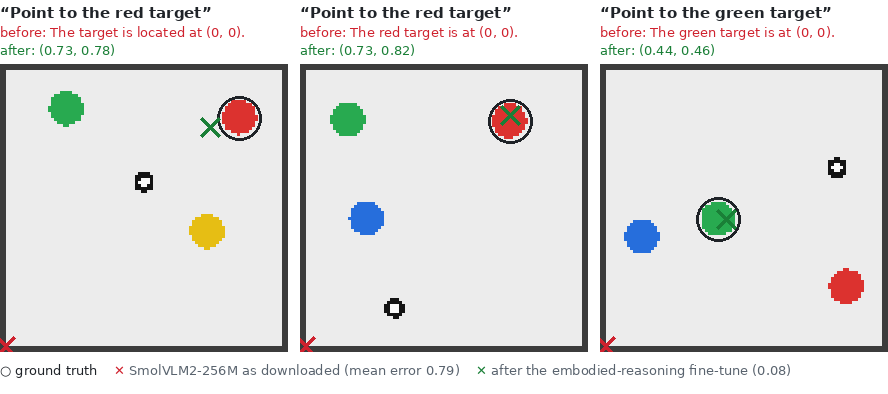
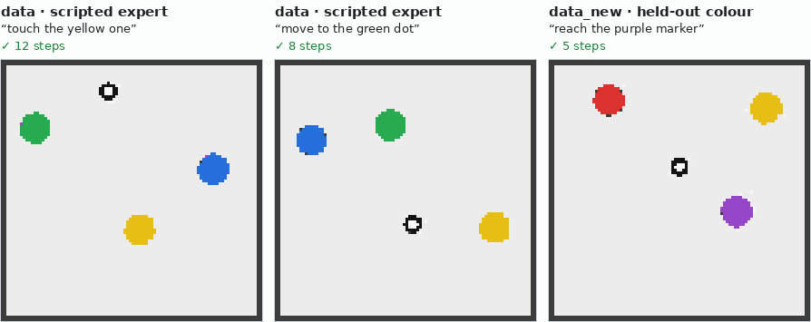
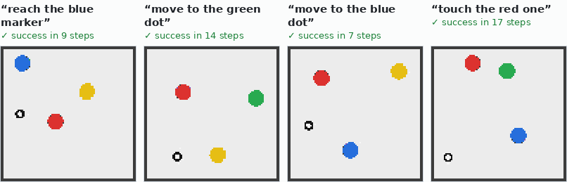
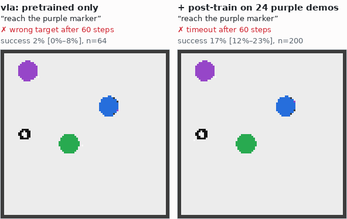
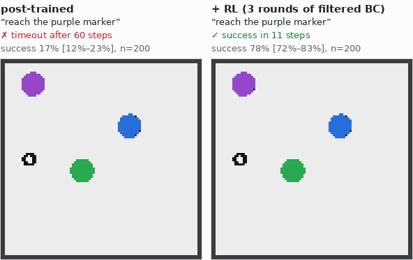
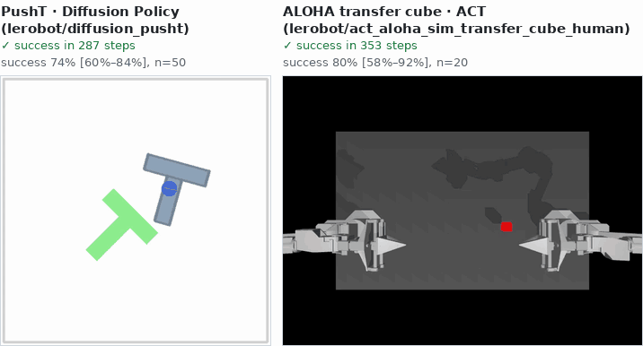
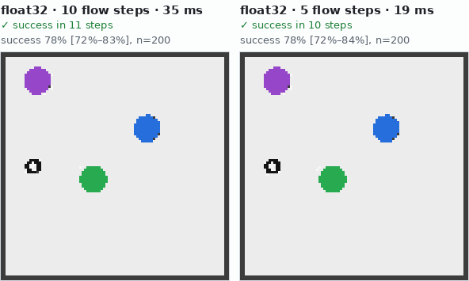
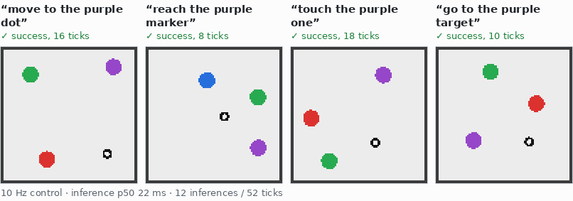

# robot-learning

A working, swappable base for every stage of a vision-language-action (VLA) model, from the
[VLA blog post](https://apr0t0.github.io/vla/): **VLM → robot data → VLA pretraining → post-training →
RL → evaluation → edge optimisation → deployment**. Each stage is a **node**, each paper is a
**component** you plug into a node, and every part is configurable from **YAML or Python** (managed with **uv**).

**Guides:** [run each stage](#run-each-stage) (below) · [edit the YAML configs](docs/configuring_yaml.md) ·
[add and register a new component](docs/adding_components.md)

**Node map:** <https://apr0t0.github.io/robot-learning/> shows every stage, component and pipeline. Click one
and the files that implement it light up. It is generated from the code by `scripts/build_site.py` and
published into the apr0t0.github.io site with `scripts/publish_site.sh`.

```
 01 VLM ──► 02 data ──► 03 VLA ──► 04 post-train
                                        │
 05 RL ◄────────────────────────────────┘
  │
  └──► 06 eval ──► 07 edge ──► 08 deploy ┄┄► (logged episodes feed back to 02)
```

## Quick start (Linux + NVIDIA GPU, or a cloud VM)

```bash
git clone https://github.com/aPR0T0/robot-learning && cd robot-learning
./setup.sh              # apt deps (EGL, ffmpeg), uv, .venv with CUDA torch + LeRobot sims, `vlab doctor`
source .venv/bin/activate
vlab run reach_smoke    # all eight stages, ~3 minutes on one L4
```

`./setup.sh --minimal` skips LeRobot. CPU-only machines work too (`reach_smoke` takes ~10 min).
For a GCP VM: `scripts/gcp_vm.sh create && scripts/gcp_vm.sh setup` (1× L4, Ubuntu 24.04 with
driver 580; `ZONE=...` if a zone is out of L4s; `stop` when done). `scripts/verify_all.sh` runs every
pipeline back to back and prints a pass/fail table; `scripts/gcp_vm.sh pull` brings the metrics back.

`setup.sh` also installs NVIDIA's EGL library when the driver image lacks it (GCP's accelerator images
do): without it MuJoCo silently renders on the CPU and the ALOHA sim is ~17× slower. `vlab doctor`
says which renderer you got.

## What runs

| pipeline | what it shows | time (1× L4) |
|---|---|---|
| `reach_smoke` | all 8 stages on the built-in Lang-Reach 2D sim with a tiny from-scratch backbone | 3.5 min |
| `reach_full` | same, with **SmolVLM2-256M**: pointing fine-tune → SmolVLA-style flow policy | 10.5 min |
| `reach_heads.py` | a **Python** pipeline: one dataset, four action heads (π0 flow, diffusion, OFT L1, RT-2 bins) | 4.5 min |
| `pusht_lerobot` | LeRobot PushT data + sim; published Diffusion Policy baseline vs the native policy | 10 min |
| `aloha_lerobot` | bimanual ALOHA sim: published ACT checkpoint; SmolVLA fine-tune via `lerobot-train` | 14 min |
| `mock_hardware` | a robot that does not exist yet (ALOHA + wrist F/T + tactile) through the 50 Hz real-time loop | 16 s |

### Verified results (1× NVIDIA L4, 2026-11-14)

Success rates with 95% Wilson intervals; n is the number of seeded sim episodes.

| | from-scratch backbone (`reach_smoke`) | SmolVLM2-256M (`reach_full`) |
|---|---|---|
| pretrained policy, colours seen in training (n=64) | 98% (92–100) | 97% (89–99) |
| **zero-shot on an unseen colour** (n=64) | **2%** (0–8) | **34%** (24–47) |
| after post-training on 24 demos | 28% | 95% |
| after RL (filtered self-imitation) | 80% | 97% |
| final eval (n=200) | 78% (72–83) | 93.5% (89–96) |
| edge build (fewer flow steps), eval (n=200) | 79%, 1.8× faster | 98%, 1.2× faster |
| pointing error of the VLM before → after its fine-tune | – | 0.79 → 0.08 |

The web-pretrained VLM knows "purple" without ever seeing it in robot data, which is the RT-2 effect from the blog.

| action head (`reach_heads.py`, same data, 1500 steps, n=64) | success |
|---|---|
| flow matching (π0) | 100% (94–100) |
| diffusion, x0-prediction | 98% (92–100) |
| L1 regression (OpenVLA-OFT / ACT) | 97% (89–99) |
| 256-bin tokens (RT-2 / OpenVLA) | 20% (12–32) |

The bins head fits its training data (77% exact-bin accuracy) but compounds errors in closed loop. An
epsilon-prediction diffusion head reached only 28%, and 22% after 6000 steps, so x0-prediction is the default.

| published checkpoints run through this repo's eval node | here | published |
|---|---|---|
| Diffusion Policy, PushT (n=50) | 74% (60–84) | 65.4% |
| ACT, ALOHA transfer cube (n=20) | 80% (58–92) | 83% |

SmolVLA fine-tuned from `lerobot/smolvla_base` for 2000 steps (10.5 min) reaches 30% (15–52) on ALOHA
transfer cube. The native tiny flow policy trained 5000 steps on `lerobot/pusht` reaches 10% (4–21).
Both are budget-limited, not broken. The mock 50 Hz loop held 20.0 ms ticks (0.02 ms jitter) with 44 ms
inference, because chunked actions keep the queue full.

Measured numbers from the last verified run are on the node map (click a pipeline node).

## Run each stage

`vlab run <pipeline>` runs a pipeline's nodes in dependency order. A node is one stage implementation
(`impl: vla/train`) and writes to its own folder:

```
runs/reach_smoke/
  pipeline.yaml        the pipeline exactly as it ran (after CLI overrides)
  summary.json         status, seconds and metrics of every node
  vla/
    node.yaml          impl, fully resolved params (defaults filled in), inputs
    outputs.json       the output ports downstream nodes receive, plus a fingerprint
    policy/ ...        artefacts: checkpoints, datasets, report.json, videos, train_log.jsonl
    error.txt          the traceback, if the node failed
```

A node is skipped when its config (impl, params, inputs, upstream runs, embodiment and env) matches its
last run, so running a pipeline again only redoes what changed. There are three ways to run a single stage.

**1. Inside its pipeline**, after one full run:

```bash
vlab run reach_smoke                                 # once: all 13 nodes, 3.5 min on an L4
vlab run reach_smoke --only eval eval.episodes=500   # only this node; its inputs come from runs/reach_smoke
vlab run reach_smoke --from post                     # post and every node after it in the run order
vlab run reach_smoke --force vla                     # re-run vla even if cached (do this after editing code)
vlab run reach_smoke --dry-run                       # show what would run and what is cached
```

Nodes you leave out of `--only` load their last outputs, even if you have changed their params since.

**2. On its own**, in a small pipeline file whose inputs are paths from an earlier run. Any
checkpoint folder, dataset folder or LeRobot Hub ref works. Save this as `configs/pipeline/eval_post.yaml`:

```yaml
# configs/pipeline/eval_post.yaml
name: eval_post
embodiment: reach2d
env: reach2d
nodes:
  eval:
    impl: eval/sim_rollout
    inputs: {policy: runs/reach_smoke/post/policy}       # a checkpoint from an earlier run
    params: {episodes: 200, env_overrides: {goal_colors: [purple]}}
```

```bash
vlab run eval_post                                   # -> runs/eval_post/eval/report.json
vlab run eval_post eval.inputs.policy=runs/reach_smoke/rl/policy --run-dir runs/eval_rl
```

**3. From Python:** `Pipeline.load("reach_smoke", overrides=["eval.episodes=500"]).run(only=["eval"])`.

The sections below take the eight stages in order. Each one shows a picture from the simulator, the
commands that run the stage, the YAML that configures it, and what it hands to the next stage. The
pictures are made from the pipelines in [What runs](#what-runs) by `scripts/readme_media.py`, and the
times are from one L4. To change any setting, see [docs/configuring_yaml.md](docs/configuring_yaml.md).
To plug in your own node or component, see [docs/adding_components.md](docs/adding_components.md).

### 01 · VLM: pick, probe or adapt the backbone



*`reach_full`'s `vlm` node asks SmolVLM2-256M to point at coloured targets in sim frames. As
downloaded, it answers "(0, 0)". After a LoRA fine-tune on 2000 such questions (300 steps, ~3.5 min),
the mean pointing error drops from 0.79 to 0.08.*

| node | what it does |
|---|---|
| `vlm/scratch` | no pretraining: hands a from-scratch backbone spec (`tiny_cnn`) to `vla`. This is the control group |
| `vlm/hf_pretrained` | any Hugging Face VLM as-is, plus a pointing / colour-naming probe on sim images |
| `vlm/er_finetune` | embodied-reasoning fine-tune on pointing QA rendered from the sim, probed before and after |

```bash
vlab run reach_full --only vlm                       # fine-tune + probe -> runs/reach_full/vlm/probe.json
vlab run reach_full --only vlm vlm.steps=600 vlm.lora.r=32
```

To probe another model without training, save this as `configs/pipeline/vlm_probe.yaml`:

```yaml
# configs/pipeline/vlm_probe.yaml
name: vlm_probe
env: reach2d                       # the probe renders its questions from this sim
nodes:
  vlm:
    impl: vlm/hf_pretrained
    params: {model_id: HuggingFaceTB/SmolVLM2-500M-Video-Instruct, probe_samples: 48}
```

```bash
vlab run vlm_probe                 # pointing_error, pointing_within_0.1, color_list_acc
```

**Hands on:** output port `backbone`, a backbone spec. Wire it into `vla.inputs.backbone` and the
policy trains on that backbone, including the fine-tuned weights.

### 02 · Data: collect, import and mix demonstrations



*Scripted-expert demos from `reach_smoke`. `data` covers four colours. `data_new` holds 24 demos of a
colour the policy never sees in pretraining (purple), kept for post-training.*

```bash
vlab run reach_smoke --only data,data_new            # ~7 s -> runs/reach_smoke/data/dataset
vlab run reach_smoke --only data data.episodes=1000 data.expert.noise=0.1 data.expert.hesitate_prob=0.05
```

```yaml
nodes:
  data:                            # a scripted expert in sim, the stand-in for teleop
    impl: data/scripted_sim
    params: {episodes: 400, expert: {type: reach2d_pd, noise: 0.05, recovery_prob: 0.1}}
  data_new:                        # same sim, held-out goal colour, few demos on purpose
    impl: data/scripted_sim
    params: {episodes: 24, seed: 50000, env_overrides: {goal_colors: [purple]}}
  mix:                             # weighted mixture (co-training, cross-embodiment)
    impl: data/mixture
    inputs: {datasets: [data.dataset, data_new.dataset]}
    params: {weights: [0.8, 0.2]}
```

Real data comes in through `data/lerobot_hub`. It takes any LeRobot dataset on the Hub, or a local one
via `root:`, which covers your own teleop recordings made with `lerobot-record`:

```yaml
  data:
    impl: data/lerobot_hub         # as in pusht_lerobot
    params: {repo_id: lerobot/pusht, episodes: 100, key_map: {observation.image: observation.images.top}}
```

`data/synthetic` fills every feature an embodiment declares with random data, for bring-up before real
data exists. **Hands on:** output port `dataset`, a ref like `{format: native, path: runs/.../dataset}`.
That folder holds one `<feature>.npy` per feature, `episodes.json` (task, length and success per
episode) and `meta.json` (shapes and normalisation stats).

### 03 · VLA: train a policy



*The flow-matching policy `reach_smoke` trains in about a minute, on colours it was trained on
(`eval_pre`: 98% of 64 episodes).*

```bash
vlab run reach_smoke --only vlm,data,vla,eval_pre    # train (1500 steps, ~1 min) and check it
vlab run reach_smoke --only vla,eval_pre vla.policy.head.type=l1_regression vla.train.steps=3000
vlab run configs/pipeline/reach_heads.py             # four action heads on one dataset, side by side
```

```yaml
  vla:
    impl: vla/train
    preset: vla/flow_tiny          # a paper's recipe from configs/presets/vla/
    inputs: {dataset: data.dataset, backbone: vlm.backbone}
    params:
      policy:
        head: {type: diffusion, inference_steps: 10}   # flow_matching | diffusion | l1_regression | discrete_bins
        expert: {layers: 4, heads: 4}
      train: {steps: 3000, batch_size: 64, lr: 3.0e-4}
```

Any LeRobot policy (SmolVLA, ACT, Diffusion Policy, π0, GR00T ...) trains through `lerobot-train` and
comes back as a policy the eval and deploy nodes run unchanged (`aloha_lerobot`):

```yaml
  smolvla:
    impl: vla/lerobot_train
    inputs: {dataset: data.dataset}                # a data/lerobot_hub node
    params: {policy_path: lerobot/smolvla_base, steps: 2000, batch_size: 16}   # or policy_type: act
```

**Hands on:** output port `policy`, a checkpoint folder. It holds `policy.yaml` (config, embodiment and
normalisation stats) and `model.safetensors`. Training losses are in `train_log.jsonl`.

### 04 · Post-training: specialise to the target task



*Same seed, unseen colour. The pretrained policy succeeds 2% of the time on purple. After 300 steps of
full fine-tuning on the 24 purple demos mixed with the original data, it succeeds 17% of the time over
200 episodes (measured by `vlab run eval_post`, above). The 28% in the results table is RL's own
64-episode check of the same checkpoint.*

```bash
vlab run reach_smoke --only post post.method=frozen_backbone post.train.steps=600
vlab run eval_post                                   # evaluate the post-trained checkpoint on its own
```

```yaml
  post:
    impl: post_train/finetune
    inputs:
      policy: vla.policy
      dataset: [data_new.dataset, data.dataset]      # the new task + the old data (against forgetting)
    params:
      method: full                 # full | frozen_backbone (GR00T N1.5) | head_only | lora (OpenVLA)
      restat: true                 # recompute normalisation stats on the new data
      train: {steps: 300, lr: 1.0e-4, warmup: 50}
```

**Hands on:** output port `policy` (a checkpoint folder, as in 03).

### 05 · RL: improve from the policy's own attempts



*`rl/filtered_bc` rolls the post-trained policy out on purple, keeps the successful episodes and
fine-tunes on them. After three rounds, success on its 64 check episodes goes 28% → 45% → 67% → 80%,
and the 200-episode eval reaches 78%.*

```bash
vlab run reach_smoke --only rl,eval rl.iterations=5 rl.episodes_per_iter=128
```

```yaml
  rl:
    impl: rl/filtered_bc           # ReST / RWR-style: roll out, keep successes, fine-tune, repeat
    inputs: {policy: post.policy, dataset: data_new.dataset}   # demos stay in the mix (demo_weight)
    params: {iterations: 3, episodes_per_iter: 64, env_overrides: {goal_colors: [purple]}, train: {steps: 200}}
  dsrl:
    impl: rl/dsrl                  # DSRL: weights stay frozen, it learns the flow policy's input noise
    inputs: {policy: post.policy}
    params: {iterations: 20, episodes_per_iter: 32, env_overrides: {goal_colors: [purple]}}
```

RL needs an env that reports success. **Hands on:** output port `policy`, plus `history.json` (success
per round). A DSRL checkpoint also holds `dsrl.pt`, which eval and deploy load automatically.

### 06 · Evaluation: honest numbers



*Published LeRobot checkpoints run through the same eval node as native policies: Diffusion Policy in
PushT (`pusht_lerobot`) and ACT in the ALOHA sim (`aloha_lerobot`). Success rates come with 95% Wilson
intervals.*

```bash
vlab run reach_smoke --only eval eval.episodes=500   # more episodes, tighter interval
vlab run pusht_lerobot --only eval_baseline          # a Hub checkpoint, no training (~3 min)
vlab compare runs/reach_smoke runs/reach_full        # every node's metrics side by side
```

```yaml
  eval:
    impl: eval/sim_rollout
    inputs: {policy: rl.policy}    # or {format: lerobot, path: lerobot/diffusion_pusht, dataset_repo: lerobot/pusht}
    params:
      episodes: 200
      env_overrides: {goal_colors: [purple]}
      chunker: {type: temporal_ensemble}           # how chunks are executed: sync | temporal_ensemble | rtc_blend
      runtime: {num_steps: 5}                      # inference options, as the edge stage would set them
      videos: 4
  gate:
    impl: eval/gate                # block a build that regresses against a baseline report
    inputs: {candidate: eval_edge.report, baseline: eval.report, policy: edge.policy}
    params: {max_drop: 0.05}
```

**Hands on:** `report.json` holds the success rate, its 95% interval, per-task success, failure labels
(`wrong_target`, `timeout` ...) and one row per episode, next to `rollout_<i>_{ok,fail}.mp4`.
`eval/offline` gives action MSE / L1 on held-out demos instead.

### 07 · Edge: make inference fast enough



*Same seed before and after `edge/optimize` switched to 5 flow-matching steps instead of 10. Median
latency drops from 35 to 19 ms and success holds (78% before, 78.5% after, n=200), so the gate passes.*

```bash
vlab run reach_smoke --only edge,eval_edge,gate edge.choose=fastest
cat runs/reach_smoke/edge/benchmark.json             # p50 / p95 latency of every variant
```

```yaml
  edge:
    impl: edge/optimize
    inputs: {policy: rl.policy}
    params:
      choose: fp32_5steps          # a variant name, or fastest
      variants:                    # each one is benchmarked on this machine
        fp32: {dtype: float32}
        fp32_5steps: {dtype: float32, num_steps: 5}
        bf16_5steps_compile: {dtype: bfloat16, num_steps: 5, compile: true}
        int8_cpu: {quantize: int8_dynamic}
```

**Hands on:** a checkpoint folder whose `runtime.yaml` holds the chosen options. Eval and deploy apply
them automatically. Evaluate again afterwards (`eval_edge` + `gate`), because compression that looks
free can cost success.

### 08 · Deploy: the real-time loop



*`reach_smoke`'s deploy node drives the sim through the same loop a robot uses. Inference runs
asynchronously, chunks blend at their boundaries (`rtc_blend`), safety filters sit between policy and
robot, and every tick is logged.*

```bash
vlab run reach_smoke --only deploy deploy.episodes=10 deploy.chunker.blend=4
vlab run mock_hardware                               # a 50 Hz loop on a robot that doesn't exist yet
```

```yaml
  deploy:
    impl: deploy/loop
    inputs: {policy: gate.policy}  # null when the gate failed, so a regressed build never deploys
    params:
      driver: {type: sim, env: {type: reach2d, goal_colors: [purple]}}   # sim | mock | lerobot_robot | yours
      chunker: {type: rtc_blend, blend: 2}
      safety: [{type: clamp}, {type: rate_limit}, {type: deadman, timeout_s: 0.5}]
      episodes: 4
      max_steps: 60
```

For a real robot, swap the driver. `driver/lerobot_robot` wraps any LeRobot robot config (SO-100/101,
Koch, ALOHA ...), or you can [write your own](docs/adding_components.md#8-a-new-chunker-safety-filter-or-driver).
**Hands on:** `deploy.json` (latency p50/p95, stalls, jitter, interventions per safety filter) and
output port `dataset`, every tick logged as a native dataset. Wire it into `data/mixture` or
`post_train/finetune` to close the loop back to stage 02.

## Configure anything

Pipelines are DAGs of nodes wired by named ports (`configs/pipeline/*.yaml` or `*.py`):

```yaml
name: my_experiment
embodiment: reach2d            # configs/embodiment/reach2d.yaml
env: reach2d                   # configs/env/reach2d.yaml
nodes:
  data: {impl: data/scripted_sim, params: {episodes: 400}}
  vla:
    impl: vla/train
    preset: vla/smolvla_style  # configs/presets/vla/smolvla_style.yaml: a paper's recipe
    inputs: {dataset: data.dataset}
    params:
      policy:
        head: {type: diffusion, inference_steps: 10}   # swap the action head
      train: {steps: 3000}
  eval: {impl: eval/sim_rollout, inputs: {policy: vla.policy}, params: {episodes: 100}}
```

Override from the CLI: `vlab run my_experiment vla.train.steps=500 vla.policy.head.type=l1_regression`
(`node.param` is shorthand for `nodes.node.params.param`). The same pipeline in Python:

```python
from vlalab import Pipeline
p = Pipeline(name="my_experiment", embodiment="reach2d", env="reach2d")
p.add("data", "data/scripted_sim", episodes=400)
p.add("vla", "vla/train", preset="vla/smolvla_style", inputs={"dataset": "data.dataset"}, train={"steps": 3000})
p.add("eval", "eval/sim_rollout", inputs={"policy": "vla.policy"}, episodes=100)
p.run()                         # or save it: p.save("configs/pipeline/my_experiment.yaml")
```

Every param is a typed dataclass. Unknown keys fail with "did you mean ...", and `vlab show vla/train`
prints every field with its default. **[docs/configuring_yaml.md](docs/configuring_yaml.md)** covers every
key of pipeline, embodiment, env and preset files, how presets and overrides merge, the overrides the
CLI can't express, and common recipes.

### New hardware, new feedback

The **embodiment spec** is the hardware contract shared by data, policy and runtime. Adding a sensor is
a YAML edit. The policy builds an encoder for each new input, and it becomes extra context tokens
(`configs/embodiment/aloha_tactile.yaml`):

```yaml
observations:
  observation.wrench:                      # 2 wrists x (Fx Fy Fz Tx Ty Tz)
    type: vector
    shape: [12]
    encoder: {type: fourier, tokens: 2}    # any registered obs_encoder
    source: {driver_key: ft_sensors, rate_hz: 500}   # how your driver fills it
    optional: true                         # learned placeholder token when missing
    dropout: 0.2                           # modality dropout in training
  observation.tactile: {type: grid, shape: [2, 16, 16], encoder: {type: conv_grid}}
```

`vlab run mock_hardware` pushes such a robot through synthetic data, training, and the real-time
loop on a mock driver. That checks the plumbing and whether inference keeps up with your control rate
before the hardware exists. For a real robot, subclass `Driver` (`src/vlalab/runtime/drivers.py`) or
use `driver/lerobot_robot` for anything LeRobot supports.

### Add a paper

```bash
vlab new rl my_paper        # writes plugins/my_paper.py with a registered node skeleton
```

Register any component the same way: `@register("action_head", "fast_tokens", config=..., paper=..., url=...)`.
List it under `plugins:` in a pipeline and reference it by name. `docs/papers.yaml` tracks which papers are
implemented natively, which run through LeRobot, and which are open slots. The node map renders it.
**[docs/adding_components.md](docs/adding_components.md)** has the contract for every kind (stage node,
backbone, encoder, action head, env, expert, chunker, safety filter, driver) with a complete worked example
for each of the main ones.

## What is in each stage

| stage | nodes | swappable components |
|---|---|---|
| 01 VLM | `vlm/hf_pretrained` (probe), `vlm/er_finetune` (pointing QA, LoRA), `vlm/scratch` | `backbone/hf_vlm` (SmolVLM2, any HF VLM; layer cut, freeze, LoRA), `backbone/tiny_cnn` |
| 02 data | `data/scripted_sim`, `data/lerobot_hub`, `data/mixture`, `data/synthetic` | `env/reach2d`, `env/gym` (PushT, ALOHA, LIBERO …), `expert/*` |
| 03 VLA | `vla/train` (native), `vla/lerobot_train` (SmolVLA, ACT, π0, GR00T …) | `action_head/{flow_matching, diffusion, l1_regression, discrete_bins}`, `obs_encoder/{mlp, fourier, conv_grid}` |
| 04 post-train | `post_train/finetune`: full, frozen backbone, head-only, LoRA; quantile re-stat | |
| 05 RL | `rl/filtered_bc` (ReST/RWR-style), `rl/dsrl` (latent-noise RL on a frozen flow policy) | |
| 06 eval | `eval/sim_rollout` (Wilson CI, failure triage, videos), `eval/offline`, `eval/gate` | native or LeRobot policies |
| 07 edge | `edge/optimize`: dtype, fewer flow steps, `torch.compile`, int8; writes `runtime.yaml` | |
| 08 deploy | `deploy/loop`: async inference, fixed-rate control, safety, episode logging | `chunker/{sync, temporal_ensemble, rtc_blend}`, `safety/{clamp, rate_limit, deadman}`, `driver/{sim, mock, lerobot_robot}` |

## Layout

```
configs/            embodiment/  env/  presets/vla/  pipeline/     (YAML or .py)
src/vlalab/core/    registry, typed configs, pipeline DAG + caching, embodiment spec
src/vlalab/stages/  one module per stage (the nodes)
src/vlalab/policy/  VLA policy: backbones, encoders, heads, trainer, checkpoints, runners
src/vlalab/runtime/ rollouts, chunk executors, safety, drivers, real-time loop
src/vlalab/envs/    Lang-Reach 2D, gymnasium wrapper, scripted experts
site/               the node map (static; graph.json generated by scripts/build_site.py)
docs/               configuring_yaml.md, adding_components.md, papers.yaml (paper catalogue), images/
```

## Commands

```
vlab run <pipeline> [k=v ...] [--only a,b] [--from n] [--force a|all] [--run-dir d] [--dry-run]
vlab validate <pipeline>      type-check params and ports without running
vlab graph <pipeline> [--mermaid]
vlab list [kind]              registered components with their papers
vlab show <component>         every param with defaults
vlab compare runs/a runs/b    metrics side by side
vlab new <stage> <name>       scaffold a plugin for a new paper
vlab doctor                   GPU / CUDA / EGL / extras check

scripts/verify_all.sh [pipelines...]   run pipelines in sequence, pass/fail table
scripts/readme_media.py                rebuild the README pictures in docs/images/ from runs/
scripts/publish_site.sh [--results runs/]   rebuild the node map into the apr0t0.github.io checkout
scripts/gcp_vm.sh create|setup|push|run|pull|stop   GPU VM helper
```

MIT licence.
