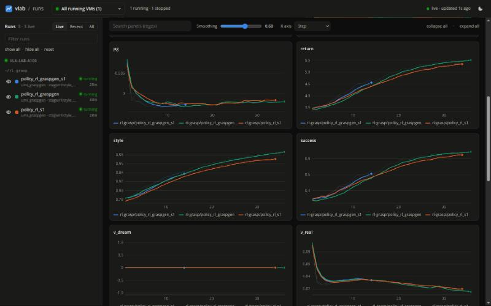

# Live dashboard: every VM's runs

[← README](../README.md)

`vlab dash` is a Weights & Biases-style dashboard native to this repo. It lists your GCP VMs, connects to each
running one, and plots every `vlab` run on it as it trains: loss curves from `train_log.jsonl`, RL histories,
and the metric lines a live run prints to its log. There is no account, no upload and nothing to install on
the VMs.



- [Start it](#start-it)
- [What you see](#what-you-see)
- [Where the numbers come from](#where-the-numbers-come-from)
- [Logging your own metrics](#logging-your-own-metrics)
- [For agents and scripts: status](#for-agents-and-scripts-status)
- [Settings](#settings)
- [How it works](#how-it-works)

## Start it

```bash
vlab dash                                  # every RUNNING VM in your gcloud project, opens http://127.0.0.1:8765
```

```bash
scripts/dash.sh                            # the same without the vlab venv: python3 + pyyaml + gcloud only
```

```bash
vlab dash 'vms=[vla-lab-a100]' port=8800   # only one VM, another port
```

```bash
vlab dash local=true 'vms=[]'              # this machine only (a GPU workstation), no gcloud
```

```bash
vlab dash status                           # no browser: one text report of every VM, then exit (--json to parse)
```

It runs on your laptop, where gcloud is logged in. A VM you start shows up within a minute
(`refresh_vms_s`), and a VM you stop drops to "stopped" in the dropdown.

## What you see

| part | what it shows |
|---|---|
| **VM dropdown** (top bar) | *All running VMs*, or one VM. Stopped VMs are listed but greyed out. Your choice is remembered and goes in the URL (`#vm=vla-lab-a100`), so a bookmark opens your own VM |
| **VM card** | GPU utilisation and memory, CPU, RAM, disk, live runs, for each selected VM |
| **Runs** (left) | every run under the watched checkouts, grouped by VM and checkout, live runs first: *running*, *finished*, *failed*, *crashed* (no outputs and no process), *done* (a plain output folder). *Live / Recent / All* filters it, the eye shows or hides a run on the charts |
| **Charts** | one panel per metric, grouped into sections by the prefix before the last `/` (`iter3/train/loss` is in *iter3/train*). Hover for every run's value at that step: the crosshair follows on every panel. Per panel: `log` scale, `⤢` full size |
| **Smoothing, X axis** | an exponential moving average (the raw curve stays faint behind it); step, time since the run started, or wall-clock time |
| **System** | GPU utilisation, memory, power and temperature, CPU and RAM over time, per VM |
| **Processes** | every `vlab` process with its command, checkout, run, uptime and GPU memory, plus anything else using the GPU, and the `~/RUNNING-*.txt` notes sessions leave on a shared VM |
| **Run drawer** (click a run) | *Overview*: folder, command, start, duration, latest values, summary. *Logs*: the live tail of its log. *Config*: `node.yaml`, `pipeline.yaml`, `error.txt`. *Media*: the run's images and videos |

The first eight visible runs get the eight palette colours in a fixed order. A run keeps its colour while it
stays visible, and any run after the eighth is drawn grey.

## Where the numbers come from

On each VM the agent looks under every checkout in `agent.roots` (default `~/robot-learning` and `~/rl-*`):

| source | written by | becomes |
|---|---|---|
| `runs/<pipeline>/<node>/metrics.jsonl` | `ctx.log(...)`, see below | keys as logged |
| `.../train_log.jsonl` | `vla/train`, `post_train/finetune`, every RL iteration's re-training | `train/loss`, `iter3/train/loss`, ... |
| `.../history.json`, `train_log.json` | `rl/filtered_bc`, `rl/dsrl`, the style-dream stages (when the node ends) | keys as written; lists become `log_std/0`, `log_std/1`, ... |
| `*.log` in the checkout, and the stdout of every running `vlab` process | the run's log lines | live metrics while the node runs |

A log line counts as metrics if it starts with a step key (`step`, `it`, `iter`, `iteration`, `epoch`,
`update`) and an integer, followed by `name value` or `name=value` pairs:

```
12:22:46 I it 3  success 0.336  return 3.61  style 0.786  pg=-0.00015
12:30:02 I step 1500 loss 0.0412 grad_norm=0.31 lr=0.0003
```

`[node] running <impl>` lines tie the metric lines that follow to that node, so `vlab run x > x.log` and
`--only` runs land on the right run. A node's files only count if they were written after its latest
`node.yaml`: a re-run never mixes with the last one. Once a node has finished and has metric files, those
replace its log lines. Metric lines outside any `vlab run` node become a run of their own, named after the log
file (`rl-grasp/logs/smoke`).

## Logging your own metrics

Inside a node, `ctx.log` works like `wandb.log`:

```python
for it in range(cfg.iterations):
    ...
    self.ctx.log(it, success=sr, loss=float(loss), lr=opt.param_groups[0]["lr"])
```

Each call appends one row to `runs/<pipeline>/<node>/metrics.jsonl`, with a wall-clock time, so the panels can
use time as the x axis. Nested dicts become `a/b` keys. The RL nodes (`rl/filtered_bc`, `rl/dsrl`) log every
iteration this way.

## For agents and scripts: status

`vlab dash status` (or `scripts/dash.sh status`) prints the same information as text and exits: for every VM
its GPU, CPU, RAM and disk, the `~/RUNNING-*` markers, the processes (with the run each one is on), and every
run that is live or was updated in the last `--hours` (3), with its latest metric values:

```
vla-lab-a100  us-central1-f  a2-highgpu-1g  1x nvidia-tesla-a100  [live]
  GPU0 100% 38.6/40 GB · CPU 46% (load 4.0) · RAM 31/83 GB · disk 103/290 GB
  marker RUNNING-graspgen.txt (2m old): graspgen-steel-port session: umi_graspgen (full.log) + ...
  processes (6):
      16592    22m   5.1 GB  vlab run umi_graspgen --only policy_rl_s1  (~/rl-grasp) -> rl-grasp/umi_graspgen/policy_rl_s1
  runs live or updated in the last 3 h (12):
    running  rl-grasp/umi_graspgen/policy_rl_s1                 22m  stage/rl/style_dream
             step 35: success 0.875  return 5.43  style 0.874  ...
vla-lab-l4b  us-west4-a  g2-standard-16  1x nvidia-l4  [terminated]
```

If a dashboard is already serving on the configured port it asks that one (`/api/status`), which is instant.
Otherwise it connects to the VMs itself and waits for their first full report (about 15 s, at most `--wait`
90 s). `--json` prints the same as JSON. It is read-only, which makes it the check to run before stopping a
shared VM (see [AGENTS.md](../AGENTS.md)).

## Settings

[`configs/dash/default.yaml`](../configs/dash/default.yaml), overridable as `key=value` (values are YAML):

| key | default | meaning |
|---|---|---|
| `vms` | `auto` | every VM in the project, or a list of names |
| `project`, `filter` | `null` | gcloud project and `--filter` (e.g. `labels.purpose=vla-lab`) |
| `local` | `false` | also watch this machine, without ssh |
| `host`, `port` | `127.0.0.1`, `8765` | where the page is served. It has no login, so keep it on localhost (or an ssh tunnel) |
| `agent.roots` | `[~/robot-learning, ~/rl-*]` | checkouts watched on each VM |
| `agent.log_globs` | `["*.log"]` | log files inside each checkout to parse |
| `agent.metric_files` | `metrics.jsonl`, `train_log.jsonl`, `history.json`, ... | file names read as metric series |
| `agent.poll_s`, `discover_s`, `sys_s` | `2`, `20`, `5` | refresh of metrics, of new runs and media, of GPU / CPU samples |
| `ui.recent_hours` | `24` | what *Recent* means |
| `ui.max_points` | `2000` | points per series in the first load (live points always stream in full) |

Every key is commented in the YAML file. Save a copy as `configs/dash/<name>.yaml` and start it with
`vlab dash <name>`.

## How it works

```
laptop                                              each running VM
┌──────────────────────────────┐   gcloud compute ssh   ┌────────────────────────────────────┐
│ hub.py                       │ ─────────────────────► │ python3 -c <boot>  (agent.py)      │
│  lists VMs (gcloud)          │ ◄── JSON lines ─────── │  stats runs/, tails logs, /proc,   │
│  keeps every series          │ ─── requests ────────► │  nvidia-smi; answers log / file    │
│  serves static/ + /api/events│                        │  requests; exits when ssh closes   │
└──────────────┬───────────────┘                        └────────────────────────────────────┘
               │ server-sent events (snapshot, then deltas)
               ▼
            browser
```

- **`dashboard/agent.py`** is sent over ssh's stdin and run by the VM's `python3`. It uses only the
  standard library and is read-only. It ends when the connection closes, so nothing is left running and
  nothing is installed. It can serve files only from inside a run's folder, and only images, videos and
  text.
- **`dashboard/hub.py`** keeps one agent per running VM and reconnects with backoff. It holds the series in
  memory, pushes changes to the browser and answers `status`. It is a standalone script that does not import
  `vlalab`: `python3` with pyyaml is enough, so `scripts/dash.sh` works without the training venv.
- **`dashboard/static/`** is the page: plain JavaScript and canvas charts, with no build step and no
  CDN.
