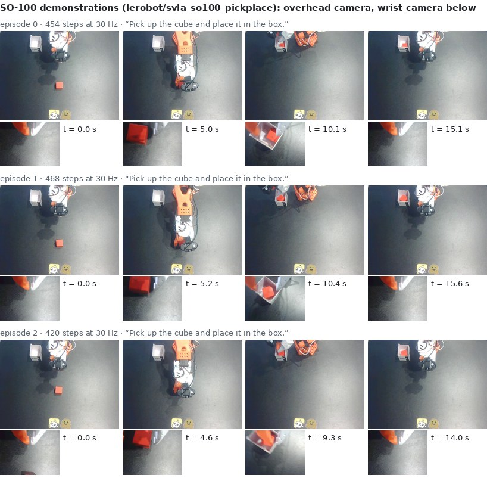
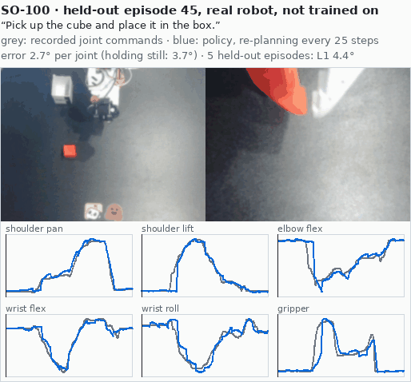

# New hardware, new feedback

[← README](../README.md)

- [The embodiment spec](#the-embodiment-spec)
- [A robot that doesn't exist yet](#a-robot-that-doesnt-exist-yet)
- [Example: an SO-100 arm, from real demos to the 30 Hz loop](#example-an-so-100-arm-from-real-demos-to-the-30-hz-loop)
- [A real robot](#a-real-robot)

## The embodiment spec

The **embodiment spec** is the hardware contract shared by data, policy and runtime: cameras, sensors,
action space, chunk length and control rate. Adding a sensor is a YAML edit. The policy builds an
encoder for each new input, and it becomes extra context tokens
([configs/embodiment/aloha_tactile.yaml](../configs/embodiment/aloha_tactile.yaml), on top of the
bimanual ALOHA [[1](#ref-1)]):

```yaml
observations:
  observation.wrench:                      # 2 wrists x (Fx Fy Fz Tx Ty Tz)
    type: vector
    shape: [12]
    encoder: {type: fourier, tokens: 2}    # any registered obs_encoder
    source: {driver_key: ft_sensors, rate_hz: 500}   # how your driver fills it
    optional: true                         # learned placeholder token when missing
    dropout: 0.2                           # modality dropout in training
  observation.tactile: {type: grid, shape: [2, 16, 16], encoder: {type: conv_grid}}
```

The `fourier` encoder uses random Fourier features [[2](#ref-2)]. Every key of an embodiment file is in
[Editing the YAML configs](configuring_yaml.md#embodiment-files), and the encoders are listed in
[03 VLA](stages/03_vla.md#nodes-and-components).

## A robot that doesn't exist yet

`vlab run mock_hardware` pushes such a robot through synthetic data, training, and the real-time loop
on a mock driver. That checks the plumbing, and whether inference keeps up with your control rate,
before the hardware exists. On an L4 the 50 Hz loop held 20.0 ms ticks (0.02 ms jitter) with 44 ms
inference, because chunked actions keep the queue full.

## Example: an SO-100 arm, from real demos to the 30 Hz loop



`so100_lerobot` runs the same nodes on a real robot's data: SmolVLA's [[3](#ref-3)] SO-100 [[4](#ref-4)]
pick-and-place set (`lerobot/svla_so100_pickplace`, 50 teleoperated episodes at 30 Hz, overhead and wrist
cameras, 6 joints), with the embodiment in
[configs/embodiment/so100.yaml](../configs/embodiment/so100.yaml). It trains the SmolVLA recipe
(`vla/smolvla_style`) on episodes 0–44 and keeps 45–49 back. There is no SO-100 simulator here, so
closed-loop success can't be measured. Instead, the policy is scored open-loop on the held-out episodes
and then driven through the 30 Hz real-time loop on a mock SO-100, which checks timing before the arm is
plugged in.



*Held-out episode 45, replayed: at every 25th step the policy sees the recorded cameras and joint state and
plans the next 50 commands (blue) against what the teleoperator did (grey). Mean error is 2.7° per joint
on this episode, against 3.7° for holding the last command, and L1 4.4° over all five held-out episodes. On
the mock arm the 30 Hz loop held 33.3 ms ticks (0.02 ms jitter) with 77 ms median inference, since
re-planning every 25 ticks leaves 833 ms per inference. The mock robot can't succeed at the task, so its
deploy success rate (0%) means nothing.*

```bash
vlab run so100_lerobot                               # ~25 min on an L4, lerobot extra; first run downloads the videos
vlab run so100_lerobot --only eval,deploy deploy.episodes=5
python scripts/readme_media.py --only so100_demos,so100_offline   # these two pictures, from runs/so100_lerobot
```

```yaml
embodiment: so100                  # overhead + wrist camera, 6 joints (degrees), 30 Hz, chunks of 50
nodes:
  data:
    impl: data/lerobot_hub
    params: {repo_id: lerobot/svla_so100_pickplace, episodes: 45,           # the first 45 episodes
             key_map: {observation.images.top: observation.images.front}}    # dataset camera -> embodiment camera
  held_out: {impl: data/lerobot_hub, params: {repo_id: lerobot/svla_so100_pickplace, episodes: [45, 46, 47, 48, 49],
             key_map: {observation.images.top: observation.images.front}}}
  vla: {impl: vla/train, preset: vla/smolvla_style, inputs: {dataset: data.dataset}, params: {train: {steps: 3000}}}
  eval: {impl: eval/offline, inputs: {policy: vla.policy, dataset: held_out.dataset}}
  deploy:
    impl: deploy/loop
    inputs: {policy: vla.policy}
    params:
      driver: {type: mock, task: Pick up the cube and place it in the box.}
      safety: [{type: rate_limit, max_delta: [5, 8, 6, 4, 4, 7]}, {type: deadman, timeout_s: 0.5}]
```

The rate limits sit just above the largest per-tick change in the recorded data. The full pipeline is
[configs/pipeline/so100_lerobot.yaml](../configs/pipeline/so100_lerobot.yaml).

## A real robot

On the real arm, swap the driver for `driver/lerobot_robot` (`robot: {type: so100_follower, port:
/dev/ttyACM0}`, cameras mapped with `key_map`) and keep the rest. It wraps any robot LeRobot [[5](#ref-5)]
supports (SO-100/101, Koch, ALOHA, LeKiwi ...). The driver is not exercised in CI because it needs
hardware. For anything else, subclass `Driver` in
[src/vlalab/runtime/drivers.py](../src/vlalab/runtime/drivers.py); [adding components](adding_components.md#8-a-new-chunker-safety-filter-or-driver)
has the contract. The deploy loop itself, chunkers and safety filters are in [08 Deploy](stages/08_deploy.md).

## References

1. <a id="ref-1"></a>T. Z. Zhao, V. Kumar, S. Levine, and C. Finn. *Learning Fine-Grained Bimanual Manipulation with Low-Cost Hardware.* RSS 2023. [arXiv:2304.13705](https://arxiv.org/abs/2304.13705)
2. <a id="ref-2"></a>M. Tancik, P. P. Srinivasan, B. Mildenhall, et al. *Fourier Features Let Networks Learn High Frequency Functions in Low Dimensional Domains.* NeurIPS 2020. [arXiv:2006.10739](https://arxiv.org/abs/2006.10739)
3. <a id="ref-3"></a>M. Shukor, D. Aubakirova, F. Capuano, et al. *SmolVLA: A Vision-Language-Action Model for Affordable and Efficient Robotics.* arXiv preprint, 2025. [arXiv:2506.01844](https://arxiv.org/abs/2506.01844)
4. <a id="ref-4"></a>TheRobotStudio. *SO-ARM100: Standard Open Arm 100.* GitHub repository, 2024. [github.com/TheRobotStudio/SO-ARM100](https://github.com/TheRobotStudio/SO-ARM100)
5. <a id="ref-5"></a>R. Cadene, S. Alibert, F. Capuano, et al. *LeRobot: An Open-Source Library for End-to-End Robot Learning.* ICLR 2026. [arXiv:2602.22818](https://arxiv.org/abs/2602.22818)

<details>
<summary>BibTeX for this page</summary>

```bibtex
@inproceedings{zhao2023act,
  title         = {{Learning Fine-Grained Bimanual Manipulation with Low-Cost Hardware}},
  author        = {Tony Z. Zhao and Vikash Kumar and Sergey Levine and Chelsea Finn},
  booktitle     = {Robotics: Science and Systems (RSS)},
  year          = {2023},
  eprint        = {2304.13705},
  archivePrefix = {arXiv},
  url           = {https://arxiv.org/abs/2304.13705}
}

@inproceedings{tancik2020fourier,
  title         = {{Fourier Features Let Networks Learn High Frequency Functions in Low Dimensional Domains}},
  author        = {Matthew Tancik and Pratul P. Srinivasan and Ben Mildenhall and Sara Fridovich-Keil and Nithin Raghavan and Utkarsh Singhal and Ravi Ramamoorthi and Jonathan T. Barron and Ren Ng},
  booktitle     = {Advances in Neural Information Processing Systems (NeurIPS)},
  year          = {2020},
  eprint        = {2006.10739},
  archivePrefix = {arXiv},
  url           = {https://arxiv.org/abs/2006.10739}
}

@article{shukor2025smolvla,
  title         = {{SmolVLA: A Vision-Language-Action Model for Affordable and Efficient Robotics}},
  author        = {Mustafa Shukor and Dana Aubakirova and Francesco Capuano and Pepijn Kooijmans and Steven Palma and Adil Zouitine and Michel Aractingi and Caroline Pascal and Martino Russi and Andres Marafioti and Simon Alibert and Matthieu Cord and Thomas Wolf and Remi Cadene},
  journal       = {arXiv preprint arXiv:2506.01844},
  year          = {2025},
  eprint        = {2506.01844},
  archivePrefix = {arXiv},
  url           = {https://arxiv.org/abs/2506.01844}
}

@misc{therobotstudio2024so100,
  title         = {{SO-ARM100: Standard Open Arm 100}},
  author        = {{TheRobotStudio}},
  howpublished  = {\url{https://github.com/TheRobotStudio/SO-ARM100}},
  note          = {GitHub repository},
  year          = {2024}
}

@inproceedings{cadene2026lerobot,
  title         = {{LeRobot: An Open-Source Library for End-to-End Robot Learning}},
  author        = {Remi Cadene and Simon Alibert and Francesco Capuano and Michel Aractingi and Adil Zouitine and Pepijn Kooijmans and Jade Choghari and Martino Russi and Caroline Pascal and Steven Palma and Mustafa Shukor and Jess Moss and Alexander Soare and Dana Aubakirova and Quentin Lhoest and Quentin Gallouédec and Thomas Wolf},
  booktitle     = {International Conference on Learning Representations (ICLR)},
  year          = {2026},
  eprint        = {2602.22818},
  archivePrefix = {arXiv},
  url           = {https://arxiv.org/abs/2602.22818}
}
```

</details>
