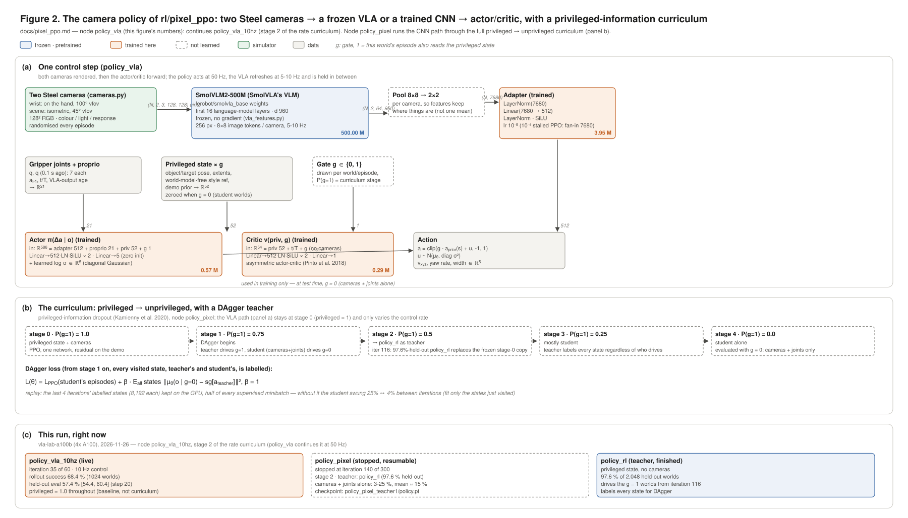
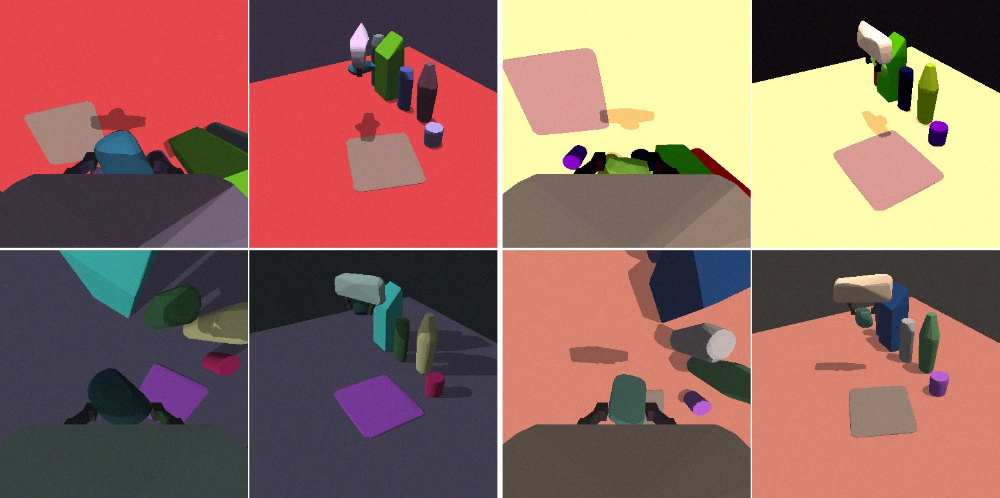
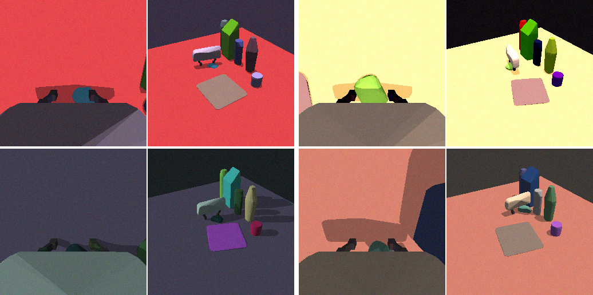

# PPO from cameras: privileged state + cameras → cameras + joints

The PPO policy of [the UMI scene](style_dream_umi.md) places the mouse in 97.6 % of held-out worlds, but it reads
what no robot has: the mouse's and the pad's poses, their sizes, a world-model state, and it acts as a residual on
the demo retargeted to those poses. This page trains the same task from **two cameras in every Steel world** (the
scene and the wrist) and the gripper's joint positions, with a curriculum that starts from the privileged state and
takes it away, PPO throughout plus a privileged teacher for the worlds that have lost the state.

Code: [`cameras.py`](../src/vlalab/dream/cameras.py) (the cameras and visual randomisation),
[`pixel_ppo.py`](../src/vlalab/dream/pixel_ppo.py) (agent, curriculum), [`vla_features.py`](../src/vlalab/dream/vla_features.py)
(the frozen-VLA camera encoder of section 2), node `rl/pixel_ppo` and the evaluation in
[`stages/dream.py`](../src/vlalab/stages/dream.py), pipeline nodes `policy_pixel`, `policy_pixel_flat`,
`policy_vla_10hz`, `policy_vla`, `eval_pixel` in [`umi_style_dream.yaml`](../configs/pipeline/umi_style_dream.yaml).

## Architecture



*Figure 2. Panel (a) is `policy_vla` / `policy_vla_10hz` (section 2): privileged state stays at 1.0 throughout, only
the control rate changes. Panel (b) is the full curriculum of `policy_pixel` (section 3): a gate `g` lowers
P(privileged) stage by stage, with a DAgger teacher once g can be 0. Panel (c) is this page's "right now" —
regenerate with `python scripts/dream/architecture_figure_pixel.py docs/images/pixel_ppo/architecture.svg --status
docs/images/pixel_ppo/status.json` after editing `status.json` with the run's latest numbers (e.g. from
`scripts/dash.sh status --json`).*

## 1. Two cameras in every world

SolverSteel steps the physics; the cameras come from Newton, which Steel plugs into: `newton.sensors.SensorCamera`
ray traces one view per world on the GPU (the worlds overlap at the origin; the sensor renders each world's own
shapes). Both cameras are 128 × 128 RGB for the policy, and are rendered again at 384 px for the videos.

* **Wrist**: rigid on the Franka hand, 10 cm beside it and 12 cm above the TCP, tilted 20° towards the fingertips
  (vertical field of view 100°, UMI's rectified GoPro). Both fingers and what lies between them are in view.
  UMI's own GoPro mount (22 cm behind the TCP on the approach axis) was tried first: on the Franka hand, whose body
  is much wider than UMI's gripper, the hand fills the lower half of that image and hides the fingers.
* **Scene**: fixed, isometric (35.26° above the table, 45° round from the gripper's side, 1.15 m from the workspace
  centre, 45° field of view): the table, the mouse, the pad, the obstacles and the gripper's whole range.

The RL worlds have no arm: as in the privileged run, the Franka hand rides on an x / y / z / yaw gantry with no
visible links (the FR3 arm exists only in real2sim's replay).

**Visual randomisation** [4], resampled at every episode, per world:

| what | how | range |
|---|---|---|
| colours | every shape but the gripper (mouse, pad, obstacles, table): a random colour with p = 0.8, else the reconstruction's own ± 0.1; gripper ± 0.06 | RGB in [0.05, 0.95] |
| light | 8 lighting conditions per batch, each rendering 1/8 of the worlds (Newton's camera has one light per render call): direction, intensity, colour temperature, ambient sky / ground; shadows on | elevation 25-89°, any azimuth, intensity 0.45-1.6, 2700-8000 K, ambient 0.03-0.45 |
| camera response | contrast, brightness, per-channel gain (white balance), pixel noise redrawn every frame | 0.7-1.3, ± 0.12, 1 ± 0.12, σ = 0.02 |



*Four worlds (two per row), each wrist | scene, while the retargeted demo carries the mouse to the pad, at 384 px
([whole episode](images/pixel_ppo/cameras.mp4), [start](images/pixel_ppo/cameras_start.jpg),
[grasp](images/pixel_ppo/cameras_grasp.jpg)). Every world has its own colours, light and camera response.*

## 2. The baseline / teacher: privileged state + a frozen VLA's view of the cameras, PPO only, 50 Hz

Before any unprivileged actor, one policy is trained with the privileged state **and** the cameras, with PPO and
nothing else (no teacher, no distillation). The cameras do not reach it as pixels: a frozen ("locked") VLA turns
them into features, and the policy acts at 50 Hz on the VLA's latest output.

* **The VLA**: SmolVLA [12], its vision-language backbone with the weights of `lerobot/smolvla_base`
  (SmolVLM2-500M, the first 16 language-model layers; all 344 tensors loaded): both cameras and the instruction "Put
  the mouse on the mouse pad." in, the token sequence its action expert reads out. Frozen, no gradient
  ([`vla_features.py`](../src/vlalab/dream/vla_features.py)).
* **What the policy reads** (as in DSRL [15], frozen-VLA hidden states as the RL actor's input): per camera, the
  grid of image tokens (4 × 4 at 256 px, 8 × 8 at 512) average-pooled to 2 × 2, so the features keep where things
  are: 2 × 4 × 960 = 7680 numbers, through a trainable adapter (LayerNorm, linear to 2 × 256), next to the
  privileged state, the gripper's joints, its last action and the age of the VLA output. The action is a residual on the retargeted demo,
  as in `policy_rl`.
* **What the VLA sees** ([vla_inputs/](images/pixel_ppo/vla_inputs/), `scripts/dream/smoke_cameras.py --size 256`;
  each row two worlds, wrist | scene, at the start, grasp, carry and end of the demo):

  
* **Two rates**: the VLA runs at 5 Hz on 256 px renders (rendered only then); the policy acts at 50 Hz, holds the
  VLA's last output in between and reads how old it is (steps since the call), as dual-system VLAs do (a slow VLM
  conditions a fast controller: Helix 7-9 → 200 Hz, GR00T N1 10 → 120 Hz [14], Fast-in-Slow [13]). The env runs at
  50 Hz control with 1/300 s physics; discount, GAE and every per-step reward term (style, success per step and the
  residual penalty λ_a |u|²) are rescaled so they mean the same in seconds as at 10 Hz (γ₅₀ = γ₁₀^{1/5}, per-step
  terms × 10 / hz).
* **The adapter's learning rate** (`lr_encoder: 1e-5`, 10 × below the CNN encoders'): the adapter's first layer
  reads all 7680 numbers, and Adam moves every weight by about the learning rate per step whatever the gradient,
  so at 1e-4 each step shifted the embedding by about as much as it varies between worlds. The actor's camera input
  was rewritten every step, the KL budget went on that churn, and privileged + VLA PPO did not learn: four 50 Hz
  runs stayed at ≈ 55 % for 7-11 iterations, and at 10 Hz it went 28.4 → 29.1 % in 5 iterations while the CNN on
  the same setup went 26.9 → 33.6 %. At 1e-5 the 10 Hz run went 28.7 → 33.8 %, as the CNN.
* **The demo prior's stiffness at 50 Hz** (`style.feedback_s: 0.1`): the action is a residual u on the retargeted
  demo, a P-controller `v = gain (p_ref(φ + dt) − tcp) / dt` that removes the whole position error within one step.
  Over one step at 50 Hz it is 5 × stiffer than at 10 Hz, so it cancelled the residual within 20 ms and a held u
  moved the gripper by u v_max dt / gain, 5 × less than at 10 Hz. Exploration barely changed what happened, the start
  was higher (55 % vs 29 %, tighter tracking) and PPO had a fifth of its reach. The prior is now the demo's own
  velocity plus the error corrected over max(dt, 0.1 s): the same formula at 10 Hz, as stiff per second at 50 Hz.
* **Rate curriculum** (nodes `policy_vla_10hz` → `policy_vla`): from scratch at 50 Hz, PPO stayed at 52-57 % in
  every run even with the fixes above, while the same agent at 10 Hz learns like the CNN. So the policy first learns
  at 10 Hz (60 iterations) and then continues at 50 Hz (40 iterations, input `init_policy`). The actions are
  velocities, the demo prior is as stiff per second at both rates, and the joints input is "now and 0.1 s ago" at
  any rate (`q_lag`), so the 10 Hz policy's inputs and outputs mean the same at 50 Hz.
* **Exploration and step size at 50 Hz**: the Gaussian noise is drawn at 10 Hz and held for 5 steps (`noise_hz`,
  gSDE's sample frequency [17]), so the gripper explores as much per second as at 10 Hz (fresh noise every step
  averages out over 5 × the steps); the policy still acts every 20 ms. The learning rate follows rsl_rl's
  KL-adaptive schedule [18] (IsaacLab's PPO default): before every step all learning rates are divided by 1.5 if the
  minibatch's KL is above 2 × 0.01 and multiplied by 1.5 if below 0.005 (`schedule: adaptive`); unlike rsl_rl (one
  optimizer) only the actor's: scaling the critic too dragged its lr from 3e-4 to 1e-5 at 50 Hz. Both came in while
  the adapter was the unknown cause (white noise: KL 0.003; held noise at a fixed lr: KL 0.08); neither has been
  shown necessary on its own since.
* **Four GPUs** (`gpus: 4`, one a2-highgpu-4g): one process per A100, each with its own 512 worlds and its own
  copy of the frozen VLA; rank 0's weights are broadcast at the start, every step averages the gradients over the
  ranks, the observation normaliser and the logged success pool all 2048 worlds, and the KL that sets the learning
  rate is the mean over the ranks, so the four copies stay one network. Rank 0 evaluates, logs and saves. This is how
  multi-GPU PPO is done in IsaacLab / rsl_rl [18].
* **Rate check** (`scripts/dream/bench_vla_policy.py`, one A100, bf16, two cameras):

  | | one robot (batch 1) | max rate | training throughput |
  |---|---|---|---|
  | frozen SmolVLA backbone, 512 px (as trained, 64 tokens per camera) | 31.3 ms | 32 Hz | 219 worlds/s |
  | frozen SmolVLA backbone, 384 px (36 tokens) | 30.3 ms | 33 Hz | 392 worlds/s |
  | frozen SmolVLA backbone, 256 px (16 tokens) | 30.3 ms | 33 Hz | 877 worlds/s |
  | the PPO policy (adapter + MLP, 50 Hz) | 0.36 ms | ≈ 2750 Hz | |
  | VLA + policy every step (one rate) | 31.6 ms | **31.6 Hz** | |
  | policy every step on the held VLA output (two rates) | 0.36 ms | **50 Hz with room to spare** | |

  So the policy acts at more than 20 Hz even with the VLA in the loop at every step, and at 50 Hz with the VLA at
  its own rate. One robot's VLA call costs ≈ 30 ms at any of these sizes (launching ~30 layers, not arithmetic), so
  a single-rate 50 Hz policy would need a compiled / graph-captured VLA. For training the arithmetic matters: at
  512 px the VLA would take ≈ 10 minutes per rollout of 1024 worlds at 10 Hz, so the run uses 256 px (the renders
  are 256 px; a 4 × 4 token grid per camera, pooled 2 × 2) at 5 Hz.

Node `policy_vla` in [`umi_style_dream.yaml`](../configs/pipeline/umi_style_dream.yaml). The curriculum towards
an unprivileged actor (section 3) starts from this policy later.

## 3. The policy and the curriculum

A gate g ∈ {0, 1}, drawn per world and episode, decides whether the policy also reads the privileged state (in stage
0, one network for both; from stage 1, g = 1 worlds belong to the frozen teacher, see below):

$$
\begin{aligned}
o_t &= \big[\,E_\text{wrist}(I^w_t, I^w_{t-1}),\; E_\text{scene}(I^s_t, I^s_{t-1}),\; q_t,\; q_{t-1},\; a_{t-1},\; t/T,\;
       g\cdot x_t,\; g\,\big] \\
x_t &= \big[\,s_t,\; p_\text{ref}-p,\; w_\text{ref}-w,\; \text{phase},\; a_\text{prior}(s_t)\,\big] \\
a_t &= \operatorname{clamp}\!\big(g\,a_\text{prior}(s_t) + u_t\big), \qquad u_t \sim \mathcal N\big(\mu_\theta(o_t), \operatorname{diag}\sigma^2\big)
\end{aligned}
$$

$E$ are two CNNs (stride-2 convolutions to 4 × 4, 256 features each), $q$ the gripper's joints (x, y, z, yaw as
cos / sin, both fingers), $s_t$ the simulator state the privileged baseline reads, $a_\text{prior}$ the demo retargeted
to it. With g = 1 the policy is the privileged baseline (a residual on the demo) with the cameras and joints added;
with g = 0 it acts from the cameras and joints alone, one network for both. The curriculum lowers P(g = 1) stage by
stage, privileged-information dropout [2]:

| stage | 0 | 1 | 2 | 3 | 4 |
|---|---|---|---|---|---|
| P(g = 1) | 1 | 0.75 | 0.5 | 0.25 | 0 |
| trains | privileged state + cameras (PPO) | student: cameras + joints (PPO + DAgger), the teacher drives P of the worlds | | | student alone |

**Teacher and student.** PPO alone does not carry stage 0 over: with g = 1 the network learnt corrections to the
demo, with g = 0 it has to produce the whole action, and in the first run the cameras-only worlds stayed at 0 % for
all of stage 1 (iterations 41-53, while the privileged worlds held 61-68 %). Distilling into the same network that
also kept its privileged mode failed too: with the network as its own teacher the privileged worlds fell from 66 %
to 45 % in 12 iterations, and with a frozen teacher but a shared network they collapsed to 6 % by iteration 60, as
the distillation moved the shared weights.

So from stage 1 on, the stages are DAgger's teacher share [10]: a privileged teacher (first a frozen copy of the
network at the end of stage 0, $\bar\theta$; from iteration 116 `policy_rl`, see below) drives the g = 1 worlds; the network, $\theta$,
is the student, reads the cameras and joints only and drives the g = 0 worlds. PPO trains the student on its own
episodes, and every visited state, the teacher's and the student's, is labelled with the teacher's action [11]:

$$
\mathcal L(\theta) = \mathcal L_\text{PPO}\big(\text{student's episodes}\big) + \beta\, \mathbb E_{\text{all states}}\Big\lVert \mu_\theta(o_t \mid g{=}0) - \operatorname{sg}\big[\operatorname{clamp}\big(a_\text{prior}(s_t) + \mu_{\bar\theta}(o_t \mid g{=}1)\big)\big]\Big\rVert^2, \qquad \beta = 1
$$

**Which teacher.** The first teacher was the frozen stage-0 network (privileged state + cameras, ≈ 78 % of its
worlds when it drives deterministically). From iteration 116 the teacher is `policy_rl`, the privileged PPO of the
UMI scene (no cameras: state, demo, world model; 97.6 % of held-out worlds), the student continuing from its
iteration-115 weights (14.5 % of its worlds by then). A teacher without cameras needs nothing the student sees: it
keeps its own world-model state, demo clock and tempo in every world (`StateTeacher`), drives its share of the
worlds and labels every state.

The teacher labels every state during the rollout, and after PPO's 32 steps the iteration adds DAgger's supervised
step: 3 epochs of the distillation loss alone over all of the iteration's states (4096-state minibatches, ≈ 100
steps), with the camera encoders' learning rate raised from 10⁻⁴ to 3·10⁻⁴. With PPO's 32 steps alone the
distillation error flattened at ≈ 0.8 (squared, summed over the 5 action dimensions) and the student stayed at 0 %.
The KL early stop is off once the teacher exists (the distillation moves the student on purpose; PPO's clipping
stays).

**Replay.** Trained on each iteration's states alone, the student swung between iterations (iterations 121-129:
24.7, 5.1, 21.2, 3.1, 19.9, 4.0, 17.9, 3.6, 23.9 % of its worlds): it fit the states it had just visited, which made
it visit others. DAgger aggregates every iteration's labelled states; here, within a memory budget, the last 4
iterations keep 8192 states each (stacked frames, joints, privileged state, the teacher's action; 6.4 GB on the GPU),
and every supervised minibatch is half replay. With the teacher the entropy bonus is off too: the supervised steps
moved the student so far that ≈ 95 % of PPO's ratios were clipped, and the bonus alone kept widening its noise.

A stage advances when the rollout success of all worlds averages 0.75 over 3 iterations (at least 5 iterations per
stage, at most 40). At the end of stage 0 the policy is saved as `policy_privileged.pt` and evaluated with g = 1;
`policy.pt`, the last stage, is evaluated with g = 0. The same PPO without the curriculum (g = 0 from the first
iteration) is node `policy_pixel_flat`, not run yet (`FLAT=1 scripts/dream/run_pixel.sh`). Optional per stage, off by default: a demo-start handover (the
retargeted demo drives the first $h\,t_\text{release}$ steps [6, 7]) and the randomisation strength.

**Critic and reward.** The critic is only used in training, so it reads $x_t$, $t/T$ and g (asymmetric actor-critic
[1]). The reward is the privileged baseline's (potential on the mouse's distance to the pad and its uprightness, a
success bonus, the style reward) plus a reach potential, since with g = 0 no prior brings the hand to the mouse:

$$
\Phi(s) = -k_s\big(\lVert p_\text{obj} - p_\text{goal}\rVert + 0.2\,(1-\text{upright})\big) - k_r \lVert p_\text{tcp} - p_\text{grasp}(\text{obj})\rVert\,[\text{not on the pad}],
\qquad r_t = \gamma\,\Phi(s_{t+1}) - \Phi(s_t) + \dots
$$

PPO [3] with GAE (γ = 0.99, λ = 0.95), clip 0.2, 8 minibatches × 4 epochs per iteration as in the privileged run (each minibatch
accumulated over 2048-image chunks), lr 3·10⁻⁴ for the action head and 10⁻⁴ for the camera encoders, a KL stop at 0.03; the privileged
inputs are normalised with statistics of the first rollout,
random-shift image augmentation (± 4 px) [5], bf16 encoders, 1024 training worlds per iteration (2048 for the
evaluation). The rollout's frames (12.3 GB at 1024 worlds) stay on the GPU when it has room and in pinned host
memory otherwise.

## 4. Results so far (stopped 2026-11-25, iteration 140 of 300)

Training was stopped before the end and before the held-out evaluation (`eval_pixel`), so every number here is the
success of the **training rollouts** (1024 randomised worlds per iteration, the stochastic policy; the
privileged teacher acts deterministically). For reference, `policy_rl` (privileged state, no cameras) reaches 96 % in
its own training rollouts and 97.6 % on the 2048 held-out worlds.

| iterations | what trains | privileged worlds | cameras + joints worlds |
|---|---|---|---|
| 1-40 (stage 0) | PPO, privileged state + both cameras + joints, residual on the demo | 29 → 66 % | (none) |
| 41-53 (stage 1) | PPO only, one network gated by g | 61-68 % | **0 %** |
| 41-115 (stages 1-2) | student by DAgger + PPO; teacher: the stage-0 network | ≈ 75-80 % (teacher) | 0 → 14.5 % |
| 116-140 (stage 2) | the same student; teacher: `policy_rl` | 95-99 % (teacher) | 3-25 %, mean 15 % |

* PPO alone does not carry the privileged policy over to the cameras: the cameras-only worlds stayed at 0 %.
* With a privileged teacher labelling every state the student learns from the cameras: 0 → 14.5 % in 75 iterations
  with the 78 % teacher, about 15 % (swinging between iterations) with `policy_rl` as the teacher.
* The swing (iterations 121-140 alternate between ≈ 20 % and ≈ 5 %) comes from fitting each iteration's states only;
  the replay above (DAgger's aggregation) and the entropy change are implemented and tested but were not run.

Checkpoints and logs are on the GCP disk `vla-lab-a100b` (us-central1-f), in `~/rl-unpriv/runs/umi_style_dream/`:
`policy_pixel_stage0/policy_privileged.pt` (privileged + cameras, iteration 40),
`policy_pixel_teacher0/policy.pt` (student, iteration 115), `policy_pixel_teacher1/policy.pt` (student, iteration
140), each with `history.json` and `train.log`; `runs/old/` keeps the logs of every attempt. To resume, from that
disk:

```bash
scripts/dream/run_pixel.sh policy_pixel.agent.init=runs/umi_style_dream/policy_pixel_teacher1/policy.pt policy_pixel.agent.start_stage=3 policy_pixel.agent.iterations=160 policy_pixel.privileged_policy=runs/umi_style_dream/policy_pixel_stage0/policy_privileged.pt
```

## Reproduce

On one GPU machine with the style-dream env (`scripts/dream/setup_env.sh`) and a finished `umi_style_dream` run
(its `worlds`, `style`, `dreamer` and `policy_rl` nodes):

```bash
scripts/dream/run_pixel.sh
```

What the cameras see, and their cost, with the retargeted demo driving:

```bash
python scripts/dream/smoke_cameras.py runs/umi_style_dream --worlds 4 --size 384 --out runs/cams_hd
```

Every camera, randomisation range and curriculum stage is a key under `policy_pixel.agent` (e.g.
`policy_pixel.agent.camera.width=96`, `policy_pixel.agent.curriculum.advance_at=0.8`); see `CameraConfig`,
`VisualRandomization`, `CurriculumConfig` and `PixelPPOConfig`.

## References

1. L. Pinto, M. Andrychowicz, P. Welinder, W. Zaremba, P. Abbeel. *Asymmetric Actor Critic for Image-Based Robot Learning.* RSS 2018. [arXiv:1710.06542](https://arxiv.org/abs/1710.06542)
2. P.-A. Kamienny, K. Arulkumaran, F. Behbahani, W. Boehmer, S. Whiteson. *Privileged Information Dropout in Reinforcement Learning.* 2020. [arXiv:2005.09220](https://arxiv.org/abs/2005.09220)
3. J. Schulman, F. Wolski, P. Dhariwal, A. Radford, O. Klimov. *Proximal Policy Optimization Algorithms.* 2017. [arXiv:1707.06347](https://arxiv.org/abs/1707.06347)
4. J. Tobin, R. Fong, A. Ray, J. Schneider, W. Zaremba, P. Abbeel. *Domain Randomization for Transferring Deep Neural Networks from Simulation to the Real World.* IROS 2017. [arXiv:1703.06907](https://arxiv.org/abs/1703.06907)
5. I. Kostrikov, D. Yarats, R. Fergus. *Image Augmentation Is All You Need: Regularizing Deep Reinforcement Learning from Pixels.* ICLR 2021. [arXiv:2004.13649](https://arxiv.org/abs/2004.13649)
6. C. Florensa, D. Held, M. Wulfmeier, M. Zhang, P. Abbeel. *Reverse Curriculum Generation for Reinforcement Learning.* CoRL 2017. [arXiv:1707.05300](https://arxiv.org/abs/1707.05300)
7. T. Salimans, R. Chen. *Learning Montezuma's Revenge from a Single Demonstration.* 2018. [arXiv:1812.03381](https://arxiv.org/abs/1812.03381)
8. C. Chi, Z. Xu, C. Pan, et al. *Universal Manipulation Interface: In-The-Wild Robot Teaching Without In-The-Wild Robots.* RSS 2024. [arXiv:2402.10329](https://arxiv.org/abs/2402.10329)
9. NVIDIA, Google DeepMind, Disney Research. *Newton physics engine* (`newton.sensors.SensorCamera`). [github.com/newton-physics/newton](https://github.com/newton-physics/newton); Skild AI and NVIDIA. *Steel.* [github.com/skild-ai/steel](https://github.com/skild-ai/steel)
10. S. Ross, G. Gordon, D. Bagnell. *A Reduction of Imitation Learning and Structured Prediction to No-Regret Online Learning* (DAgger). AISTATS 2011. [arXiv:1011.0686](https://arxiv.org/abs/1011.0686)
11. D. Chen, B. Zhou, V. Koltun, P. Krähenbühl. *Learning by Cheating.* CoRL 2019. [arXiv:1912.12294](https://arxiv.org/abs/1912.12294)
12. M. Shukor, D. Aubakirova, F. Capuano, et al. *SmolVLA: A Vision-Language-Action Model for Affordable and Efficient Robotics.* 2025. [arXiv:2506.01844](https://arxiv.org/abs/2506.01844)
13. H. Chen et al. *Fast-in-Slow: A Dual-System Foundation Model Unifying Fast Manipulation within Slow Reasoning.* NeurIPS 2025. [arXiv:2506.01953](https://arxiv.org/abs/2506.01953)
14. NVIDIA. *GR00T N1: An Open Foundation Model for Generalist Humanoid Robots.* 2025 (white paper). [arXiv:2503.14734](https://arxiv.org/abs/2503.14734)
15. A. Wagenmaker et al. *Steering Your Diffusion Policy with Latent Space Reinforcement Learning* (DSRL). CoRL 2025. [arXiv:2506.15799](https://arxiv.org/abs/2506.15799): RL on a frozen π0, its VLM's last hidden state as the actor's input.
16. A. Cheng et al. *NaVILA: Legged Robot Vision-Language-Action Model for Navigation.* RSS 2025. [arXiv:2412.04453](https://arxiv.org/abs/2412.04453): a slow VLA over a fast policy trained with PPO in simulation (privileged critic).
17. A. Raffin, J. Kober, F. Stulp. *Smooth Exploration for Robotic Reinforcement Learning* (gSDE). CoRL 2021. [arXiv:2005.05719](https://arxiv.org/abs/2005.05719): exploration noise resampled every n steps instead of every step.
18. N. Rudin, D. Hoeller, P. Reist, M. Hutter. *Learning to Walk in Minutes Using Massively Parallel Deep Reinforcement Learning.* CoRL 2021. [arXiv:2109.11978](https://arxiv.org/abs/2109.11978); its PPO, [rsl_rl](https://github.com/leggedrobotics/rsl_rl) (KL-adaptive learning rate, multi-GPU training), is the one IsaacLab uses.

BibTeX: `pinto2018asymmetric`, `kamienny2020privileged`, `schulman2017ppo`, `tobin2017domain`, `kostrikov2021drq`,
`florensa2017reverse`, `salimans2018montezuma`, `chi2024umi`, `ross2011dagger`, `chen2019cheating` in
[references.bib](references.bib).
