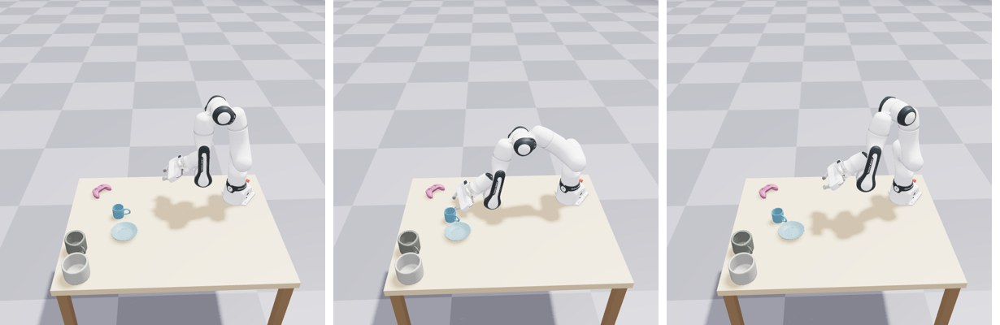
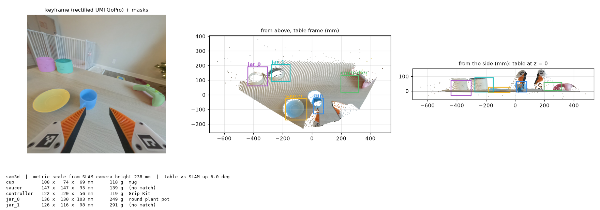

# Real-to-sim from one UMI demo

The first piece of the single-demo research track: take **one** demonstration from a public UMI dataset, rebuild
its scene as metric 3D objects with SAM 3D, give every object a mass from a database of real objects, and load
the result into NVIDIA's Newton physics with Skild AI's Steel solver, where a Franka FR3 plays the demonstration
as joint angles. Five nodes in the data stage, one pipeline (`configs/pipeline/umi_real2sim.yaml`):

```
 UMI session ──► data/umi_demo ──► data/scene_masks ──► data/sam3d_scene ──► data/physics_match ──► data/steel_scene
 (GoPro + SLAM)   one demo,          text-prompted       metric 3D objects     one-to-one match:      3D environment in
                  metric poses       masks (SAM 3)       (SAM 3D Objects)      mass from YCB / ABO    Newton + Steel, FR3
                                                                                                      plays joint angles
```



*Newton + Steel: the table, SAM 3D's cup, saucer, controller and two candle jars with their matched masses, and an
FR3 playing UMI demo 0 as joint angles, open loop. Start, mid-demo and end.*

| node | what it does | runs in |
|---|---|---|
| `data/umi_demo` | downloads a UMI session if needed, runs UMI's SLAM pipeline (ORB-SLAM3 + ArUco, steps 00-06), picks one demo and exports it: rectified keyframes, metric TCP poses in the table-tag frame, gripper width | UMI venv |
| `data/scene_masks` | text-prompted masks on the keyframe: SAM 3 (synonyms allowed: a saucer is found as a "small plate"), or Grounding DINO + SAM 2.1 without SAM 3's weights | vlab venv |
| `data/sam3d_scene` | `method: sam3d`: SAM 3D Objects per mask, metric from SLAM; `method: moge`: the visible metric points only (measured, nothing generated) | SAM 3D conda env |
| `data/physics_match` | matches each object one-to-one to a database object with a known mass; inertia from the object's geometry at that mass; friction from the entry or a material prior | vlab venv |
| `data/steel_scene` | the 3D environment in Newton with `SolverSteel`, an FR3 playing joint angles (recorded, or IK from the demo) | Steel venv |

## The data: UMI's cup demo

The UMI authors' example session ([UMI](https://arxiv.org/abs/2402.10329), Chi et al., RSS 2024): a living-room
table with an espresso cup and saucer, filmed by the gripper's GoPro (2.7K fisheye, 60 fps) in 7 videos
(one mapping sweep, one gripper calibration, five demos, 730 MB). UMI's pipeline turns them into metric camera
and gripper trajectories in the frame of the ArUco tag lying on the table. `data/umi_demo` picks the median-length
demo with one clean grasp, here **demo 0**: 7.8 s, 468 frames, the gripper closing from 82 to 59 mm on the cup
at frame 279 and opening at 393. The scene is rebuilt from **frame 234** (`keyframe: pre_grasp`, 0.75 s before
the fingers close), where the cup and saucer are close up and not yet touched. The fisheye frame is rectified to a
1024 px pinhole image with a 100° field of view using UMI's own Kannala-Brandt calibration.

Other UMI-format sessions plug in through `session:` / `url:` (any session that has been through UMI's SLAM
pipeline, e.g. [Data Scaling Laws](https://github.com/Fanqi-Lin/Data-Scaling-Laws)' raw videos).

## Metric scale, and the table frame

SAM 3D lays objects out on MoGe's point map ([Wang et al. 2025](https://arxiv.org/abs/2410.19115)), whose scale is
only relative. UMI's SLAM knows how high the camera was above the table tag, so the table plane is fitted in the
point map (RANSAC, normal within 20° of SLAM's up) and the map is scaled until the camera sits that high above it;
SAM 3D then gets that metric point map. On demo 0 the camera is 238 mm above the table and the fitted plane is
tilted about **6°** from the tag's plane; left alone, that tilt makes objects 0.5 m away read ~55 mm too tall.
Objects rest on the table, so all geometry is expressed in the **table frame**: the tag frame turned so the
measured table is exactly z = 0 (`T_table_tag` in `scene.json`). The demo's poses go through the same transform.



*The keyframe with SAM 3's masks, and SAM 3D's objects (boxes) over the metric point map, from above and from the
side, with each object's size and mass. `method: moge` makes the same picture from the visible points alone
([measured scene](images/real2sim/scene_moge.png)), the reference SAM 3D is checked against:*

| object | measured (MoGe, visible part) | SAM 3D (full mesh, principal extents) |
|---|---|---|
| cup | 97 × 74 × 51 mm | 108 × 74 × 69 mm, hollow (0.032 L of ceramic) |
| saucer | 134 × 124 × 17 mm | 149 × 148 × 26 mm |
| controller | 160 × 134 × 54 mm | 133 × 81 × 50 mm |
| candle jars | 105 × 101 × 84 mm (one seen) | 131 × 129 × 99 and 145 × 110 × 95 mm |

SAM 3D runs per object in 12-21 s on an A100 at ~18 GB peak (`offload: false`); on a 24 GB L4 the worker moves
its generators to the CPU while the mesh decodes (`offload: true`).

## Mass: one-to-one match to a public database

Every object is matched to **one** entry of a database of real objects and takes that entry's mass:

* **YCB** ([Calli et al. 2015](https://arxiv.org/abs/1502.03143)): 77 household objects, mass measured on a
  digital scale (±1 g), scanned meshes ([elpis-lab packaging](https://github.com/elpis-lab/ycb_dataset), MIT).
  Each is rendered once (`scripts/real2sim/render_ycb.py`) so it can be compared photo to photo.
* **ABO** ([Collins et al., CVPR 2022](https://arxiv.org/abs/2110.06199), CC BY 4.0): Amazon product listings with
  item weight, dimensions, material and a catalog photo. Kept: 9,983 single items of tabletop size; dropped:
  sets and multi-packs, and listings whose weight over their box implies more than 4,000 kg/m³.
* Optional: `steel_shelf` (the 20 bodies Skild AI tuned for Steel, the only source with tuned friction and
  restitution) and `json` (your own measured objects).

The classifier is small on purpose: frozen CLIP ViT-L/14 features and nearest neighbours. Appearance is the
object's crop against each entry's photo and name, and the detector label against the names, each z-scored over
the database (renders and photos centred separately); size is the object's extents against the entry's
dimensions; score = appearance^0.6 × size^0.4. The top entry gives the mass when its score is at least 0.5, and
the top 5 are kept in `physics.json` for review. Below 0.5 the mass is the material's density (CLIP on the
uncropped box: "a ceramic object", ...) times the SAM 3D mesh's volume. Inertia is always the object's own
geometry at its mass, so it agrees with the shape the solver collides.

Demo 0, on the SAM 3D meshes:

| object | mass | from |
|---|---|---|
| cup | **118 g** | YCB mug (score 0.62): measured on a scale |
| saucer | **139 g** | no match above 0.5: glass/ceramic density × 0.055 L |
| controller | 119 g | ABO "Grip Kit" (0.85): likely low, a game controller is ~250 g |
| candle jar 1 | 250 g | ABO round plant pot (0.62) |
| candle jar 2 | 291 g | no match above 0.5: ceramic density × 0.126 L |

## From the demo to joint angles

A UMI demo has no robot: the gripper is handheld, so what is recorded is the gripper's 6-DoF pose (SLAM) and its
opening (ArUco on the fingers). `data/steel_scene` turns that into FR3 joint angles:

* the UMI TCP (between the fingertips; x: finger opening, z: approach) maps to the FR3's `fr3_hand_tcp`
  (z: approach, y: finger opening): R_fr3 = R_umi · Rz(∓90°);
* a batched IK (Newton's Levenberg-Marquardt solver with joint limits) over 72 base placements × 24 demo frames
  picks the base that reaches the worst frames best; then every frame is solved, seeded with the previous one,
  so the joint path is continuous; finger joints are half the UMI width (≤ 40 mm each).

On demo 0 the base lands at (0.18, −0.78) m in the table frame, facing 130°, and the joint path reproduces the
demo's TCP to **0.0008 mm** (median; max 0.003 mm, 10⁻⁴ °). The result is `joint_trajectory.npz` / `.csv`
(`t`, 7 arm + 2 finger angles, base pose). Angles recorded on a real robot replace it one-to-one:
`vlab run umi_real2sim nodes.sim.params.joints=<npz with t, q [N x 9], base [x, y, z, yaw]>`.

## The environment and the playback

The environment (`rollout/env.json`, meshes in `rollout/env/`):

* a table box whose top is the measured table (z = 0), sized to the table in the keyframe and the robot base,
  on legs over a floor;
* every object a free body: SAM 3D's mesh decimated to 20k triangles to draw, a CoACD decomposition of a 4k
  triangle copy to collide (up to 16 convex parts, cached), the mass, inertia, friction and restitution above;
* the FR3 (+ Franka hand, from `newton-assets`) mounted on the table at the IK base, PD position drives with the
  FR3's effort limits (87 / 12 Nm).

Playback is open loop: the joint angles are joint position targets, interpolated each substep (60 fps × 4
substeps, Steel at 16 iterations), and nothing corrects them. On demo 0 the joints follow their targets to
**0.41°** (median; max 3.8°) and the TCP stays within **11 mm** of the demo's (median; max 19.5 mm, PD lag). The
FR3 reaches the cup and closes on it, but the cup slides **105 mm** and lifts 9 mm instead of riding to the saucer:
the raw demo, played on a different gripper against reconstructed geometry, does not pick it up, and nothing
here asks it to.

Outputs in `runs/umi_real2sim/sim/rollout/`: `env.json` (every body, pose, mass, inertia, contact parameter, the
robot base and drives, the solver settings), `env/<object>_{visual,collision}.obj`, `joint_trajectory.{npz,csv}`,
`replay.usd` (the whole replay, opens in Isaac Sim or usdview), `replay_side.mp4`, `replay_wrist.mp4` (a camera
where UMI's GoPro sits relative to the TCP), stills and `report.json`.

## Set up (one GPU machine or VM)

```bash
./setup.sh --minimal && uv pip install -e '.[real2sim]' matplotlib   # the vlab venv
scripts/real2sim/setup_umi.sh          # UMI repo + small venv, ORB-SLAM3 and OpenICC docker images
scripts/real2sim/setup_steel.sh        # skild-ai/steel examples: Newton (pinned fork) + SolverSteel, Python 3.12
scripts/real2sim/setup_sam3d.sh        # SAM 3D Objects conda env (uv for the pins), then its gated checkpoints
scripts/real2sim/setup_physics_db.sh   # YCB + ABO (listings, 3 GB of images), YCB renders
```

Everything lands in `~/real2sim`. Each repo is checked out at the commit its submodule in
[thirdparty/](../thirdparty/README.md) pins: the one this page's results came from (UMI `d095ba9`, SAM 3D Objects
`f91db41`, Steel `v0.2.0`, YCB `9e8c648`). `UMI_REV`, `SAM3D_REV`, `STEEL_REV` or `YCB_REV` overrides one, e.g.
`STEEL_REV=main`. Outside a git checkout (a copy without `.git`) there is no pin to read and each repo stays at the
commit it already has. SAM 3D's and SAM 3's weights are gated: request access to
[facebook/sam-3d-objects](https://huggingface.co/facebook/sam-3d-objects) and
[facebook/sam3](https://huggingface.co/facebook/sam3) and log in with a token that can read them (a fine-grained
token needs "Read access to contents of all public gated repos you can access"); `setup_sam3d.sh` then downloads
the 13 GB of checkpoints. It departs from SAM 3D's `doc/setup.md` in three places: it installs with `uv` (pip's
resolver backtracked for 20+ minutes on the pins), it drops the `pypi.ngc.nvidia.com` index (no longer resolves),
and it uses flash-attn's prebuilt wheel.

Headless rendering: Newton's GL viewer needs `PYGLET_HEADLESS=true` (and NVIDIA's EGL, which `setup.sh` installs
on GCP's driver images), e.g. `PYGLET_HEADLESS=true uv run python -m shelf thumbs jenga` in `steel/examples`.

## Run

```bash
vlab run umi_real2sim                       # SAM 3D scene, masses, FR3 replay
vlab run umi_real2sim scene.method=moge     # measured geometry only (no SAM 3D weights needed)
python scripts/real2sim/plot_scene.py runs/umi_real2sim out.png
```

## Checked (2026-11-24)

| check | result |
|---|---|
| UMI SLAM on the example session | map + 5 of 5 demos tracked, 99% of raw data used, table tag σ < 1.3 cm |
| Newton + Steel (L4) | `newton 1.9.0.dev0`, warp 1.18; `shelf bench robot_cartpole --world-count 4096`: 0.27 ms a frame, 15M world-frames/s |
| SAM 3 masks (A100) | cup 0.97, saucer ("small plate") 0.96, controller 0.96, both candle jars 0.43 |
| SAM 3D (A100) | 5 objects, 12-21 s each, 18 GB peak; scale from SLAM, table tilt 6.0° corrected |
| masses | cup 118 g (YCB mug), saucer 139 g, controller 119 g, jars 250 / 291 g |
| IK | base (0.18, −0.78) m, 130°; TCP error 0.0008 mm median |
| playback (A100) | joints 0.41° median, TCP 11 mm from the demo; cup pushed 105 mm, not lifted; 2 min for 8.3 s |

## References

1. C. Chi, Z. Xu, C. Pan, et al. *Universal Manipulation Interface: In-The-Wild Robot Teaching Without In-The-Wild Robots.* RSS 2024. [arXiv:2402.10329](https://arxiv.org/abs/2402.10329)
2. C. Campos, R. Elvira, J. J. Gómez Rodríguez, J. M. M. Montiel, and J. D. Tardós. *ORB-SLAM3: An Accurate Open-Source Library for Visual, Visual-Inertial and Multi-Map SLAM.* IEEE T-RO 2021. [arXiv:2007.11898](https://arxiv.org/abs/2007.11898)
3. SAM 3D Team, X. Chen, F.-J. Chu, et al. *SAM 3D: 3Dfy Anything in Images.* 2025. [arXiv:2511.16624](https://arxiv.org/abs/2511.16624)
4. N. Carion, L. Gustafson, et al. *SAM 3: Segment Anything with Concepts.* 2025. [arXiv:2511.16719](https://arxiv.org/abs/2511.16719)
5. N. Ravi, V. Gabeur, et al. *SAM 2: Segment Anything in Images and Videos.* ICLR 2025. [arXiv:2408.00714](https://arxiv.org/abs/2408.00714)
6. S. Liu, Z. Zeng, et al. *Grounding DINO: Marrying DINO with Grounded Pre-Training for Open-Set Object Detection.* ECCV 2024. [arXiv:2303.05499](https://arxiv.org/abs/2303.05499)
7. R. Wang, S. Xu, et al. *MoGe: Unlocking Accurate Monocular Geometry Estimation for Open-Domain Images with Optimal Training Supervision.* CVPR 2025. [arXiv:2410.19115](https://arxiv.org/abs/2410.19115)
8. A. Radford, J. W. Kim, et al. *Learning Transferable Visual Models From Natural Language Supervision.* ICML 2021. [arXiv:2103.00020](https://arxiv.org/abs/2103.00020)
9. B. Calli, A. Walsman, A. Singh, et al. *Benchmarking in Manipulation Research: The YCB Object and Model Set and Benchmarking Protocols.* IEEE RAM 2015. [arXiv:1502.03143](https://arxiv.org/abs/1502.03143)
10. J. Collins, S. Goel, K. Deng, et al. *ABO: Dataset and Benchmarks for Real-World 3D Object Understanding.* CVPR 2022. [arXiv:2110.06199](https://arxiv.org/abs/2110.06199)
11. X. Wei, M. Liu, et al. *Approximate Convex Decomposition for 3D Meshes with Collision-Aware Concavity and Tree Search.* SIGGRAPH 2022. [arXiv:2205.02961](https://arxiv.org/abs/2205.02961)
12. Skild AI and NVIDIA. *Steel: Scaling Simulation Across Robots, Tasks, and Worlds.* 2026. [skild.ai/blogs/steel](https://www.skild.ai/blogs/steel), [github.com/skild-ai/steel](https://github.com/skild-ai/steel)
