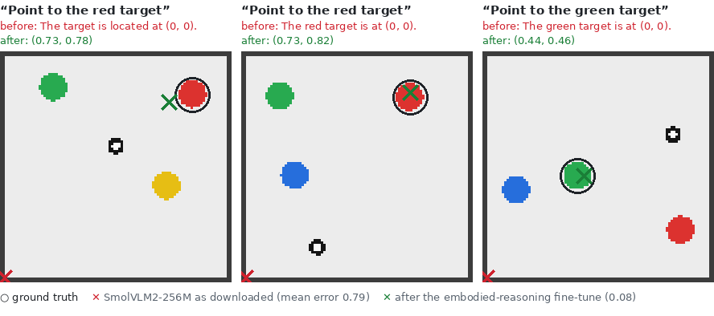

# 01 · VLM: pick, probe or adapt the backbone

[← README](../../README.md#the-eight-stages) · next: [02 Data →](02_data.md)

The vision-language backbone is what a VLA inherits from web-scale pretraining. It lets a policy follow
an instruction about something it never saw in robot data, which RT-2 showed first [[1](#ref-1)]. Pretraining
a VLM from scratch is out of scope for one GPU, so this stage **chooses and probes** a pretrained VLM,
or adapts it on embodied-reasoning data (pointing). That pointing step is what Gemini Robotics-ER
[[2](#ref-2)] and π0.5 [[3](#ref-3)] add before robot training. A from-scratch backbone is the control
group for "does the VLM help?".



*`reach_full`'s `vlm` node asks SmolVLM2-256M [[4](#ref-4)] to point at coloured targets in sim frames. As
downloaded, it answers "(0, 0)". After a LoRA [[5](#ref-5)] fine-tune on 2000 such questions (300 steps,
~3.5 min), the mean pointing error drops from 0.79 to 0.08.*

## Nodes and components

| node | what it does |
|---|---|
| `vlm/scratch` | no pretraining: hands a from-scratch backbone spec (`tiny_cnn`) to `vla`. This is the control group |
| `vlm/hf_pretrained` | any Hugging Face VLM as-is, plus a pointing / colour-naming probe on sim images |
| `vlm/er_finetune` | embodied-reasoning fine-tune on pointing QA rendered from the sim, probed before and after |

| backbone | what it is |
|---|---|
| `backbone/hf_vlm` | any Hugging Face image-text-to-text model: SmolVLM2 [[4](#ref-4)], Qwen2.5-VL [[6](#ref-6)], PaliGemma 2 [[7](#ref-7)], Idefics3 [[8](#ref-8)] ... Options mirror the papers: keep only the first N language-model layers (SmolVLA [[9](#ref-9)]), freeze all / vision only / nothing, LoRA on the language model (OpenVLA [[10](#ref-10)]), bf16 |
| `backbone/tiny_cnn` | a from-scratch CNN whose image features are FiLM-conditioned on the instruction [[11](#ref-11)], as in RT-1 [[12](#ref-12)], then turned into tokens and fused with hashed word embeddings in a small transformer. No downloads, trains in seconds on a CPU |

Code: [src/vlalab/stages/vlm.py](../../src/vlalab/stages/vlm.py) (nodes) and
[src/vlalab/policy/backbones.py](../../src/vlalab/policy/backbones.py) (backbones).

## Run it

The commands assume one full `vlab run reach_full` first. [Running pipelines](../running.md) explains
`--only`, `--from` and caching.

```bash
vlab run reach_full --only vlm                       # fine-tune + probe -> runs/reach_full/vlm/probe.json
vlab run reach_full --only vlm vlm.steps=600 vlm.lora.r=32
```

To probe another model without training, save this as `configs/pipeline/vlm_probe.yaml`:

```yaml
# configs/pipeline/vlm_probe.yaml
name: vlm_probe
env: reach2d                       # the probe renders its questions from this sim
nodes:
  vlm:
    impl: vlm/hf_pretrained
    params: {model_id: HuggingFaceTB/SmolVLM2-500M-Video-Instruct, probe_samples: 48}
```

```bash
vlab run vlm_probe                 # pointing_error, pointing_within_0.1, color_list_acc
```

## Hands on

Output port `backbone`, a backbone spec. Wire it into `vla.inputs.backbone` and the policy trains on
that backbone, including the fine-tuned weights ([03 VLA](03_vla.md)).

## Papers in this stage

| paper | status | where |
|---|---|---|
| SmolVLM2 (256M / 500M / 2.2B) [[4](#ref-4)] | native | `backbone/hf_vlm` |
| Any HF image-text-to-text VLM: Qwen2.5-VL [[6](#ref-6)], PaliGemma 2 [[7](#ref-7)], Idefics3 [[8](#ref-8)] | native | `backbone/hf_vlm` |
| RT-1 FiLM CNN + tokens, from scratch [[12](#ref-12), [11](#ref-11)] | native | `backbone/tiny_cnn` |
| Embodied-reasoning fine-tune: Gemini Robotics-ER [[2](#ref-2)], π0.5 pointing data [[3](#ref-3)] | native | `vlm/er_finetune` |
| Prismatic fused DINOv2 + SigLIP encoder, as used by OpenVLA [[13](#ref-13), [10](#ref-10)] | planned | open slot |
| Eagle 2 backbone of GR00T N1 [[14](#ref-14), [15](#ref-15)] | via LeRobot | `vla/lerobot_train` with `policy_type: groot` |

*native*: implemented in this repo. *via LeRobot*: runs through the LeRobot [[16](#ref-16)] adapters.
*planned*: an open slot; `vlab new vlm <name>` scaffolds it ([adding components](../adding_components.md)).
The full catalogue is [docs/papers.yaml](../papers.yaml).

## References

1. <a id="ref-1"></a>A. Brohan, N. Brown, J. Carbajal, et al. *RT-2: Vision-Language-Action Models Transfer Web Knowledge to Robotic Control.* CoRL 2023. [arXiv:2307.15818](https://arxiv.org/abs/2307.15818)
2. <a id="ref-2"></a>Gemini Robotics Team, S. Abeyruwan, J. Ainslie, et al. *Gemini Robotics: Bringing AI into the Physical World.* arXiv preprint, 2025. [arXiv:2503.20020](https://arxiv.org/abs/2503.20020)
3. <a id="ref-3"></a>Physical Intelligence, K. Black, N. Brown, et al. *π0.5: a Vision-Language-Action Model with Open-World Generalization.* arXiv preprint, 2025. [arXiv:2504.16054](https://arxiv.org/abs/2504.16054)
4. <a id="ref-4"></a>A. Marafioti, O. Zohar, M. Farré, et al. *SmolVLM: Redefining small and efficient multimodal models.* arXiv preprint, 2025. [arXiv:2504.05299](https://arxiv.org/abs/2504.05299)
5. <a id="ref-5"></a>E. J. Hu, Y. Shen, P. Wallis, et al. *LoRA: Low-Rank Adaptation of Large Language Models.* ICLR 2022. [arXiv:2106.09685](https://arxiv.org/abs/2106.09685)
6. <a id="ref-6"></a>S. Bai, K. Chen, X. Liu, et al. *Qwen2.5-VL Technical Report.* arXiv preprint, 2025. [arXiv:2502.13923](https://arxiv.org/abs/2502.13923)
7. <a id="ref-7"></a>A. Steiner, A. Susano Pinto, M. Tschannen, et al. *PaliGemma 2: A Family of Versatile VLMs for Transfer.* arXiv preprint, 2024. [arXiv:2412.03555](https://arxiv.org/abs/2412.03555)
8. <a id="ref-8"></a>H. Laurençon, A. Marafioti, V. Sanh, and L. Tronchon. *Building and better understanding vision-language models: insights and future directions.* arXiv preprint, 2024. [arXiv:2408.12637](https://arxiv.org/abs/2408.12637)
9. <a id="ref-9"></a>M. Shukor, D. Aubakirova, F. Capuano, et al. *SmolVLA: A Vision-Language-Action Model for Affordable and Efficient Robotics.* arXiv preprint, 2025. [arXiv:2506.01844](https://arxiv.org/abs/2506.01844)
10. <a id="ref-10"></a>M. J. Kim, K. Pertsch, S. Karamcheti, et al. *OpenVLA: An Open-Source Vision-Language-Action Model.* CoRL 2024. [arXiv:2406.09246](https://arxiv.org/abs/2406.09246)
11. <a id="ref-11"></a>E. Perez, F. Strub, H. de Vries, V. Dumoulin, and A. Courville. *FiLM: Visual Reasoning with a General Conditioning Layer.* AAAI 2018. [arXiv:1709.07871](https://arxiv.org/abs/1709.07871)
12. <a id="ref-12"></a>A. Brohan, N. Brown, J. Carbajal, et al. *RT-1: Robotics Transformer for Real-World Control at Scale.* RSS 2023. [arXiv:2212.06817](https://arxiv.org/abs/2212.06817)
13. <a id="ref-13"></a>S. Karamcheti, S. Nair, A. Balakrishna, et al. *Prismatic VLMs: Investigating the Design Space of Visually-Conditioned Language Models.* ICML 2024. [arXiv:2402.07865](https://arxiv.org/abs/2402.07865)
14. <a id="ref-14"></a>Z. Li, G. Chen, S. Liu, et al. *Eagle 2: Building Post-Training Data Strategies from Scratch for Frontier Vision-Language Models.* arXiv preprint, 2025. [arXiv:2501.14818](https://arxiv.org/abs/2501.14818)
15. <a id="ref-15"></a>NVIDIA, J. Bjorck, F. Castañeda, et al. *GR00T N1: An Open Foundation Model for Generalist Humanoid Robots.* arXiv preprint, 2025. [arXiv:2503.14734](https://arxiv.org/abs/2503.14734)
16. <a id="ref-16"></a>R. Cadene, S. Alibert, F. Capuano, et al. *LeRobot: An Open-Source Library for End-to-End Robot Learning.* ICLR 2026. [arXiv:2602.22818](https://arxiv.org/abs/2602.22818)

<details>
<summary>BibTeX for this page</summary>

```bibtex
@inproceedings{brohan2023rt2,
  title         = {{RT-2: Vision-Language-Action Models Transfer Web Knowledge to Robotic Control}},
  author        = {Anthony Brohan and Noah Brown and Justice Carbajal and Yevgen Chebotar and Xi Chen and Krzysztof Choromanski and Tianli Ding and Danny Driess and Avinava Dubey and Chelsea Finn and others},
  booktitle     = {Conference on Robot Learning (CoRL)},
  year          = {2023},
  eprint        = {2307.15818},
  archivePrefix = {arXiv},
  url           = {https://arxiv.org/abs/2307.15818}
}

@article{geminirobotics2025,
  title         = {{Gemini Robotics: Bringing AI into the Physical World}},
  author        = {{Gemini Robotics Team} and Saminda Abeyruwan and Joshua Ainslie and Jean-Baptiste Alayrac and Gonzalez Arenas, Montserrat and Travis Armstrong and Ashwin Balakrishna and Robert Baruch and Maria Bauza and Michiel Blokzijl and others},
  journal       = {arXiv preprint arXiv:2503.20020},
  year          = {2025},
  eprint        = {2503.20020},
  archivePrefix = {arXiv},
  url           = {https://arxiv.org/abs/2503.20020}
}

@article{pi2025pi05,
  title         = {{{$\pi_{0.5}$}: a Vision-Language-Action Model with Open-World Generalization}},
  author        = {{Physical Intelligence} and Kevin Black and Noah Brown and James Darpinian and Karan Dhabalia and Danny Driess and Adnan Esmail and Michael Equi and Chelsea Finn and Niccolo Fusai and others},
  journal       = {arXiv preprint arXiv:2504.16054},
  year          = {2025},
  eprint        = {2504.16054},
  archivePrefix = {arXiv},
  url           = {https://arxiv.org/abs/2504.16054}
}

@article{marafioti2025smolvlm,
  title         = {{SmolVLM: Redefining small and efficient multimodal models}},
  author        = {Andrés Marafioti and Orr Zohar and Miquel Farré and Merve Noyan and Elie Bakouch and Pedro Cuenca and Cyril Zakka and Ben Allal, Loubna and Anton Lozhkov and Nouamane Tazi and Vaibhav Srivastav and Joshua Lochner and Hugo Larcher and Mathieu Morlon and Lewis Tunstall and Leandro von Werra and Thomas Wolf},
  journal       = {arXiv preprint arXiv:2504.05299},
  year          = {2025},
  eprint        = {2504.05299},
  archivePrefix = {arXiv},
  url           = {https://arxiv.org/abs/2504.05299}
}

@inproceedings{hu2022lora,
  title         = {{LoRA: Low-Rank Adaptation of Large Language Models}},
  author        = {Edward J. Hu and Yelong Shen and Phillip Wallis and Zeyuan Allen-Zhu and Yuanzhi Li and Shean Wang and Lu Wang and Weizhu Chen},
  booktitle     = {International Conference on Learning Representations (ICLR)},
  year          = {2022},
  eprint        = {2106.09685},
  archivePrefix = {arXiv},
  url           = {https://arxiv.org/abs/2106.09685}
}

@article{bai2025qwen25vl,
  title         = {{Qwen2.5-VL Technical Report}},
  author        = {Shuai Bai and Keqin Chen and Xuejing Liu and Jialin Wang and Wenbin Ge and Sibo Song and Kai Dang and Peng Wang and Shijie Wang and Jun Tang and others},
  journal       = {arXiv preprint arXiv:2502.13923},
  year          = {2025},
  eprint        = {2502.13923},
  archivePrefix = {arXiv},
  url           = {https://arxiv.org/abs/2502.13923}
}

@article{steiner2024paligemma2,
  title         = {{PaliGemma 2: A Family of Versatile VLMs for Transfer}},
  author        = {Andreas Steiner and Susano Pinto, André and Michael Tschannen and Daniel Keysers and Xiao Wang and Yonatan Bitton and Alexey Gritsenko and Matthias Minderer and Anthony Sherbondy and Shangbang Long and Siyang Qin and Reeve Ingle and Emanuele Bugliarello and Sahar Kazemzadeh and Thomas Mesnard and Ibrahim Alabdulmohsin and Lucas Beyer and Xiaohua Zhai},
  journal       = {arXiv preprint arXiv:2412.03555},
  year          = {2024},
  eprint        = {2412.03555},
  archivePrefix = {arXiv},
  url           = {https://arxiv.org/abs/2412.03555}
}

@article{laurencon2024idefics3,
  title         = {{Building and better understanding vision-language models: insights and future directions}},
  author        = {Hugo Laurençon and Andrés Marafioti and Victor Sanh and Léo Tronchon},
  journal       = {arXiv preprint arXiv:2408.12637},
  year          = {2024},
  eprint        = {2408.12637},
  archivePrefix = {arXiv},
  url           = {https://arxiv.org/abs/2408.12637}
}

@article{shukor2025smolvla,
  title         = {{SmolVLA: A Vision-Language-Action Model for Affordable and Efficient Robotics}},
  author        = {Mustafa Shukor and Dana Aubakirova and Francesco Capuano and Pepijn Kooijmans and Steven Palma and Adil Zouitine and Michel Aractingi and Caroline Pascal and Martino Russi and Andres Marafioti and Simon Alibert and Matthieu Cord and Thomas Wolf and Remi Cadene},
  journal       = {arXiv preprint arXiv:2506.01844},
  year          = {2025},
  eprint        = {2506.01844},
  archivePrefix = {arXiv},
  url           = {https://arxiv.org/abs/2506.01844}
}

@inproceedings{kim2024openvla,
  title         = {{OpenVLA: An Open-Source Vision-Language-Action Model}},
  author        = {Moo Jin Kim and Karl Pertsch and Siddharth Karamcheti and Ted Xiao and Ashwin Balakrishna and Suraj Nair and Rafael Rafailov and Ethan Foster and Grace Lam and Pannag Sanketi and Quan Vuong and Thomas Kollar and Benjamin Burchfiel and Russ Tedrake and Dorsa Sadigh and Sergey Levine and Percy Liang and Chelsea Finn},
  booktitle     = {Conference on Robot Learning (CoRL)},
  year          = {2024},
  eprint        = {2406.09246},
  archivePrefix = {arXiv},
  url           = {https://arxiv.org/abs/2406.09246}
}

@inproceedings{perez2018film,
  title         = {{FiLM: Visual Reasoning with a General Conditioning Layer}},
  author        = {Ethan Perez and Florian Strub and Harm de Vries and Vincent Dumoulin and Aaron Courville},
  booktitle     = {AAAI Conference on Artificial Intelligence},
  year          = {2018},
  eprint        = {1709.07871},
  archivePrefix = {arXiv},
  url           = {https://arxiv.org/abs/1709.07871}
}

@inproceedings{brohan2023rt1,
  title         = {{RT-1: Robotics Transformer for Real-World Control at Scale}},
  author        = {Anthony Brohan and Noah Brown and Justice Carbajal and Yevgen Chebotar and Joseph Dabis and Chelsea Finn and Keerthana Gopalakrishnan and Karol Hausman and Alex Herzog and Jasmine Hsu and others},
  booktitle     = {Robotics: Science and Systems (RSS)},
  year          = {2023},
  eprint        = {2212.06817},
  archivePrefix = {arXiv},
  url           = {https://arxiv.org/abs/2212.06817}
}

@inproceedings{karamcheti2024prismatic,
  title         = {{Prismatic VLMs: Investigating the Design Space of Visually-Conditioned Language Models}},
  author        = {Siddharth Karamcheti and Suraj Nair and Ashwin Balakrishna and Percy Liang and Thomas Kollar and Dorsa Sadigh},
  booktitle     = {International Conference on Machine Learning (ICML)},
  year          = {2024},
  eprint        = {2402.07865},
  archivePrefix = {arXiv},
  url           = {https://arxiv.org/abs/2402.07865}
}

@article{li2025eagle2,
  title         = {{Eagle 2: Building Post-Training Data Strategies from Scratch for Frontier Vision-Language Models}},
  author        = {Zhiqi Li and Guo Chen and Shilong Liu and Shihao Wang and Vibashan VS and Yishen Ji and Shiyi Lan and Hao Zhang and Yilin Zhao and Subhashree Radhakrishnan and others},
  journal       = {arXiv preprint arXiv:2501.14818},
  year          = {2025},
  eprint        = {2501.14818},
  archivePrefix = {arXiv},
  url           = {https://arxiv.org/abs/2501.14818}
}

@article{nvidia2025groot,
  title         = {{GR00T N1: An Open Foundation Model for Generalist Humanoid Robots}},
  author        = {{NVIDIA} and Johan Bjorck and Fernando Castañeda and Nikita Cherniadev and Xingye Da and Runyu Ding and Linxi Fan and Yu Fang and Dieter Fox and Fengyuan Hu and others},
  journal       = {arXiv preprint arXiv:2503.14734},
  year          = {2025},
  eprint        = {2503.14734},
  archivePrefix = {arXiv},
  url           = {https://arxiv.org/abs/2503.14734}
}

@inproceedings{cadene2026lerobot,
  title         = {{LeRobot: An Open-Source Library for End-to-End Robot Learning}},
  author        = {Remi Cadene and Simon Alibert and Francesco Capuano and Michel Aractingi and Adil Zouitine and Pepijn Kooijmans and Jade Choghari and Martino Russi and Caroline Pascal and Steven Palma and Mustafa Shukor and Jess Moss and Alexander Soare and Dana Aubakirova and Quentin Lhoest and Quentin Gallouédec and Thomas Wolf},
  booktitle     = {International Conference on Learning Representations (ICLR)},
  year          = {2026},
  eprint        = {2602.22818},
  archivePrefix = {arXiv},
  url           = {https://arxiv.org/abs/2602.22818}
}
```

</details>
