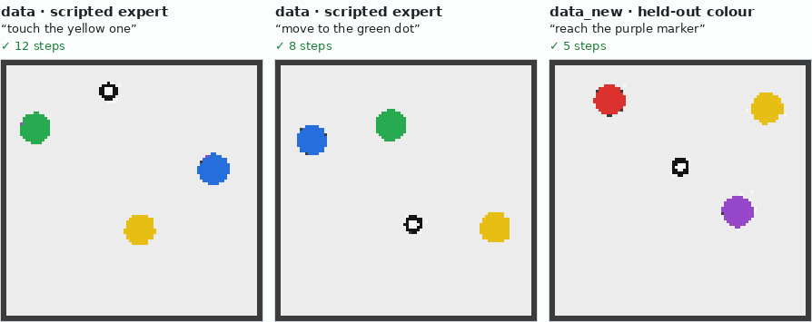

# 02 · Data: collect, import and mix demonstrations

[← README](../../README.md#the-eight-stages) · previous: [01 VLM](01_vlm.md) · next: [03 VLA →](03_vla.md)

Robot demonstrations are the scarce input of every VLA. This stage produces them three ways: a scripted
expert in sim (a stand-in for teleoperation), any LeRobot dataset on the Hub or on disk [[1](#ref-1)], and
weighted mixtures of datasets. The mixtures are the co-training recipe behind Open X-Embodiment [[2](#ref-2)]
and π0 [[3](#ref-3)]. A fourth node fills an embodiment's features with random data so that a robot can be
brought up before any real data exists.



*Scripted-expert demos from `reach_smoke`. `data` covers four colours. `data_new` holds 24 demos of a
colour the policy never sees in pretraining (purple), kept for post-training.*

## Nodes and components

| node | what it does |
|---|---|
| `data/scripted_sim` | rolls a scripted expert in sim and logs LeRobot-style episodes, with noise / hesitation / recovery knobs |
| `data/lerobot_hub` | any LeRobot dataset on the Hub (PushT, ALOHA, SO-100, DROID, LIBERO ...) or a local one via `root:` |
| `data/mixture` | weighted mixture of datasets (co-training, cross-embodiment) |
| `data/synthetic` | random data shaped like the embodiment spec, for hardware bring-up |

| component | what it is |
|---|---|
| `env/reach2d` | Lang-Reach 2D, the built-in sim: reach the target of the named colour |
| `env/gym` | any gymnasium env: PushT (introduced by IBC [[4](#ref-4)], used by Diffusion Policy [[5](#ref-5)]), the ALOHA sim [[6](#ref-6)], LIBERO [[7](#ref-7)] ... |
| `expert/reach2d_pd`, `expert/random` | scripted experts that drive `data/scripted_sim` |

Code: [src/vlalab/stages/data.py](../../src/vlalab/stages/data.py),
[src/vlalab/data/](../../src/vlalab/data/), [src/vlalab/envs/](../../src/vlalab/envs/).

## Run it

```bash
vlab run reach_smoke --only data,data_new            # ~7 s -> runs/reach_smoke/data/dataset
vlab run reach_smoke --only data data.episodes=1000 data.expert.noise=0.1 data.expert.hesitate_prob=0.05
```

## Configure it

```yaml
nodes:
  data:                            # a scripted expert in sim, the stand-in for teleop
    impl: data/scripted_sim
    params: {episodes: 400, expert: {type: reach2d_pd, noise: 0.05, recovery_prob: 0.1}}
  data_new:                        # same sim, held-out goal colour, few demos on purpose
    impl: data/scripted_sim
    params: {episodes: 24, seed: 50000, env_overrides: {goal_colors: [purple]}}
  mix:                             # weighted mixture (co-training, cross-embodiment)
    impl: data/mixture
    inputs: {datasets: [data.dataset, data_new.dataset]}
    params: {weights: [0.8, 0.2]}
```

Real data comes in through `data/lerobot_hub`. It takes any LeRobot dataset on the Hub, or a local one
via `root:`, which covers your own teleop recordings made with `lerobot-record` (ALOHA [[6](#ref-6)], GELLO
[[8](#ref-8)] or SO-100 [[9](#ref-9)] leader-follower arms):

```yaml
  data:
    impl: data/lerobot_hub         # as in pusht_lerobot
    params: {repo_id: lerobot/pusht, episodes: 100, key_map: {observation.image: observation.images.top}}
```

`data/synthetic` fills every feature an embodiment declares with random data, for bring-up before real
data exists ([new hardware](../hardware.md)).

## Hands on

Output port `dataset`, a ref like `{format: native, path: runs/.../dataset}`. That folder holds one
`<feature>.npy` per feature, `episodes.json` (task, length and success per episode) and `meta.json`
(shapes and normalisation stats). Training nodes ([03 VLA](03_vla.md), [04 post-training](04_post_train.md))
take one ref or a list of refs.

## Papers in this stage

| paper | status | where |
|---|---|---|
| Scripted sim demos with noise / hesitation / recovery knobs | native | `data/scripted_sim` |
| LeRobotDataset Hub sources [[1](#ref-1)]: ALOHA [[6](#ref-6)], PushT [[5](#ref-5)], SO-100 (SmolVLA's pick-and-place set [[10](#ref-10)]), DROID [[11](#ref-11)], LIBERO [[7](#ref-7)] | native | `data/lerobot_hub` |
| Weighted mixtures / co-training: Open X-Embodiment [[2](#ref-2)], π0 [[3](#ref-3)] | native | `data/mixture` |
| Spec-shaped synthetic data for hardware bring-up | native | `data/synthetic` |
| ALOHA [[6](#ref-6)] / GELLO [[8](#ref-8)] / SO-100 [[9](#ref-9)] leader-follower teleop recording | via LeRobot | `lerobot-record`, then `data/lerobot_hub` with `root:` |
| UMI handheld-gripper demos [[12](#ref-12)] | planned | open slot |
| MimicGen-style demo multiplication in sim [[13](#ref-13)] | planned | open slot |

*native*: implemented in this repo. *via LeRobot*: runs through the LeRobot adapters. *planned*: an
open slot; `vlab new data <name>` scaffolds it ([adding components](../adding_components.md)).

## References

1. <a id="ref-1"></a>R. Cadene, S. Alibert, F. Capuano, et al. *LeRobot: An Open-Source Library for End-to-End Robot Learning.* ICLR 2026. [arXiv:2602.22818](https://arxiv.org/abs/2602.22818)
2. <a id="ref-2"></a>Open X-Embodiment Collaboration, A. O'Neill, A. Rehman, et al. *Open X-Embodiment: Robotic Learning Datasets and RT-X Models.* ICRA 2024. [arXiv:2310.08864](https://arxiv.org/abs/2310.08864)
3. <a id="ref-3"></a>K. Black, N. Brown, D. Driess, et al. *π0: A Vision-Language-Action Flow Model for General Robot Control.* RSS 2025. [arXiv:2410.24164](https://arxiv.org/abs/2410.24164)
4. <a id="ref-4"></a>P. Florence, C. Lynch, A. Zeng, et al. *Implicit Behavioral Cloning.* CoRL 2021. [arXiv:2109.00137](https://arxiv.org/abs/2109.00137)
5. <a id="ref-5"></a>C. Chi, Z. Xu, S. Feng, et al. *Diffusion Policy: Visuomotor Policy Learning via Action Diffusion.* RSS 2023. [arXiv:2303.04137](https://arxiv.org/abs/2303.04137)
6. <a id="ref-6"></a>T. Z. Zhao, V. Kumar, S. Levine, and C. Finn. *Learning Fine-Grained Bimanual Manipulation with Low-Cost Hardware.* RSS 2023. [arXiv:2304.13705](https://arxiv.org/abs/2304.13705)
7. <a id="ref-7"></a>B. Liu, Y. Zhu, C. Gao, et al. *LIBERO: Benchmarking Knowledge Transfer for Lifelong Robot Learning.* NeurIPS D&B 2023. [arXiv:2306.03310](https://arxiv.org/abs/2306.03310)
8. <a id="ref-8"></a>P. Wu, Y. Shentu, Z. Yi, X. Lin, and P. Abbeel. *GELLO: A General, Low-Cost, and Intuitive Teleoperation Framework for Robot Manipulators.* arXiv preprint, 2023. [arXiv:2309.13037](https://arxiv.org/abs/2309.13037)
9. <a id="ref-9"></a>TheRobotStudio. *SO-ARM100: Standard Open Arm 100.* GitHub repository, 2024. [github.com/TheRobotStudio/SO-ARM100](https://github.com/TheRobotStudio/SO-ARM100)
10. <a id="ref-10"></a>M. Shukor, D. Aubakirova, F. Capuano, et al. *SmolVLA: A Vision-Language-Action Model for Affordable and Efficient Robotics.* arXiv preprint, 2025. [arXiv:2506.01844](https://arxiv.org/abs/2506.01844)
11. <a id="ref-11"></a>A. Khazatsky, K. Pertsch, S. Nair, et al. *DROID: A Large-Scale In-The-Wild Robot Manipulation Dataset.* RSS 2024. [arXiv:2403.12945](https://arxiv.org/abs/2403.12945)
12. <a id="ref-12"></a>C. Chi, Z. Xu, C. Pan, et al. *Universal Manipulation Interface: In-The-Wild Robot Teaching Without In-The-Wild Robots.* RSS 2024. [arXiv:2402.10329](https://arxiv.org/abs/2402.10329)
13. <a id="ref-13"></a>A. Mandlekar, S. Nasiriany, B. Wen, et al. *MimicGen: A Data Generation System for Scalable Robot Learning using Human Demonstrations.* CoRL 2023. [arXiv:2310.17596](https://arxiv.org/abs/2310.17596)

<details>
<summary>BibTeX for this page</summary>

```bibtex
@inproceedings{cadene2026lerobot,
  title         = {{LeRobot: An Open-Source Library for End-to-End Robot Learning}},
  author        = {Remi Cadene and Simon Alibert and Francesco Capuano and Michel Aractingi and Adil Zouitine and Pepijn Kooijmans and Jade Choghari and Martino Russi and Caroline Pascal and Steven Palma and Mustafa Shukor and Jess Moss and Alexander Soare and Dana Aubakirova and Quentin Lhoest and Quentin Gallouédec and Thomas Wolf},
  booktitle     = {International Conference on Learning Representations (ICLR)},
  year          = {2026},
  eprint        = {2602.22818},
  archivePrefix = {arXiv},
  url           = {https://arxiv.org/abs/2602.22818}
}

@inproceedings{oxe2024,
  title         = {{Open X-Embodiment: Robotic Learning Datasets and RT-X Models}},
  author        = {{Open X-Embodiment Collaboration} and Abby O'Neill and Abdul Rehman and Abhinav Gupta and Abhiram Maddukuri and Abhishek Gupta and Abhishek Padalkar and Abraham Lee and Acorn Pooley and Agrim Gupta and others},
  booktitle     = {IEEE International Conference on Robotics and Automation (ICRA)},
  year          = {2024},
  eprint        = {2310.08864},
  archivePrefix = {arXiv},
  url           = {https://arxiv.org/abs/2310.08864}
}

@inproceedings{black2025pi0,
  title         = {{{$\pi_0$}: A Vision-Language-Action Flow Model for General Robot Control}},
  author        = {Kevin Black and Noah Brown and Danny Driess and Adnan Esmail and Michael Equi and Chelsea Finn and Niccolo Fusai and Lachy Groom and Karol Hausman and Brian Ichter and Szymon Jakubczak and Tim Jones and Liyiming Ke and Sergey Levine and Adrian Li-Bell and Mohith Mothukuri and Suraj Nair and Karl Pertsch and Lucy Xiaoyang Shi and James Tanner and Quan Vuong and Anna Walling and Haohuan Wang and Ury Zhilinsky},
  booktitle     = {Robotics: Science and Systems (RSS)},
  year          = {2025},
  eprint        = {2410.24164},
  archivePrefix = {arXiv},
  url           = {https://arxiv.org/abs/2410.24164}
}

@inproceedings{florence2021ibc,
  title         = {{Implicit Behavioral Cloning}},
  author        = {Pete Florence and Corey Lynch and Andy Zeng and Oscar Ramirez and Ayzaan Wahid and Laura Downs and Adrian Wong and Johnny Lee and Igor Mordatch and Jonathan Tompson},
  booktitle     = {Conference on Robot Learning (CoRL)},
  year          = {2021},
  eprint        = {2109.00137},
  archivePrefix = {arXiv},
  url           = {https://arxiv.org/abs/2109.00137}
}

@inproceedings{chi2023diffusion,
  title         = {{Diffusion Policy: Visuomotor Policy Learning via Action Diffusion}},
  author        = {Cheng Chi and Zhenjia Xu and Siyuan Feng and Eric Cousineau and Yilun Du and Benjamin Burchfiel and Russ Tedrake and Shuran Song},
  booktitle     = {Robotics: Science and Systems (RSS)},
  year          = {2023},
  eprint        = {2303.04137},
  archivePrefix = {arXiv},
  url           = {https://arxiv.org/abs/2303.04137}
}

@inproceedings{zhao2023act,
  title         = {{Learning Fine-Grained Bimanual Manipulation with Low-Cost Hardware}},
  author        = {Tony Z. Zhao and Vikash Kumar and Sergey Levine and Chelsea Finn},
  booktitle     = {Robotics: Science and Systems (RSS)},
  year          = {2023},
  eprint        = {2304.13705},
  archivePrefix = {arXiv},
  url           = {https://arxiv.org/abs/2304.13705}
}

@inproceedings{liu2023libero,
  title         = {{LIBERO: Benchmarking Knowledge Transfer for Lifelong Robot Learning}},
  author        = {Bo Liu and Yifeng Zhu and Chongkai Gao and Yihao Feng and Qiang Liu and Yuke Zhu and Peter Stone},
  booktitle     = {NeurIPS Datasets and Benchmarks Track},
  year          = {2023},
  eprint        = {2306.03310},
  archivePrefix = {arXiv},
  url           = {https://arxiv.org/abs/2306.03310}
}

@article{wu2023gello,
  title         = {{GELLO: A General, Low-Cost, and Intuitive Teleoperation Framework for Robot Manipulators}},
  author        = {Philipp Wu and Yide Shentu and Zhongke Yi and Xingyu Lin and Pieter Abbeel},
  journal       = {arXiv preprint arXiv:2309.13037},
  year          = {2023},
  eprint        = {2309.13037},
  archivePrefix = {arXiv},
  url           = {https://arxiv.org/abs/2309.13037}
}

@misc{therobotstudio2024so100,
  title         = {{SO-ARM100: Standard Open Arm 100}},
  author        = {{TheRobotStudio}},
  howpublished  = {\url{https://github.com/TheRobotStudio/SO-ARM100}},
  note          = {GitHub repository},
  year          = {2024}
}

@article{shukor2025smolvla,
  title         = {{SmolVLA: A Vision-Language-Action Model for Affordable and Efficient Robotics}},
  author        = {Mustafa Shukor and Dana Aubakirova and Francesco Capuano and Pepijn Kooijmans and Steven Palma and Adil Zouitine and Michel Aractingi and Caroline Pascal and Martino Russi and Andres Marafioti and Simon Alibert and Matthieu Cord and Thomas Wolf and Remi Cadene},
  journal       = {arXiv preprint arXiv:2506.01844},
  year          = {2025},
  eprint        = {2506.01844},
  archivePrefix = {arXiv},
  url           = {https://arxiv.org/abs/2506.01844}
}

@inproceedings{khazatsky2024droid,
  title         = {{DROID: A Large-Scale In-The-Wild Robot Manipulation Dataset}},
  author        = {Alexander Khazatsky and Karl Pertsch and Suraj Nair and Ashwin Balakrishna and Sudeep Dasari and Siddharth Karamcheti and Soroush Nasiriany and Mohan Kumar Srirama and Lawrence Yunliang Chen and Kirsty Ellis and others},
  booktitle     = {Robotics: Science and Systems (RSS)},
  year          = {2024},
  eprint        = {2403.12945},
  archivePrefix = {arXiv},
  url           = {https://arxiv.org/abs/2403.12945}
}

@inproceedings{chi2024umi,
  title         = {{Universal Manipulation Interface: In-The-Wild Robot Teaching Without In-The-Wild Robots}},
  author        = {Cheng Chi and Zhenjia Xu and Chuer Pan and Eric Cousineau and Benjamin Burchfiel and Siyuan Feng and Russ Tedrake and Shuran Song},
  booktitle     = {Robotics: Science and Systems (RSS)},
  year          = {2024},
  eprint        = {2402.10329},
  archivePrefix = {arXiv},
  url           = {https://arxiv.org/abs/2402.10329}
}

@inproceedings{mandlekar2023mimicgen,
  title         = {{MimicGen: A Data Generation System for Scalable Robot Learning using Human Demonstrations}},
  author        = {Ajay Mandlekar and Soroush Nasiriany and Bowen Wen and Iretiayo Akinola and Yashraj Narang and Linxi Fan and Yuke Zhu and Dieter Fox},
  booktitle     = {Conference on Robot Learning (CoRL)},
  year          = {2023},
  eprint        = {2310.17596},
  archivePrefix = {arXiv},
  url           = {https://arxiv.org/abs/2310.17596}
}
```

</details>
