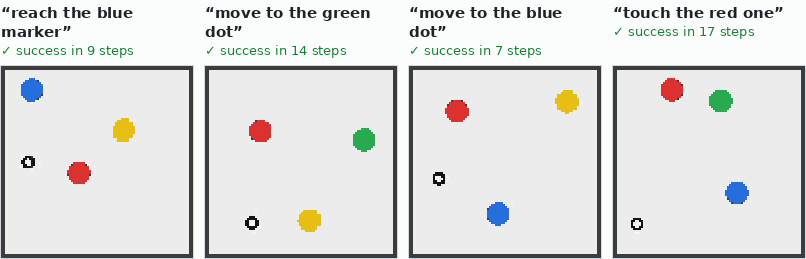

# 03 · VLA: train a policy

[← README](../../README.md#the-eight-stages) · previous: [02 Data](02_data.md) · next: [04 Post-training →](04_post_train.md)

A VLA is a backbone from [01 VLM](01_vlm.md), one encoder per extra input (joint state, force, touch),
and an **action head** that turns the fused tokens into a chunk of future actions. The native `vla/train`
node makes all three swappable, so the action-head families can be compared on the same data: π0's
flow-matching expert [[1](#ref-1), [2](#ref-2)], Diffusion Policy's denoising head [[3](#ref-3), [4](#ref-4)],
L1 regression of a whole chunk as in ACT and OpenVLA-OFT [[5](#ref-5), [6](#ref-6)], and RT-2 / OpenVLA's
256-bin action tokens [[7](#ref-7), [8](#ref-8)]. Any LeRobot policy [[9](#ref-9)] trains through `lerobot-train`
instead and comes back in the same checkpoint format.



*The flow-matching policy `reach_smoke` trains in about a minute, on colours it was trained on
(`eval_pre`: 98% of 64 episodes).*

## Nodes and components

| node | what it does |
|---|---|
| `vla/train` | the native, fully configurable policy: backbone × observation encoders × action head |
| `vla/lerobot_train` | delegates to `lerobot-train` for any LeRobot policy: SmolVLA [[10](#ref-10)], ACT [[5](#ref-5)], Diffusion Policy [[3](#ref-3)], π0 [[1](#ref-1)], GR00T [[11](#ref-11)] ... |

| action head | from | how it works |
|---|---|---|
| `action_head/flow_matching` | π0 [[1](#ref-1)] | an action expert learns a velocity field from noise to the action chunk [[2](#ref-2)]; inference integrates it in a few steps |
| `action_head/diffusion` | Diffusion Policy [[3](#ref-3)], Octo [[12](#ref-12)] | DDPM training [[4](#ref-4)], DDIM sampling [[13](#ref-13)]. Predicts the clean chunk (x0) by default, which trains far faster for small heads than epsilon-prediction ([results](../results.md)) |
| `action_head/l1_regression` | ACT [[5](#ref-5)], OpenVLA-OFT [[6](#ref-6)] | parallel decoding of the whole chunk with learned queries and an L1 loss |
| `action_head/discrete_bins` | RT-2 [[7](#ref-7)], OpenVLA [[8](#ref-8)] | each action dimension split into 256 bins and classified, decoded in parallel |

| observation encoder | what it is |
|---|---|
| `obs_encoder/mlp` | two-layer MLP → k tokens, the default for state and force vectors |
| `obs_encoder/fourier` | random Fourier features [[14](#ref-14)] + MLP, sharper for low-dimensional positions |
| `obs_encoder/conv_grid` | small CNN for grid sensors (tactile pads, depth patches) → pooled tokens |

Presets in [configs/presets/vla/](../../configs/presets/vla/) hold each paper's recipe:
`pi0_style` [[1](#ref-1)], `smolvla_style` [[10](#ref-10)], `openvla_oft` [[6](#ref-6)], `rt2_bins` [[7](#ref-7), [8](#ref-8)],
and tiny CPU-friendly versions `flow_tiny`, `diffusion_tiny`, `l1_tiny` and `bins_tiny`.

Code: [src/vlalab/stages/vla.py](../../src/vlalab/stages/vla.py),
[src/vlalab/policy/](../../src/vlalab/policy/) (`heads.py`, `encoders.py`, `vla.py`, `train.py`).

## Run it

```bash
vlab run reach_smoke --only vlm,data,vla,eval_pre    # train (1500 steps, ~1 min) and check it
vlab run reach_smoke --only vla,eval_pre vla.policy.head.type=l1_regression vla.train.steps=3000
vlab run configs/pipeline/reach_heads.py             # four action heads on one dataset, side by side
```

## Configure it

```yaml
  vla:
    impl: vla/train
    preset: vla/flow_tiny          # a paper's recipe from configs/presets/vla/
    inputs: {dataset: data.dataset, backbone: vlm.backbone}
    params:
      policy:
        head: {type: diffusion, inference_steps: 10}   # flow_matching | diffusion | l1_regression | discrete_bins
        expert: {layers: 4, heads: 4}
      train: {steps: 3000, batch_size: 64, lr: 3.0e-4}
```

Any LeRobot policy (SmolVLA, ACT, Diffusion Policy, π0, GR00T ...) trains through `lerobot-train` and
comes back as a policy the eval and deploy nodes run unchanged (`aloha_lerobot`):

```yaml
  smolvla:
    impl: vla/lerobot_train
    inputs: {dataset: data.dataset}                # a data/lerobot_hub node
    params: {policy_path: lerobot/smolvla_base, steps: 2000, batch_size: 16}   # or policy_type: act
```

Switching the head's `type` from the CLI has a catch, see
[configuring_yaml.md](../configuring_yaml.md#cli-overrides).

## Hands on

Output port `policy`, a checkpoint folder. It holds `policy.yaml` (config, embodiment and
normalisation stats) and `model.safetensors`. Training losses are in `train_log.jsonl`.

## Papers in this stage

| paper | status | where |
|---|---|---|
| π0 flow-matching action expert [[1](#ref-1)] | native | `action_head/flow_matching` |
| Diffusion Policy [[3](#ref-3)] / Octo [[12](#ref-12)] diffusion head | native | `action_head/diffusion` |
| OpenVLA-OFT parallel decoding + L1 [[6](#ref-6)] | native | `action_head/l1_regression` |
| RT-2 [[7](#ref-7)] / OpenVLA [[8](#ref-8)] 256-bin action tokens | native | `action_head/discrete_bins` |
| SmolVLA: half-depth VLM + flow expert [[10](#ref-10)] | native | preset `vla/smolvla_style` |
| SmolVLA official weights [[10](#ref-10)] | via LeRobot | `policy_path: lerobot/smolvla_base` |
| ACT, action chunking transformer [[5](#ref-5)] | via LeRobot | `policy_type: act` |
| π0 / π0.5 official weights [[1](#ref-1), [15](#ref-15)] | via LeRobot | `pi0` / `pi05` |
| GR00T N1.5 [[11](#ref-11), [16](#ref-16)] | via LeRobot | `groot` |
| X-VLA [[17](#ref-17)] | via LeRobot | `xvla` |
| FAST action tokenizer, DCT + BPE [[18](#ref-18)] | planned | open slot |
| Knowledge insulation: stop action-expert gradients into the VLM [[19](#ref-19)] | planned | open slot |
| Joint (blockwise-causal) attention prefix instead of cross-attention, as in π0 [[1](#ref-1)] | planned | open slot |

*native*: implemented in this repo. *via LeRobot*: runs through `vla/lerobot_train`. *planned*: an open
slot; `vlab new vla <name>` scaffolds a node and [adding components](../adding_components.md#4-a-new-action-head)
walks through a new action head.

## References

1. <a id="ref-1"></a>K. Black, N. Brown, D. Driess, et al. *π0: A Vision-Language-Action Flow Model for General Robot Control.* RSS 2025. [arXiv:2410.24164](https://arxiv.org/abs/2410.24164)
2. <a id="ref-2"></a>Y. Lipman, R. T. Q. Chen, H. Ben-Hamu, M. Nickel, and M. Le. *Flow Matching for Generative Modeling.* ICLR 2023. [arXiv:2210.02747](https://arxiv.org/abs/2210.02747)
3. <a id="ref-3"></a>C. Chi, Z. Xu, S. Feng, et al. *Diffusion Policy: Visuomotor Policy Learning via Action Diffusion.* RSS 2023. [arXiv:2303.04137](https://arxiv.org/abs/2303.04137)
4. <a id="ref-4"></a>J. Ho, A. Jain, and P. Abbeel. *Denoising Diffusion Probabilistic Models.* NeurIPS 2020. [arXiv:2006.11239](https://arxiv.org/abs/2006.11239)
5. <a id="ref-5"></a>T. Z. Zhao, V. Kumar, S. Levine, and C. Finn. *Learning Fine-Grained Bimanual Manipulation with Low-Cost Hardware.* RSS 2023. [arXiv:2304.13705](https://arxiv.org/abs/2304.13705)
6. <a id="ref-6"></a>M. J. Kim, C. Finn, and P. Liang. *Fine-Tuning Vision-Language-Action Models: Optimizing Speed and Success.* RSS 2025. [arXiv:2502.19645](https://arxiv.org/abs/2502.19645)
7. <a id="ref-7"></a>A. Brohan, N. Brown, J. Carbajal, et al. *RT-2: Vision-Language-Action Models Transfer Web Knowledge to Robotic Control.* CoRL 2023. [arXiv:2307.15818](https://arxiv.org/abs/2307.15818)
8. <a id="ref-8"></a>M. J. Kim, K. Pertsch, S. Karamcheti, et al. *OpenVLA: An Open-Source Vision-Language-Action Model.* CoRL 2024. [arXiv:2406.09246](https://arxiv.org/abs/2406.09246)
9. <a id="ref-9"></a>R. Cadene, S. Alibert, F. Capuano, et al. *LeRobot: An Open-Source Library for End-to-End Robot Learning.* ICLR 2026. [arXiv:2602.22818](https://arxiv.org/abs/2602.22818)
10. <a id="ref-10"></a>M. Shukor, D. Aubakirova, F. Capuano, et al. *SmolVLA: A Vision-Language-Action Model for Affordable and Efficient Robotics.* arXiv preprint, 2025. [arXiv:2506.01844](https://arxiv.org/abs/2506.01844)
11. <a id="ref-11"></a>NVIDIA, J. Bjorck, F. Castañeda, et al. *GR00T N1: An Open Foundation Model for Generalist Humanoid Robots.* arXiv preprint, 2025. [arXiv:2503.14734](https://arxiv.org/abs/2503.14734)
12. <a id="ref-12"></a>Octo Model Team, D. Ghosh, H. Walke, et al. *Octo: An Open-Source Generalist Robot Policy.* RSS 2024. [arXiv:2405.12213](https://arxiv.org/abs/2405.12213)
13. <a id="ref-13"></a>J. Song, C. Meng, and S. Ermon. *Denoising Diffusion Implicit Models.* ICLR 2021. [arXiv:2010.02502](https://arxiv.org/abs/2010.02502)
14. <a id="ref-14"></a>M. Tancik, P. P. Srinivasan, B. Mildenhall, et al. *Fourier Features Let Networks Learn High Frequency Functions in Low Dimensional Domains.* NeurIPS 2020. [arXiv:2006.10739](https://arxiv.org/abs/2006.10739)
15. <a id="ref-15"></a>Physical Intelligence, K. Black, N. Brown, et al. *π0.5: a Vision-Language-Action Model with Open-World Generalization.* arXiv preprint, 2025. [arXiv:2504.16054](https://arxiv.org/abs/2504.16054)
16. <a id="ref-16"></a>NVIDIA. *GR00T N1.5.* Project page, 2025. [research.nvidia.com/labs/gear/gr00t-n1_5](https://research.nvidia.com/labs/gear/gr00t-n1_5/)
17. <a id="ref-17"></a>J. Zheng, J. Li, Z. Wang, et al. *X-VLA: Soft-Prompted Transformer as Scalable Cross-Embodiment Vision-Language-Action Model.* arXiv preprint, 2025. [arXiv:2510.10274](https://arxiv.org/abs/2510.10274)
18. <a id="ref-18"></a>K. Pertsch, K. Stachowicz, B. Ichter, et al. *FAST: Efficient Action Tokenization for Vision-Language-Action Models.* arXiv preprint, 2025. [arXiv:2501.09747](https://arxiv.org/abs/2501.09747)
19. <a id="ref-19"></a>D. Driess, J. T. Springenberg, B. Ichter, et al. *Knowledge Insulating Vision-Language-Action Models: Train Fast, Run Fast, Generalize Better.* arXiv preprint, 2025. [arXiv:2505.23705](https://arxiv.org/abs/2505.23705)

<details>
<summary>BibTeX for this page</summary>

```bibtex
@inproceedings{black2025pi0,
  title         = {{{$\pi_0$}: A Vision-Language-Action Flow Model for General Robot Control}},
  author        = {Kevin Black and Noah Brown and Danny Driess and Adnan Esmail and Michael Equi and Chelsea Finn and Niccolo Fusai and Lachy Groom and Karol Hausman and Brian Ichter and Szymon Jakubczak and Tim Jones and Liyiming Ke and Sergey Levine and Adrian Li-Bell and Mohith Mothukuri and Suraj Nair and Karl Pertsch and Lucy Xiaoyang Shi and James Tanner and Quan Vuong and Anna Walling and Haohuan Wang and Ury Zhilinsky},
  booktitle     = {Robotics: Science and Systems (RSS)},
  year          = {2025},
  eprint        = {2410.24164},
  archivePrefix = {arXiv},
  url           = {https://arxiv.org/abs/2410.24164}
}

@inproceedings{lipman2023flow,
  title         = {{Flow Matching for Generative Modeling}},
  author        = {Yaron Lipman and Ricky T. Q. Chen and Heli Ben-Hamu and Maximilian Nickel and Matt Le},
  booktitle     = {International Conference on Learning Representations (ICLR)},
  year          = {2023},
  eprint        = {2210.02747},
  archivePrefix = {arXiv},
  url           = {https://arxiv.org/abs/2210.02747}
}

@inproceedings{chi2023diffusion,
  title         = {{Diffusion Policy: Visuomotor Policy Learning via Action Diffusion}},
  author        = {Cheng Chi and Zhenjia Xu and Siyuan Feng and Eric Cousineau and Yilun Du and Benjamin Burchfiel and Russ Tedrake and Shuran Song},
  booktitle     = {Robotics: Science and Systems (RSS)},
  year          = {2023},
  eprint        = {2303.04137},
  archivePrefix = {arXiv},
  url           = {https://arxiv.org/abs/2303.04137}
}

@inproceedings{ho2020ddpm,
  title         = {{Denoising Diffusion Probabilistic Models}},
  author        = {Jonathan Ho and Ajay Jain and Pieter Abbeel},
  booktitle     = {Advances in Neural Information Processing Systems (NeurIPS)},
  year          = {2020},
  eprint        = {2006.11239},
  archivePrefix = {arXiv},
  url           = {https://arxiv.org/abs/2006.11239}
}

@inproceedings{zhao2023act,
  title         = {{Learning Fine-Grained Bimanual Manipulation with Low-Cost Hardware}},
  author        = {Tony Z. Zhao and Vikash Kumar and Sergey Levine and Chelsea Finn},
  booktitle     = {Robotics: Science and Systems (RSS)},
  year          = {2023},
  eprint        = {2304.13705},
  archivePrefix = {arXiv},
  url           = {https://arxiv.org/abs/2304.13705}
}

@inproceedings{kim2025oft,
  title         = {{Fine-Tuning Vision-Language-Action Models: Optimizing Speed and Success}},
  author        = {Moo Jin Kim and Chelsea Finn and Percy Liang},
  booktitle     = {Robotics: Science and Systems (RSS)},
  year          = {2025},
  eprint        = {2502.19645},
  archivePrefix = {arXiv},
  url           = {https://arxiv.org/abs/2502.19645}
}

@inproceedings{brohan2023rt2,
  title         = {{RT-2: Vision-Language-Action Models Transfer Web Knowledge to Robotic Control}},
  author        = {Anthony Brohan and Noah Brown and Justice Carbajal and Yevgen Chebotar and Xi Chen and Krzysztof Choromanski and Tianli Ding and Danny Driess and Avinava Dubey and Chelsea Finn and others},
  booktitle     = {Conference on Robot Learning (CoRL)},
  year          = {2023},
  eprint        = {2307.15818},
  archivePrefix = {arXiv},
  url           = {https://arxiv.org/abs/2307.15818}
}

@inproceedings{kim2024openvla,
  title         = {{OpenVLA: An Open-Source Vision-Language-Action Model}},
  author        = {Moo Jin Kim and Karl Pertsch and Siddharth Karamcheti and Ted Xiao and Ashwin Balakrishna and Suraj Nair and Rafael Rafailov and Ethan Foster and Grace Lam and Pannag Sanketi and Quan Vuong and Thomas Kollar and Benjamin Burchfiel and Russ Tedrake and Dorsa Sadigh and Sergey Levine and Percy Liang and Chelsea Finn},
  booktitle     = {Conference on Robot Learning (CoRL)},
  year          = {2024},
  eprint        = {2406.09246},
  archivePrefix = {arXiv},
  url           = {https://arxiv.org/abs/2406.09246}
}

@inproceedings{cadene2026lerobot,
  title         = {{LeRobot: An Open-Source Library for End-to-End Robot Learning}},
  author        = {Remi Cadene and Simon Alibert and Francesco Capuano and Michel Aractingi and Adil Zouitine and Pepijn Kooijmans and Jade Choghari and Martino Russi and Caroline Pascal and Steven Palma and Mustafa Shukor and Jess Moss and Alexander Soare and Dana Aubakirova and Quentin Lhoest and Quentin Gallouédec and Thomas Wolf},
  booktitle     = {International Conference on Learning Representations (ICLR)},
  year          = {2026},
  eprint        = {2602.22818},
  archivePrefix = {arXiv},
  url           = {https://arxiv.org/abs/2602.22818}
}

@article{shukor2025smolvla,
  title         = {{SmolVLA: A Vision-Language-Action Model for Affordable and Efficient Robotics}},
  author        = {Mustafa Shukor and Dana Aubakirova and Francesco Capuano and Pepijn Kooijmans and Steven Palma and Adil Zouitine and Michel Aractingi and Caroline Pascal and Martino Russi and Andres Marafioti and Simon Alibert and Matthieu Cord and Thomas Wolf and Remi Cadene},
  journal       = {arXiv preprint arXiv:2506.01844},
  year          = {2025},
  eprint        = {2506.01844},
  archivePrefix = {arXiv},
  url           = {https://arxiv.org/abs/2506.01844}
}

@article{nvidia2025groot,
  title         = {{GR00T N1: An Open Foundation Model for Generalist Humanoid Robots}},
  author        = {{NVIDIA} and Johan Bjorck and Fernando Castañeda and Nikita Cherniadev and Xingye Da and Runyu Ding and Linxi Fan and Yu Fang and Dieter Fox and Fengyuan Hu and others},
  journal       = {arXiv preprint arXiv:2503.14734},
  year          = {2025},
  eprint        = {2503.14734},
  archivePrefix = {arXiv},
  url           = {https://arxiv.org/abs/2503.14734}
}

@inproceedings{octo2024,
  title         = {{Octo: An Open-Source Generalist Robot Policy}},
  author        = {{Octo Model Team} and Dibya Ghosh and Homer Walke and Karl Pertsch and Kevin Black and Oier Mees and Sudeep Dasari and Joey Hejna and Tobias Kreiman and Charles Xu and Jianlan Luo and You Liang Tan and Lawrence Yunliang Chen and Pannag Sanketi and Quan Vuong and Ted Xiao and Dorsa Sadigh and Chelsea Finn and Sergey Levine},
  booktitle     = {Robotics: Science and Systems (RSS)},
  year          = {2024},
  eprint        = {2405.12213},
  archivePrefix = {arXiv},
  url           = {https://arxiv.org/abs/2405.12213}
}

@inproceedings{song2021ddim,
  title         = {{Denoising Diffusion Implicit Models}},
  author        = {Jiaming Song and Chenlin Meng and Stefano Ermon},
  booktitle     = {International Conference on Learning Representations (ICLR)},
  year          = {2021},
  eprint        = {2010.02502},
  archivePrefix = {arXiv},
  url           = {https://arxiv.org/abs/2010.02502}
}

@inproceedings{tancik2020fourier,
  title         = {{Fourier Features Let Networks Learn High Frequency Functions in Low Dimensional Domains}},
  author        = {Matthew Tancik and Pratul P. Srinivasan and Ben Mildenhall and Sara Fridovich-Keil and Nithin Raghavan and Utkarsh Singhal and Ravi Ramamoorthi and Jonathan T. Barron and Ren Ng},
  booktitle     = {Advances in Neural Information Processing Systems (NeurIPS)},
  year          = {2020},
  eprint        = {2006.10739},
  archivePrefix = {arXiv},
  url           = {https://arxiv.org/abs/2006.10739}
}

@article{pi2025pi05,
  title         = {{{$\pi_{0.5}$}: a Vision-Language-Action Model with Open-World Generalization}},
  author        = {{Physical Intelligence} and Kevin Black and Noah Brown and James Darpinian and Karan Dhabalia and Danny Driess and Adnan Esmail and Michael Equi and Chelsea Finn and Niccolo Fusai and others},
  journal       = {arXiv preprint arXiv:2504.16054},
  year          = {2025},
  eprint        = {2504.16054},
  archivePrefix = {arXiv},
  url           = {https://arxiv.org/abs/2504.16054}
}

@misc{nvidia2025grootn15,
  title         = {{GR00T N1.5}},
  author        = {{NVIDIA}},
  howpublished  = {\url{https://research.nvidia.com/labs/gear/gr00t-n1_5/}},
  note          = {Project page},
  year          = {2025}
}

@article{zheng2025xvla,
  title         = {{X-VLA: Soft-Prompted Transformer as Scalable Cross-Embodiment Vision-Language-Action Model}},
  author        = {Jinliang Zheng and Jianxiong Li and Zhihao Wang and Dongxiu Liu and Xirui Kang and Yuchun Feng and Yinan Zheng and Jiayin Zou and Yilun Chen and Jia Zeng and Ya-Qin Zhang and Jiangmiao Pang and Jingjing Liu and Tai Wang and Xianyuan Zhan},
  journal       = {arXiv preprint arXiv:2510.10274},
  year          = {2025},
  eprint        = {2510.10274},
  archivePrefix = {arXiv},
  url           = {https://arxiv.org/abs/2510.10274}
}

@article{pertsch2025fast,
  title         = {{FAST: Efficient Action Tokenization for Vision-Language-Action Models}},
  author        = {Karl Pertsch and Kyle Stachowicz and Brian Ichter and Danny Driess and Suraj Nair and Quan Vuong and Oier Mees and Chelsea Finn and Sergey Levine},
  journal       = {arXiv preprint arXiv:2501.09747},
  year          = {2025},
  eprint        = {2501.09747},
  archivePrefix = {arXiv},
  url           = {https://arxiv.org/abs/2501.09747}
}

@article{driess2025knowledge,
  title         = {{Knowledge Insulating Vision-Language-Action Models: Train Fast, Run Fast, Generalize Better}},
  author        = {Danny Driess and Jost Tobias Springenberg and Brian Ichter and Lili Yu and Adrian Li-Bell and Karl Pertsch and Allen Z. Ren and Homer Walke and Quan Vuong and Lucy Xiaoyang Shi and Sergey Levine},
  journal       = {arXiv preprint arXiv:2505.23705},
  year          = {2025},
  eprint        = {2505.23705},
  archivePrefix = {arXiv},
  url           = {https://arxiv.org/abs/2505.23705}
}
```

</details>
