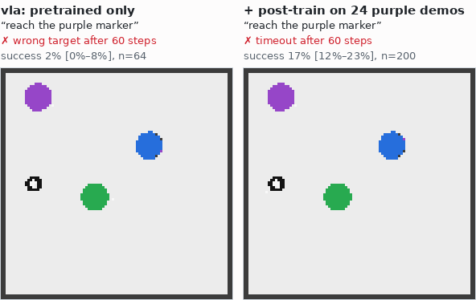

# 04 · Post-training: specialise to the target task

[← README](../../README.md#the-eight-stages) · previous: [03 VLA](03_vla.md) · next: [05 RL →](05_rl.md)

A pretrained generalist rarely does the target task well out of the box. Post-training fine-tunes it on
a small set of target demonstrations. The recipes differ in what trains: everything; only the action
expert with the VLM frozen, as in GR00T N1.5 [[1](#ref-1), [2](#ref-2)]; only the head; or LoRA adapters
on the VLM [[3](#ref-3)], which is how OpenVLA fine-tunes [[4](#ref-4)]. Mixing the old data back in guards
against forgetting. Recomputing the quantile normalisation stats on the new data matters when the action
range or the robot changes. 1st/99th-percentile bounds are what OpenVLA's action bins [[4](#ref-4)] and the
FAST tokenizer [[5](#ref-5)] use too.



*Same seed, unseen colour. The pretrained policy succeeds 2% of the time on purple. After 300 steps of
full fine-tuning on the 24 purple demos mixed with the original data, it succeeds 17% of the time over
200 episodes (measured by `vlab run eval_post`, see [running a single stage](../running.md#2-on-its-own)).
The 28% in the [results table](../results.md) is RL's own 64-episode check of the same checkpoint.*

## Nodes and components

| node | what it does |
|---|---|
| `post_train/finetune` | fine-tunes a pretrained VLA on target data with one of four `method`s, optionally re-computing normalisation stats |

| `method` | what trains | from |
|---|---|---|
| `full` | everything (best with compute) | |
| `frozen_backbone` | action expert + encoders; the VLM is frozen | GR00T N1.5 [[2](#ref-2)] |
| `head_only` | only the action head | |
| `lora` | LoRA adapters on the VLM [[3](#ref-3)] + the full head; merged before saving | OpenVLA [[4](#ref-4)] |

Code: [src/vlalab/stages/post_train.py](../../src/vlalab/stages/post_train.py),
[src/vlalab/policy/normalize.py](../../src/vlalab/policy/normalize.py).

## Run it

```bash
vlab run reach_smoke --only post post.method=frozen_backbone post.train.steps=600
vlab run eval_post --force eval                      # evaluate the new post-trained checkpoint on its own
```

`eval_post` is the standalone eval pipeline from [running a single stage](../running.md#2-on-its-own).

## Configure it

```yaml
  post:
    impl: post_train/finetune
    inputs:
      policy: vla.policy
      dataset: [data_new.dataset, data.dataset]      # the new task + the old data (against forgetting)
    params:
      method: full                 # full | frozen_backbone (GR00T N1.5) | head_only | lora (OpenVLA)
      restat: true                 # recompute normalisation stats on the new data
      train: {steps: 300, lr: 1.0e-4, warmup: 50}
```

## Hands on

Output port `policy`, a checkpoint folder in the same format as [03 VLA](03_vla.md).

## Papers in this stage

| paper | status | where |
|---|---|---|
| Full fine-tune | native | `method: full` |
| Frozen VLM + trained expert, GR00T N1.5 [[1](#ref-1), [2](#ref-2)] | native | `method: frozen_backbone` |
| LoRA on the VLM [[3](#ref-3)], as in OpenVLA [[4](#ref-4)] | native | `method: lora` |
| Quantile action normalisation [[4](#ref-4), [5](#ref-5)] | native | `restat: true`, [normalize.py](../../src/vlalab/policy/normalize.py) |
| Data curation / filtering of hesitant demos | planned | open slot |

*native*: implemented in this repo. *planned*: an open slot; `vlab new post_train <name>` scaffolds it
([adding components](../adding_components.md)).

## References

1. <a id="ref-1"></a>NVIDIA, J. Bjorck, F. Castañeda, et al. *GR00T N1: An Open Foundation Model for Generalist Humanoid Robots.* arXiv preprint, 2025. [arXiv:2503.14734](https://arxiv.org/abs/2503.14734)
2. <a id="ref-2"></a>NVIDIA. *GR00T N1.5.* Project page, 2025. [research.nvidia.com/labs/gear/gr00t-n1_5](https://research.nvidia.com/labs/gear/gr00t-n1_5/)
3. <a id="ref-3"></a>E. J. Hu, Y. Shen, P. Wallis, et al. *LoRA: Low-Rank Adaptation of Large Language Models.* ICLR 2022. [arXiv:2106.09685](https://arxiv.org/abs/2106.09685)
4. <a id="ref-4"></a>M. J. Kim, K. Pertsch, S. Karamcheti, et al. *OpenVLA: An Open-Source Vision-Language-Action Model.* CoRL 2024. [arXiv:2406.09246](https://arxiv.org/abs/2406.09246)
5. <a id="ref-5"></a>K. Pertsch, K. Stachowicz, B. Ichter, et al. *FAST: Efficient Action Tokenization for Vision-Language-Action Models.* arXiv preprint, 2025. [arXiv:2501.09747](https://arxiv.org/abs/2501.09747)

<details>
<summary>BibTeX for this page</summary>

```bibtex
@article{nvidia2025groot,
  title         = {{GR00T N1: An Open Foundation Model for Generalist Humanoid Robots}},
  author        = {{NVIDIA} and Johan Bjorck and Fernando Castañeda and Nikita Cherniadev and Xingye Da and Runyu Ding and Linxi Fan and Yu Fang and Dieter Fox and Fengyuan Hu and others},
  journal       = {arXiv preprint arXiv:2503.14734},
  year          = {2025},
  eprint        = {2503.14734},
  archivePrefix = {arXiv},
  url           = {https://arxiv.org/abs/2503.14734}
}

@misc{nvidia2025grootn15,
  title         = {{GR00T N1.5}},
  author        = {{NVIDIA}},
  howpublished  = {\url{https://research.nvidia.com/labs/gear/gr00t-n1_5/}},
  note          = {Project page},
  year          = {2025}
}

@inproceedings{hu2022lora,
  title         = {{LoRA: Low-Rank Adaptation of Large Language Models}},
  author        = {Edward J. Hu and Yelong Shen and Phillip Wallis and Zeyuan Allen-Zhu and Yuanzhi Li and Shean Wang and Lu Wang and Weizhu Chen},
  booktitle     = {International Conference on Learning Representations (ICLR)},
  year          = {2022},
  eprint        = {2106.09685},
  archivePrefix = {arXiv},
  url           = {https://arxiv.org/abs/2106.09685}
}

@inproceedings{kim2024openvla,
  title         = {{OpenVLA: An Open-Source Vision-Language-Action Model}},
  author        = {Moo Jin Kim and Karl Pertsch and Siddharth Karamcheti and Ted Xiao and Ashwin Balakrishna and Suraj Nair and Rafael Rafailov and Ethan Foster and Grace Lam and Pannag Sanketi and Quan Vuong and Thomas Kollar and Benjamin Burchfiel and Russ Tedrake and Dorsa Sadigh and Sergey Levine and Percy Liang and Chelsea Finn},
  booktitle     = {Conference on Robot Learning (CoRL)},
  year          = {2024},
  eprint        = {2406.09246},
  archivePrefix = {arXiv},
  url           = {https://arxiv.org/abs/2406.09246}
}

@article{pertsch2025fast,
  title         = {{FAST: Efficient Action Tokenization for Vision-Language-Action Models}},
  author        = {Karl Pertsch and Kyle Stachowicz and Brian Ichter and Danny Driess and Suraj Nair and Quan Vuong and Oier Mees and Chelsea Finn and Sergey Levine},
  journal       = {arXiv preprint arXiv:2501.09747},
  year          = {2025},
  eprint        = {2501.09747},
  archivePrefix = {arXiv},
  url           = {https://arxiv.org/abs/2501.09747}
}
```

</details>
