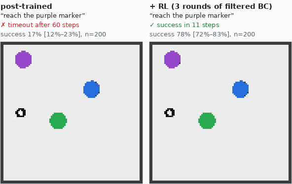

# 05 · RL: improve from the policy's own attempts

[← README](../../README.md#the-eight-stages) · previous: [04 Post-training](04_post_train.md) · next: [06 Evaluation →](06_eval.md)

Demonstrations only take a policy so far. RL lets it learn from its own rollouts, with a success signal
from the env. Two families are implemented:

- **Filtered self-imitation** (`rl/filtered_bc`): roll out, keep the successful episodes, fine-tune on
  them plus the demos, repeat. This is ReST-style self-training [[1](#ref-1)] and reward-weighted regression
  [[2](#ref-2)] with a binary reward, the simplest member of the family that SimpleVLA-RL [[3](#ref-3)] and
  π\*0.6's Recap [[4](#ref-4)] belong to.
- **DSRL** (`rl/dsrl`) [[5](#ref-5)]: the policy's weights stay frozen. A small Gaussian policy learns which
  *input noise* to feed the flow-matching head, trained with REINFORCE on episode success. It needs a
  flow or diffusion head ([03 VLA](03_vla.md)).



*`rl/filtered_bc` rolls the post-trained policy out on purple, keeps the successful episodes and
fine-tunes on them. After three rounds, success on its 64 check episodes goes 28% → 45% → 67% → 80%,
and the 200-episode eval reaches 78%.*

## Nodes and components

| node | what it does | from |
|---|---|---|
| `rl/filtered_bc` | rollout (with exploration noise) → keep successes → fine-tune on them + the demos, repeat. Success should climb each iteration | ReST [[1](#ref-1)], RWR [[2](#ref-2)] |
| `rl/dsrl` | RL in the latent-noise space of a frozen flow policy (REINFORCE on success). Weights never change | DSRL [[5](#ref-5)] |

Code: [src/vlalab/stages/rl.py](../../src/vlalab/stages/rl.py),
[src/vlalab/policy/dsrl.py](../../src/vlalab/policy/dsrl.py).

## Run it

```bash
vlab run reach_smoke --only rl,eval rl.iterations=5 rl.episodes_per_iter=128
```

## Configure it

```yaml
  rl:
    impl: rl/filtered_bc           # ReST / RWR-style: roll out, keep successes, fine-tune, repeat
    inputs: {policy: post.policy, dataset: data_new.dataset}   # demos stay in the mix (demo_weight)
    params: {iterations: 3, episodes_per_iter: 64, env_overrides: {goal_colors: [purple]}, train: {steps: 200}}
  dsrl:
    impl: rl/dsrl                  # DSRL: weights stay frozen, it learns the flow policy's input noise
    inputs: {policy: post.policy}
    params: {iterations: 20, episodes_per_iter: 32, env_overrides: {goal_colors: [purple]}}
```

RL needs an env that reports success.

## Hands on

Output port `policy`, plus `history.json` (success per round). A DSRL checkpoint also holds `dsrl.pt`,
which eval and deploy load automatically.

## Papers in this stage

| paper | status | where |
|---|---|---|
| Filtered self-imitation, ReST [[1](#ref-1)] / RWR [[2](#ref-2)] family | native | `rl/filtered_bc` |
| DSRL: RL in the latent-noise space [[5](#ref-5)] | native | `rl/dsrl` |
| SimpleVLA-RL: GRPO with binary success [[3](#ref-3)] | planned | open slot |
| π\*0.6 Recap: advantage-conditioned policy + value function [[4](#ref-4)] | planned | open slot |
| HIL-SERL: human-in-the-loop RL [[6](#ref-6)] | via LeRobot | LeRobot's `hilserl` |
| Residual RL on top of a frozen VLA | planned | open slot |

*native*: implemented in this repo. *via LeRobot*: runs in LeRobot [[7](#ref-7)]. *planned*: an open slot;
`vlab new rl <name>` scaffolds it ([adding components](../adding_components.md#3-a-new-stage-node)).

## References

1. <a id="ref-1"></a>C. Gulcehre, T. Le Paine, S. Srinivasan, et al. *Reinforced Self-Training (ReST) for Language Modeling.* arXiv preprint, 2023. [arXiv:2308.08998](https://arxiv.org/abs/2308.08998)
2. <a id="ref-2"></a>J. Peters and S. Schaal. *Reinforcement Learning by Reward-Weighted Regression for Operational Space Control.* ICML 2007. [doi:10.1145/1273496.1273590](https://doi.org/10.1145/1273496.1273590)
3. <a id="ref-3"></a>H. Li, Y. Zuo, J. Yu, et al. *SimpleVLA-RL: Scaling VLA Training via Reinforcement Learning.* arXiv preprint, 2025. [arXiv:2509.09674](https://arxiv.org/abs/2509.09674)
4. <a id="ref-4"></a>Physical Intelligence, A. Amin, R. Aniceto, et al. *π\*0.6: a VLA That Learns From Experience.* arXiv preprint, 2025. [arXiv:2511.14759](https://arxiv.org/abs/2511.14759)
5. <a id="ref-5"></a>A. Wagenmaker, M. Nakamoto, Y. Zhang, et al. *Steering Your Diffusion Policy with Latent Space Reinforcement Learning.* arXiv preprint, 2025. [arXiv:2506.15799](https://arxiv.org/abs/2506.15799)
6. <a id="ref-6"></a>J. Luo, C. Xu, J. Wu, and S. Levine. *Precise and Dexterous Robotic Manipulation via Human-in-the-Loop Reinforcement Learning.* arXiv preprint, 2024. [arXiv:2410.21845](https://arxiv.org/abs/2410.21845)
7. <a id="ref-7"></a>R. Cadene, S. Alibert, F. Capuano, et al. *LeRobot: An Open-Source Library for End-to-End Robot Learning.* ICLR 2026. [arXiv:2602.22818](https://arxiv.org/abs/2602.22818)

<details>
<summary>BibTeX for this page</summary>

```bibtex
@article{gulcehre2023rest,
  title         = {{Reinforced Self-Training (ReST) for Language Modeling}},
  author        = {Caglar Gulcehre and Le Paine, Tom and Srivatsan Srinivasan and Ksenia Konyushkova and Lotte Weerts and Abhishek Sharma and Aditya Siddhant and Alex Ahern and Miaosen Wang and Chenjie Gu and Wolfgang Macherey and Arnaud Doucet and Orhan Firat and Nando de Freitas},
  journal       = {arXiv preprint arXiv:2308.08998},
  year          = {2023},
  eprint        = {2308.08998},
  archivePrefix = {arXiv},
  url           = {https://arxiv.org/abs/2308.08998}
}

@inproceedings{peters2007rwr,
  title         = {{Reinforcement Learning by Reward-Weighted Regression for Operational Space Control}},
  author        = {Jan Peters and Stefan Schaal},
  booktitle     = {International Conference on Machine Learning (ICML)},
  pages         = {745--750},
  year          = {2007},
  doi           = {10.1145/1273496.1273590}
}

@article{li2025simplevlarl,
  title         = {{SimpleVLA-RL: Scaling VLA Training via Reinforcement Learning}},
  author        = {Haozhan Li and Yuxin Zuo and Jiale Yu and Yuhao Zhang and Zhaohui Yang and Kaiyan Zhang and Xuekai Zhu and Yuchen Zhang and Tianxing Chen and Ganqu Cui and Dehui Wang and Dingxiang Luo and Yuchen Fan and Youbang Sun and Jia Zeng and Jiangmiao Pang and Shanghang Zhang and Yu Wang and Yao Mu and Bowen Zhou and Ning Ding},
  journal       = {arXiv preprint arXiv:2509.09674},
  year          = {2025},
  eprint        = {2509.09674},
  archivePrefix = {arXiv},
  url           = {https://arxiv.org/abs/2509.09674}
}

@article{pi2025pistar06,
  title         = {{{$\pi^{*}_{0.6}$}: a {VLA} That Learns From Experience}},
  author        = {{Physical Intelligence} and Ali Amin and Raichelle Aniceto and Ashwin Balakrishna and Kevin Black and Ken Conley and Grace Connors and James Darpinian and Karan Dhabalia and Jared DiCarlo and others},
  journal       = {arXiv preprint arXiv:2511.14759},
  year          = {2025},
  eprint        = {2511.14759},
  archivePrefix = {arXiv},
  url           = {https://arxiv.org/abs/2511.14759}
}

@article{wagenmaker2025dsrl,
  title         = {{Steering Your Diffusion Policy with Latent Space Reinforcement Learning}},
  author        = {Andrew Wagenmaker and Mitsuhiko Nakamoto and Yunchu Zhang and Seohong Park and Waleed Yagoub and Anusha Nagabandi and Abhishek Gupta and Sergey Levine},
  journal       = {arXiv preprint arXiv:2506.15799},
  year          = {2025},
  eprint        = {2506.15799},
  archivePrefix = {arXiv},
  url           = {https://arxiv.org/abs/2506.15799}
}

@article{luo2024hilserl,
  title         = {{Precise and Dexterous Robotic Manipulation via Human-in-the-Loop Reinforcement Learning}},
  author        = {Jianlan Luo and Charles Xu and Jeffrey Wu and Sergey Levine},
  journal       = {arXiv preprint arXiv:2410.21845},
  year          = {2024},
  eprint        = {2410.21845},
  archivePrefix = {arXiv},
  url           = {https://arxiv.org/abs/2410.21845}
}

@inproceedings{cadene2026lerobot,
  title         = {{LeRobot: An Open-Source Library for End-to-End Robot Learning}},
  author        = {Remi Cadene and Simon Alibert and Francesco Capuano and Michel Aractingi and Adil Zouitine and Pepijn Kooijmans and Jade Choghari and Martino Russi and Caroline Pascal and Steven Palma and Mustafa Shukor and Jess Moss and Alexander Soare and Dana Aubakirova and Quentin Lhoest and Quentin Gallouédec and Thomas Wolf},
  booktitle     = {International Conference on Learning Representations (ICLR)},
  year          = {2026},
  eprint        = {2602.22818},
  archivePrefix = {arXiv},
  url           = {https://arxiv.org/abs/2602.22818}
}
```

</details>
