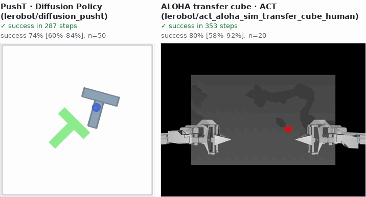

# 06 · Evaluation: honest numbers

[← README](../../README.md#the-eight-stages) · previous: [05 RL](05_rl.md) · next: [07 Edge →](07_edge.md)

A success rate from 20 episodes can be off by 20 points, so every closed-loop number here comes with a
95% Wilson score interval [[1](#ref-1)], per-task success and a label for each failure. Evaluation is in
simulation, as in LIBERO [[2](#ref-2)] and SimplerEnv [[3](#ref-3)], and rollouts are seeded, so two
policies face the same scenes. The
same eval node runs native checkpoints and published LeRobot ones [[4](#ref-4)], such as Diffusion Policy
in PushT [[5](#ref-5), [6](#ref-6)] and ACT in the ALOHA sim [[7](#ref-7)]. A gate node blocks a build that
regresses against a baseline, which is what keeps a bad edge build ([07](07_edge.md)) from being
deployed ([08](08_deploy.md)).



*Published LeRobot checkpoints run through the same eval node as native policies: Diffusion Policy in
PushT (`pusht_lerobot`) and ACT in the ALOHA sim (`aloha_lerobot`). Success rates come with 95% Wilson
intervals.*

## Nodes and components

| node | what it does |
|---|---|
| `eval/sim_rollout` | N seeded rollouts → success rate with a 95% Wilson interval [[1](#ref-1)], per-task success, failure triage, videos. Native or LeRobot policies |
| `eval/offline` | action MSE / L1 on held-out demos. Cheap, and only loosely tied to real success (used where no simulator exists, see [the SO-100 example](../hardware.md#example-an-so-100-arm-from-real-demos-to-the-30-hz-loop)) |
| `eval/gate` | compares a candidate report to a baseline and fails (or flags) a regression |

The simulators come from `env/reach2d` (built in) and `env/gym`, which wraps any gymnasium env: PushT,
the ALOHA sim, LIBERO, Meta-World [[8](#ref-8)] ...

Code: [src/vlalab/stages/evaluate.py](../../src/vlalab/stages/evaluate.py),
[src/vlalab/runtime/rollout.py](../../src/vlalab/runtime/rollout.py).

## Run it

```bash
vlab run reach_smoke --only eval eval.episodes=500   # more episodes, tighter interval
vlab run pusht_lerobot --only eval_baseline          # a Hub checkpoint, no training (~3 min)
vlab compare runs/reach_smoke runs/reach_full        # every node's metrics side by side
```

To evaluate one checkpoint on its own, outside its pipeline, see
[running a single stage](../running.md#2-on-its-own).

## Configure it

```yaml
  eval:
    impl: eval/sim_rollout
    inputs: {policy: rl.policy}    # or {format: lerobot, path: lerobot/diffusion_pusht, dataset_repo: lerobot/pusht}
    params:
      episodes: 200
      env_overrides: {goal_colors: [purple]}
      chunker: {type: temporal_ensemble}           # how chunks are executed: sync | temporal_ensemble | rtc_blend
      runtime: {num_steps: 5}                      # inference options, as the edge stage would set them
      videos: 4
  gate:
    impl: eval/gate                # block a build that regresses against a baseline report
    inputs: {candidate: eval_edge.report, baseline: eval.report, policy: edge.policy}
    params: {max_drop: 0.05}
```

The chunkers are described in [08 Deploy](08_deploy.md).

## Hands on

`report.json` holds the success rate, its 95% interval, per-task success, failure labels
(`wrong_target`, `timeout` ...) and one row per episode, next to `rollout_<i>_{ok,fail}.mp4`.
`eval/offline` gives action MSE / L1 on held-out demos instead. `eval/gate` passes its `policy` input
through only when the candidate holds up, so wiring `deploy` to `gate.policy` means a regressed build
never deploys.

## Papers in this stage

| paper | status | where |
|---|---|---|
| Seeded sim rollouts + 95% Wilson interval [[1](#ref-1)] + failure triage | native | `eval/sim_rollout` |
| Offline action error on held-out demos | native | `eval/offline` |
| Regression gate between builds | native | `eval/gate` |
| PushT [[6](#ref-6), [5](#ref-5)] / ALOHA [[7](#ref-7)] / LIBERO [[2](#ref-2)] / Meta-World [[8](#ref-8)] sims via gymnasium | native | `env/gym` |
| SimplerEnv: real-to-sim matched evaluation [[3](#ref-3)] | planned | open slot |
| RoboArena-style pairwise A/B comparisons [[9](#ref-9)] | planned | open slot |

*native*: implemented in this repo. *planned*: an open slot; `vlab new eval <name>` scaffolds it, and
[adding components](../adding_components.md#3-a-new-stage-node) builds an eval node as its worked example.

## References

1. <a id="ref-1"></a>E. B. Wilson. *Probable Inference, the Law of Succession, and Statistical Inference.* *Journal of the American Statistical Association* 22(158):209–212, 1927. [doi:10.1080/01621459.1927.10502953](https://doi.org/10.1080/01621459.1927.10502953)
2. <a id="ref-2"></a>B. Liu, Y. Zhu, C. Gao, et al. *LIBERO: Benchmarking Knowledge Transfer for Lifelong Robot Learning.* NeurIPS D&B 2023. [arXiv:2306.03310](https://arxiv.org/abs/2306.03310)
3. <a id="ref-3"></a>X. Li, K. Hsu, J. Gu, et al. *Evaluating Real-World Robot Manipulation Policies in Simulation.* CoRL 2024. [arXiv:2405.05941](https://arxiv.org/abs/2405.05941)
4. <a id="ref-4"></a>R. Cadene, S. Alibert, F. Capuano, et al. *LeRobot: An Open-Source Library for End-to-End Robot Learning.* ICLR 2026. [arXiv:2602.22818](https://arxiv.org/abs/2602.22818)
5. <a id="ref-5"></a>C. Chi, Z. Xu, S. Feng, et al. *Diffusion Policy: Visuomotor Policy Learning via Action Diffusion.* RSS 2023. [arXiv:2303.04137](https://arxiv.org/abs/2303.04137)
6. <a id="ref-6"></a>P. Florence, C. Lynch, A. Zeng, et al. *Implicit Behavioral Cloning.* CoRL 2021. [arXiv:2109.00137](https://arxiv.org/abs/2109.00137)
7. <a id="ref-7"></a>T. Z. Zhao, V. Kumar, S. Levine, and C. Finn. *Learning Fine-Grained Bimanual Manipulation with Low-Cost Hardware.* RSS 2023. [arXiv:2304.13705](https://arxiv.org/abs/2304.13705)
8. <a id="ref-8"></a>T. Yu, D. Quillen, Z. He, et al. *Meta-World: A Benchmark and Evaluation for Multi-Task and Meta Reinforcement Learning.* CoRL 2019. [arXiv:1910.10897](https://arxiv.org/abs/1910.10897)
9. <a id="ref-9"></a>P. Atreya, K. Pertsch, T. Lee, et al. *RoboArena: Distributed Real-World Evaluation of Generalist Robot Policies.* arXiv preprint, 2025. [arXiv:2506.18123](https://arxiv.org/abs/2506.18123)

<details>
<summary>BibTeX for this page</summary>

```bibtex
@article{wilson1927probable,
  title         = {{Probable Inference, the Law of Succession, and Statistical Inference}},
  author        = {Edwin B. Wilson},
  journal       = {Journal of the American Statistical Association},
  volume        = {22},
  number        = {158},
  pages         = {209--212},
  year          = {1927},
  doi           = {10.1080/01621459.1927.10502953}
}

@inproceedings{liu2023libero,
  title         = {{LIBERO: Benchmarking Knowledge Transfer for Lifelong Robot Learning}},
  author        = {Bo Liu and Yifeng Zhu and Chongkai Gao and Yihao Feng and Qiang Liu and Yuke Zhu and Peter Stone},
  booktitle     = {NeurIPS Datasets and Benchmarks Track},
  year          = {2023},
  eprint        = {2306.03310},
  archivePrefix = {arXiv},
  url           = {https://arxiv.org/abs/2306.03310}
}

@inproceedings{li2024simplerenv,
  title         = {{Evaluating Real-World Robot Manipulation Policies in Simulation}},
  author        = {Xuanlin Li and Kyle Hsu and Jiayuan Gu and Karl Pertsch and Oier Mees and Homer Rich Walke and Chuyuan Fu and Ishikaa Lunawat and Isabel Sieh and Sean Kirmani and Sergey Levine and Jiajun Wu and Chelsea Finn and Hao Su and Quan Vuong and Ted Xiao},
  booktitle     = {Conference on Robot Learning (CoRL)},
  year          = {2024},
  eprint        = {2405.05941},
  archivePrefix = {arXiv},
  url           = {https://arxiv.org/abs/2405.05941}
}

@inproceedings{cadene2026lerobot,
  title         = {{LeRobot: An Open-Source Library for End-to-End Robot Learning}},
  author        = {Remi Cadene and Simon Alibert and Francesco Capuano and Michel Aractingi and Adil Zouitine and Pepijn Kooijmans and Jade Choghari and Martino Russi and Caroline Pascal and Steven Palma and Mustafa Shukor and Jess Moss and Alexander Soare and Dana Aubakirova and Quentin Lhoest and Quentin Gallouédec and Thomas Wolf},
  booktitle     = {International Conference on Learning Representations (ICLR)},
  year          = {2026},
  eprint        = {2602.22818},
  archivePrefix = {arXiv},
  url           = {https://arxiv.org/abs/2602.22818}
}

@inproceedings{chi2023diffusion,
  title         = {{Diffusion Policy: Visuomotor Policy Learning via Action Diffusion}},
  author        = {Cheng Chi and Zhenjia Xu and Siyuan Feng and Eric Cousineau and Yilun Du and Benjamin Burchfiel and Russ Tedrake and Shuran Song},
  booktitle     = {Robotics: Science and Systems (RSS)},
  year          = {2023},
  eprint        = {2303.04137},
  archivePrefix = {arXiv},
  url           = {https://arxiv.org/abs/2303.04137}
}

@inproceedings{florence2021ibc,
  title         = {{Implicit Behavioral Cloning}},
  author        = {Pete Florence and Corey Lynch and Andy Zeng and Oscar Ramirez and Ayzaan Wahid and Laura Downs and Adrian Wong and Johnny Lee and Igor Mordatch and Jonathan Tompson},
  booktitle     = {Conference on Robot Learning (CoRL)},
  year          = {2021},
  eprint        = {2109.00137},
  archivePrefix = {arXiv},
  url           = {https://arxiv.org/abs/2109.00137}
}

@inproceedings{zhao2023act,
  title         = {{Learning Fine-Grained Bimanual Manipulation with Low-Cost Hardware}},
  author        = {Tony Z. Zhao and Vikash Kumar and Sergey Levine and Chelsea Finn},
  booktitle     = {Robotics: Science and Systems (RSS)},
  year          = {2023},
  eprint        = {2304.13705},
  archivePrefix = {arXiv},
  url           = {https://arxiv.org/abs/2304.13705}
}

@inproceedings{yu2019metaworld,
  title         = {{Meta-World: A Benchmark and Evaluation for Multi-Task and Meta Reinforcement Learning}},
  author        = {Tianhe Yu and Deirdre Quillen and Zhanpeng He and Ryan Julian and Avnish Narayan and Hayden Shively and Adithya Bellathur and Karol Hausman and Chelsea Finn and Sergey Levine},
  booktitle     = {Conference on Robot Learning (CoRL)},
  year          = {2019},
  eprint        = {1910.10897},
  archivePrefix = {arXiv},
  url           = {https://arxiv.org/abs/1910.10897}
}

@article{atreya2025roboarena,
  title         = {{RoboArena: Distributed Real-World Evaluation of Generalist Robot Policies}},
  author        = {Pranav Atreya and Karl Pertsch and Tony Lee and Moo Jin Kim and Arhan Jain and Artur Kuramshin and Clemens Eppner and Cyrus Neary and Edward Hu and Fabio Ramos and others},
  journal       = {arXiv preprint arXiv:2506.18123},
  year          = {2025},
  eprint        = {2506.18123},
  archivePrefix = {arXiv},
  url           = {https://arxiv.org/abs/2506.18123}
}
```

</details>
