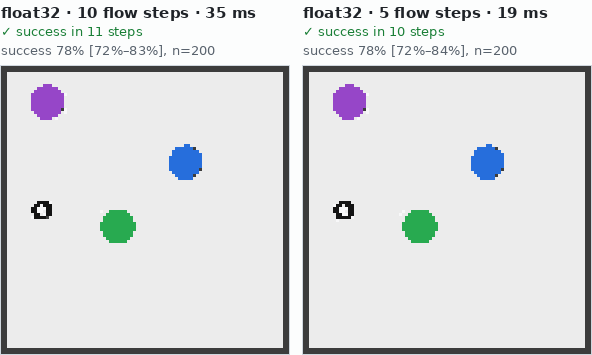

# 07 · Edge: make inference fast enough

[← README](../../README.md#the-eight-stages) · previous: [06 Evaluation](06_eval.md) · next: [08 Deploy →](08_deploy.md)

A policy that plans a 50-step chunk still has to produce it before the robot runs out of actions. This
stage benchmarks inference variants on the machine it runs on and ships the chosen one: lower precision
(bf16 [[1](#ref-1)]), fewer flow-matching or diffusion steps (π0 integrates its flow in 10 [[2](#ref-2)]),
`torch.compile` [[3](#ref-3)], and int8 dynamic quantisation [[4](#ref-4)] for CPU inference. Compression that
looks free can cost success, so the pipeline evaluates again afterwards and gates the build
([06 Evaluation](06_eval.md)).



*Same seed before and after `edge/optimize` switched to 5 flow-matching steps instead of 10. Median
latency drops from 35 to 19 ms and success holds (78% before, 78.5% after, n=200), so the gate passes.*

## Nodes and components

| node | what it does |
|---|---|
| `edge/optimize` | benchmarks dtype / flow-step / compile / int8 variants on this machine and ships one via `runtime.yaml` |

| variant option | what it does | from |
|---|---|---|
| `dtype: bfloat16` / `float16` | lower-precision inference | [[1](#ref-1)] |
| `num_steps: N` | fewer flow / diffusion integration steps | π0 [[2](#ref-2)], flow matching [[5](#ref-5)] |
| `compile: true` | `torch.compile` of the action expert | PyTorch 2 [[3](#ref-3)] |
| `quantize: int8_dynamic` / `int8_weight` | int8 action head: dynamic on the CPU, or weight-only with torchao | [[4](#ref-4)] |

Code: [src/vlalab/stages/edge.py](../../src/vlalab/stages/edge.py).

## Run it

```bash
vlab run reach_smoke --only edge,eval_edge,gate edge.choose=fastest
cat runs/reach_smoke/edge/benchmark.json             # p50 / p95 latency of every variant
```

## Configure it

```yaml
  edge:
    impl: edge/optimize
    inputs: {policy: rl.policy}
    params:
      choose: fp32_5steps          # a variant name, or fastest
      variants:                    # each one is benchmarked on this machine
        fp32: {dtype: float32}
        fp32_5steps: {dtype: float32, num_steps: 5}
        bf16_5steps_compile: {dtype: bfloat16, num_steps: 5, compile: true}
        int8_cpu: {quantize: int8_dynamic}            # int8 action head, CPU inference
```

## Hands on

A checkpoint folder whose `runtime.yaml` holds the chosen options. Eval and deploy apply them
automatically. Evaluate again afterwards (`eval_edge` + `gate`), because compression that looks free
can cost success.

## Papers in this stage

| paper | status | where |
|---|---|---|
| bf16 / fp16 inference [[1](#ref-1)] | native | `dtype` |
| Fewer flow / diffusion steps [[2](#ref-2)] | native | `num_steps` |
| `torch.compile` of the action expert [[3](#ref-3)] | native | `compile` |
| int8 dynamic (CPU) / int8 weight-only (torchao) [[4](#ref-4)] | native | `quantize` |
| Prefix KV caching: re-run only the expert while denoising, as in π0 [[2](#ref-2)] | planned | open slot |
| ONNX / TensorRT export for Jetson | planned | open slot |
| System 2 / System 1 split: GR00T N1 [[6](#ref-6)], Helix [[7](#ref-7)] | planned | open slot |

*native*: implemented in this repo. *planned*: an open slot; `vlab new edge <name>` scaffolds it
([adding components](../adding_components.md)).

## References

1. <a id="ref-1"></a>D. Kalamkar, D. Mudigere, N. Mellempudi, et al. *A Study of BFLOAT16 for Deep Learning Training.* arXiv preprint, 2019. [arXiv:1905.12322](https://arxiv.org/abs/1905.12322)
2. <a id="ref-2"></a>K. Black, N. Brown, D. Driess, et al. *π0: A Vision-Language-Action Flow Model for General Robot Control.* RSS 2025. [arXiv:2410.24164](https://arxiv.org/abs/2410.24164)
3. <a id="ref-3"></a>J. Ansel, E. Yang, H. He, et al. *PyTorch 2: Faster Machine Learning Through Dynamic Python Bytecode Transformation and Graph Compilation.* ASPLOS 2024. [doi:10.1145/3620665.3640366](https://doi.org/10.1145/3620665.3640366)
4. <a id="ref-4"></a>B. Jacob, S. Kligys, B. Chen, et al. *Quantization and Training of Neural Networks for Efficient Integer-Arithmetic-Only Inference.* CVPR 2018. [arXiv:1712.05877](https://arxiv.org/abs/1712.05877)
5. <a id="ref-5"></a>Y. Lipman, R. T. Q. Chen, H. Ben-Hamu, M. Nickel, and M. Le. *Flow Matching for Generative Modeling.* ICLR 2023. [arXiv:2210.02747](https://arxiv.org/abs/2210.02747)
6. <a id="ref-6"></a>NVIDIA, J. Bjorck, F. Castañeda, et al. *GR00T N1: An Open Foundation Model for Generalist Humanoid Robots.* arXiv preprint, 2025. [arXiv:2503.14734](https://arxiv.org/abs/2503.14734)
7. <a id="ref-7"></a>Figure AI. *Helix: A Vision-Language-Action Model for Generalist Humanoid Control.* Blog post, 2025. [figure.ai/news/helix](https://www.figure.ai/news/helix)

<details>
<summary>BibTeX for this page</summary>

```bibtex
@article{kalamkar2019bfloat16,
  title         = {{A Study of BFLOAT16 for Deep Learning Training}},
  author        = {Dhiraj Kalamkar and Dheevatsa Mudigere and Naveen Mellempudi and Dipankar Das and Kunal Banerjee and Sasikanth Avancha and Dharma Teja Vooturi and Nataraj Jammalamadaka and Jianyu Huang and Hector Yuen and Jiyan Yang and Jongsoo Park and Alexander Heinecke and Evangelos Georganas and Sudarshan Srinivasan and Abhisek Kundu and Misha Smelyanskiy and Bharat Kaul and Pradeep Dubey},
  journal       = {arXiv preprint arXiv:1905.12322},
  year          = {2019},
  eprint        = {1905.12322},
  archivePrefix = {arXiv},
  url           = {https://arxiv.org/abs/1905.12322}
}

@inproceedings{black2025pi0,
  title         = {{{$\pi_0$}: A Vision-Language-Action Flow Model for General Robot Control}},
  author        = {Kevin Black and Noah Brown and Danny Driess and Adnan Esmail and Michael Equi and Chelsea Finn and Niccolo Fusai and Lachy Groom and Karol Hausman and Brian Ichter and Szymon Jakubczak and Tim Jones and Liyiming Ke and Sergey Levine and Adrian Li-Bell and Mohith Mothukuri and Suraj Nair and Karl Pertsch and Lucy Xiaoyang Shi and James Tanner and Quan Vuong and Anna Walling and Haohuan Wang and Ury Zhilinsky},
  booktitle     = {Robotics: Science and Systems (RSS)},
  year          = {2025},
  eprint        = {2410.24164},
  archivePrefix = {arXiv},
  url           = {https://arxiv.org/abs/2410.24164}
}

@inproceedings{ansel2024pytorch2,
  title         = {{PyTorch 2: Faster Machine Learning Through Dynamic Python Bytecode Transformation and Graph Compilation}},
  author        = {Jason Ansel and Edward Yang and Horace He and Natalia Gimelshein and Animesh Jain and Michael Voznesensky and Bin Bao and Peter Bell and David Berard and Evgeni Burovski and others},
  booktitle     = {ACM International Conference on Architectural Support for Programming Languages and Operating Systems (ASPLOS)},
  pages         = {929--947},
  year          = {2024},
  doi           = {10.1145/3620665.3640366}
}

@inproceedings{jacob2018quantization,
  title         = {{Quantization and Training of Neural Networks for Efficient Integer-Arithmetic-Only Inference}},
  author        = {Benoit Jacob and Skirmantas Kligys and Bo Chen and Menglong Zhu and Matthew Tang and Andrew Howard and Hartwig Adam and Dmitry Kalenichenko},
  booktitle     = {IEEE/CVF Conference on Computer Vision and Pattern Recognition (CVPR)},
  year          = {2018},
  eprint        = {1712.05877},
  archivePrefix = {arXiv},
  url           = {https://arxiv.org/abs/1712.05877}
}

@inproceedings{lipman2023flow,
  title         = {{Flow Matching for Generative Modeling}},
  author        = {Yaron Lipman and Ricky T. Q. Chen and Heli Ben-Hamu and Maximilian Nickel and Matt Le},
  booktitle     = {International Conference on Learning Representations (ICLR)},
  year          = {2023},
  eprint        = {2210.02747},
  archivePrefix = {arXiv},
  url           = {https://arxiv.org/abs/2210.02747}
}

@article{nvidia2025groot,
  title         = {{GR00T N1: An Open Foundation Model for Generalist Humanoid Robots}},
  author        = {{NVIDIA} and Johan Bjorck and Fernando Castañeda and Nikita Cherniadev and Xingye Da and Runyu Ding and Linxi Fan and Yu Fang and Dieter Fox and Fengyuan Hu and others},
  journal       = {arXiv preprint arXiv:2503.14734},
  year          = {2025},
  eprint        = {2503.14734},
  archivePrefix = {arXiv},
  url           = {https://arxiv.org/abs/2503.14734}
}

@misc{figure2025helix,
  title         = {{Helix: A Vision-Language-Action Model for Generalist Humanoid Control}},
  author        = {{Figure AI}},
  howpublished  = {\url{https://www.figure.ai/news/helix}},
  note          = {Blog post},
  year          = {2025}
}
```

</details>
