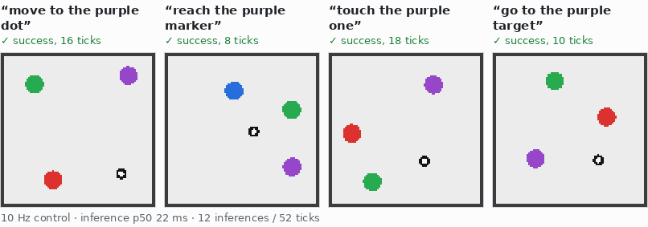

# 08 · Deploy: the real-time loop

[← README](../../README.md#the-eight-stages) · previous: [07 Edge](07_edge.md) · back to [02 Data](02_data.md) (the feedback loop)

On a robot, the policy is slower than the control rate. The deploy loop runs inference asynchronously
on the latest observation while the main thread keeps executing the current action chunk at a fixed
rate, the asynchronous inference that SmolVLA [[1](#ref-1)] describes. A **chunker** decides how chunks
become one action per tick. It can execute the first n actions and re-plan, the receding-horizon
scheme of Diffusion Policy [[2](#ref-2)]. It can infer every tick and average the overlapping
chunks, ACT's temporal ensembling [[3](#ref-3)]. Or it can skip the actions consumed during inference and blend
into the new chunk, an output-space simplification of real-time chunking (RTC) [[4](#ref-4)]. Safety filters
sit between policy and robot, and every tick is logged as a dataset, which closes the loop back to
[02 Data](02_data.md).



*`reach_smoke`'s deploy node drives the sim through the same loop a robot uses. Inference runs
asynchronously, chunks blend at their boundaries (`rtc_blend`), safety filters sit between policy and
robot, and every tick is logged.*

## Nodes and components

| node | what it does |
|---|---|
| `deploy/loop` | observe → infer (async) → act at `control_hz`, with safety filters and episode logging |

| component | what it does | from |
|---|---|---|
| `chunker/sync` | receding horizon: run the policy, execute the first n actions, re-plan | Diffusion Policy [[2](#ref-2)], ACT action chunking [[3](#ref-3)] |
| `chunker/temporal_ensemble` | infer every tick and average all chunks that cover the current tick | ACT [[3](#ref-3)] |
| `chunker/rtc_blend` | latency-aware: skips actions consumed during inference and blends into the new chunk | RTC, simplified [[4](#ref-4)] |
| `safety/clamp` | clamps actions to the embodiment's joint / command limits | |
| `safety/rate_limit` | limits the change between consecutive commands (velocity clamp) | |
| `safety/deadman` | repeats the last safe command (hold) if the policy stops producing actions in time | |
| `driver/sim` | drives a simulator through the real-time loop (same code path as hardware) | |
| `driver/mock` | hardware-free robot that matches any embodiment spec (loops, rates, new sensors) | |
| `driver/lerobot_robot` | any LeRobot-supported robot (SO-100/101, Koch, ALOHA, LeKiwi ...) via its robot config | LeRobot [[5](#ref-5)] |

Code: [src/vlalab/stages/deploy.py](../../src/vlalab/stages/deploy.py) and
[src/vlalab/runtime/](../../src/vlalab/runtime/) (`loop.py`, `chunking.py`, `safety.py`, `drivers.py`).

## Run it

```bash
vlab run reach_smoke --only deploy deploy.episodes=10 deploy.chunker.blend=4
vlab run mock_hardware                               # a 50 Hz loop on a robot that doesn't exist yet
```

## Configure it

```yaml
  deploy:
    impl: deploy/loop
    inputs: {policy: gate.policy}  # null when the gate failed, so a regressed build never deploys
    params:
      driver: {type: sim, env: {type: reach2d, goal_colors: [purple]}}   # sim | mock | lerobot_robot | yours
      chunker: {type: rtc_blend, blend: 2}
      safety: [{type: clamp}, {type: rate_limit}, {type: deadman, timeout_s: 0.5}]
      episodes: 4
      max_steps: 60
```

For a real robot, swap the driver. `driver/lerobot_robot` wraps any LeRobot robot config (SO-100/101,
Koch, ALOHA ...), or you can [write your own](../adding_components.md#8-a-new-chunker-safety-filter-or-driver).
[New hardware](../hardware.md) walks through a mock robot with new sensors and a real SO-100 arm.

## Hands on

`deploy.json` (latency p50/p95, stalls, jitter, interventions per safety filter) and output port
`dataset`, every tick logged as a native dataset. Wire it into `data/mixture` or `post_train/finetune`
to close the loop back to [02 Data](02_data.md).

## Papers in this stage

| paper | status | where |
|---|---|---|
| Receding-horizon chunk execution [[2](#ref-2)] | native | `chunker/sync` |
| ACT temporal ensembling [[3](#ref-3)] | native | `chunker/temporal_ensemble` |
| Latency-aware chunk blending, output-space RTC [[4](#ref-4)] | native | `chunker/rtc_blend` |
| Real-time chunking by inpainting during denoising [[4](#ref-4)] | planned | open slot |
| Async inference control loop [[1](#ref-1)] + safety filters + episode logging | native | `deploy/loop` |
| LeRobot robots: SO-100/101, Koch, ALOHA, LeKiwi [[5](#ref-5)] | native | `driver/lerobot_robot` |
| ROS 2 bridge driver | planned | open slot |

*native*: implemented in this repo. *planned*: an open slot
([adding components](../adding_components.md#8-a-new-chunker-safety-filter-or-driver)).

## References

1. <a id="ref-1"></a>M. Shukor, D. Aubakirova, F. Capuano, et al. *SmolVLA: A Vision-Language-Action Model for Affordable and Efficient Robotics.* arXiv preprint, 2025. [arXiv:2506.01844](https://arxiv.org/abs/2506.01844)
2. <a id="ref-2"></a>C. Chi, Z. Xu, S. Feng, et al. *Diffusion Policy: Visuomotor Policy Learning via Action Diffusion.* RSS 2023. [arXiv:2303.04137](https://arxiv.org/abs/2303.04137)
3. <a id="ref-3"></a>T. Z. Zhao, V. Kumar, S. Levine, and C. Finn. *Learning Fine-Grained Bimanual Manipulation with Low-Cost Hardware.* RSS 2023. [arXiv:2304.13705](https://arxiv.org/abs/2304.13705)
4. <a id="ref-4"></a>K. Black, M. Y. Galliker, and S. Levine. *Real-Time Execution of Action Chunking Flow Policies.* NeurIPS 2025. [arXiv:2506.07339](https://arxiv.org/abs/2506.07339)
5. <a id="ref-5"></a>R. Cadene, S. Alibert, F. Capuano, et al. *LeRobot: An Open-Source Library for End-to-End Robot Learning.* ICLR 2026. [arXiv:2602.22818](https://arxiv.org/abs/2602.22818)

<details>
<summary>BibTeX for this page</summary>

```bibtex
@article{shukor2025smolvla,
  title         = {{SmolVLA: A Vision-Language-Action Model for Affordable and Efficient Robotics}},
  author        = {Mustafa Shukor and Dana Aubakirova and Francesco Capuano and Pepijn Kooijmans and Steven Palma and Adil Zouitine and Michel Aractingi and Caroline Pascal and Martino Russi and Andres Marafioti and Simon Alibert and Matthieu Cord and Thomas Wolf and Remi Cadene},
  journal       = {arXiv preprint arXiv:2506.01844},
  year          = {2025},
  eprint        = {2506.01844},
  archivePrefix = {arXiv},
  url           = {https://arxiv.org/abs/2506.01844}
}

@inproceedings{chi2023diffusion,
  title         = {{Diffusion Policy: Visuomotor Policy Learning via Action Diffusion}},
  author        = {Cheng Chi and Zhenjia Xu and Siyuan Feng and Eric Cousineau and Yilun Du and Benjamin Burchfiel and Russ Tedrake and Shuran Song},
  booktitle     = {Robotics: Science and Systems (RSS)},
  year          = {2023},
  eprint        = {2303.04137},
  archivePrefix = {arXiv},
  url           = {https://arxiv.org/abs/2303.04137}
}

@inproceedings{zhao2023act,
  title         = {{Learning Fine-Grained Bimanual Manipulation with Low-Cost Hardware}},
  author        = {Tony Z. Zhao and Vikash Kumar and Sergey Levine and Chelsea Finn},
  booktitle     = {Robotics: Science and Systems (RSS)},
  year          = {2023},
  eprint        = {2304.13705},
  archivePrefix = {arXiv},
  url           = {https://arxiv.org/abs/2304.13705}
}

@inproceedings{black2025rtc,
  title         = {{Real-Time Execution of Action Chunking Flow Policies}},
  author        = {Kevin Black and Manuel Y. Galliker and Sergey Levine},
  booktitle     = {Advances in Neural Information Processing Systems (NeurIPS)},
  year          = {2025},
  eprint        = {2506.07339},
  archivePrefix = {arXiv},
  url           = {https://arxiv.org/abs/2506.07339}
}

@inproceedings{cadene2026lerobot,
  title         = {{LeRobot: An Open-Source Library for End-to-End Robot Learning}},
  author        = {Remi Cadene and Simon Alibert and Francesco Capuano and Michel Aractingi and Adil Zouitine and Pepijn Kooijmans and Jade Choghari and Martino Russi and Caroline Pascal and Steven Palma and Mustafa Shukor and Jess Moss and Alexander Soare and Dana Aubakirova and Quentin Lhoest and Quentin Gallouédec and Thomas Wolf},
  booktitle     = {International Conference on Learning Representations (ICLR)},
  year          = {2026},
  eprint        = {2602.22818},
  archivePrefix = {arXiv},
  url           = {https://arxiv.org/abs/2602.22818}
}
```

</details>
