# One demo → thousands of noisy worlds: a style-conserving dreamer with RL grounding

[← README](../README.md) · builds on [real-to-sim from one UMI demo](https://github.com/aPR0T0/robot-learning/blob/claude/umi-demo-sam3d-0571b5/docs/real2sim.md) · research map: [C1 · style-conditioned interaction search](https://github.com/aPR0T0/robot-learning/blob/claude/single-demo-robot-research-c67b32/docs/research/single_demo.md#c1)

The real-to-sim track rebuilds the scene of **one** UMI demonstration (cup and saucer) in NVIDIA's Newton
with Skild AI's Steel solver, and replays the demo there. This page covers what comes next:

1. turn the one scene into **thousands of worlds**. Each world varies the object's shape, size, mass,
   centre of mass and small geometric details, and **noises the contact physics** (friction, restitution,
   contact gap, grip force, random wrenches);
2. extract the **style** of the demo: *how* the manipulation is done (approach path, arc heights, grasp
   point, gripper opening, tempo), separated from *what* is done (cup onto saucer) and *where* (poses);
3. train a **dreamer**: a recurrent latent world model that imagines rollouts in any of those worlds,
   with the demo's style as its behaviour prior and its yardstick;
4. train the **policy** on a loss computed **through the dreams**, starting from the **actual current
   state** of each simulated world, and **grounded by RL** on the real Steel rollouts.

Phase A (this page, run first on a toy): **the dreamer is frozen and only the policy learns**. Phase B
(later) trains the dreamer and the policy together, and the two are benchmarked against each other.

> **Results so far ([details](#results)).** In 2048 Newton + Steel worlds, replaying the demo's style succeeds
> 72.6 %. Dreams + RL grounding reaches **96.3 %** held-out and **49.1 %** out of distribution, against PPO's
> 95.8 % / 44.5 %, keeping the style within 3.7 mm. Dreams without RL grounding collapse (54.4 %). In a 2D
> replication with 3 seeds, the grounding result holds, but PPO edges dreams + RL (95.3 % vs 93.5 %), so whether
> dreams add generalisation beyond RL is still open.

```
 real2sim (done)                 this pipeline
 ───────────────                 ───────────────────────────────────────────────────────────────────────────
 UMI demo ─► scene + masses ─►   scenario bank ──► Newton + SolverSteel, N worlds in parallel on one GPU
 (one)       (Newton/Steel)      ξ ~ p(ξ | ξ₀)      │ actual states s_t, rewards r_t           ▲ actions
                                                    ▼                                          │
 demo trajectory ──────────────► style z_D ──► style prior π_style ──(residual)──► policy π_θ ─┘
                                                    │                                ▲
                                                    ▼                                │ L_dream (pathwise)
                                  dreamer M_ψ (frozen in phase A) ── dreams from ────┤
                                                                     actual states   │ L_PPO  (RL grounding)
```

Physics runs in **Newton** with **SolverSteel** (Steel's reduced-coordinate articulated solver with a
projected Gauss-Seidel contact solve [[2](#ref-2), [3](#ref-3)]). Every world is a separate Newton
world in one model, so one GPU steps thousands of them at once. Rollouts are written as USD, which
opens in **Isaac Sim**.

Contents: [notation](#notation) · [1 worlds](#1-thousands-of-worlds-domain-randomisation) ·
[2 style](#2-style-from-one-demonstration) · [3 dreamer](#3-the-dreamer-a-style-conditioned-world-model) ·
[4 policy](#4-the-policy-dreams--rl-grounding-phase-a) · [5 why](#5-why-this-should-work) ·
[6 toy](#6-the-toy-example-newton--steel) · [7 benchmark](#7-evaluation-and-the-phase-b-benchmark) ·
[8 VLA](#8-from-the-policy-to-the-vla) · [run](#run-it) · [results](#results) · [references](#references)

## Notation

| symbol | meaning |
|---|---|
| $s_t,\ o_t,\ a_t$ | full simulator state, what the agent observes, the action sent to the robot (10 Hz) |
| $\xi,\ p(\xi)$ | one world's parameters (geometry, mass, contact, poses) and the randomisation distribution |
| $\xi_0$ | the nominal world reconstructed by real2sim (meshes, masses matched from YCB/ABO) |
| $\tau_D = \{(p_t, R_t, w_t)\}_{t=0}^{T}$ | the one demonstration: TCP position, TCP orientation, gripper width (UMI's `trajectory.npz`) |
| $z_D$ | the style extracted from $\tau_D$ |
| $\pi_{\text{style}}$ | the style prior: the demo retargeted to a new world and executed as a controller |
| $\pi_\theta,\ v_\phi$ | the policy (a residual on top of $\pi_{\text{style}}$) and its critic |
| $M_\psi = (h_t, z_t)$ | the dreamer: recurrent latent world model with deterministic state $h_t$ and stochastic state $z_t$ |
| $\phi_t,\ \kappa_t$ | the style clock (where in the demo we are) and its rate (tempo) |

## 1. Thousands of worlds (domain randomisation)

The policy is trained for the **expected** return over a distribution of worlds centred on the
reconstruction, not for the reconstruction alone [[4](#ref-4), [5](#ref-5)]:

$$
\max_\theta\; J(\theta) \;=\; \mathbb{E}_{\xi \sim p(\xi)}\Big[\, \mathbb{E}_{\tau \sim p_\xi(\tau \mid \pi_\theta)} \sum_{t=0}^{T-1} \gamma^t\, r(s_t, a_t) \Big].
$$

A world is $\xi = (G,\ \ell,\ m,\ c,\ \mu,\ \mu_\tau,\ e,\ \delta,\ F_{\max},\ k_p,\ \sigma_f,\ x_{\text{obj}},\ x_{\text{goal}})$:

| group | parameters | how it is sampled |
|---|---|---|
| **shape** $G$ | superellipse cross-section (round ↔ boxy), aspect ratio, taper (cup-like top), small radial noise | procedural, below |
| **size** $\ell$ | base half-width and height | uniform around the reconstructed extents |
| **mass** $m$, **CoM** $c$ | mass × log-uniform factor around the matched mass (cup: 118 g, YCB mug); CoM offset up to 15 % of the half-extents | the inertia is the convex hull's at that mass, so it agrees with the collider |
| **contact** | sliding friction $\mu$, torsional friction $\mu_\tau$, restitution $e$, contact gap $\delta$ | per shape, per world |
| **actuation** | finger effort limit $F_{\max}$ (grip force), drive stiffness $k_p$ | per world |
| **contact noise** | a random wrench on the object, redrawn each control step: $f_t \sim \mathcal N(0, \sigma_f^2 I)$, $\tau_t \sim \mathcal N(0, \sigma_\tau^2 I)$ | per world: $\sigma_f$ itself is sampled |
| **poses** | object and saucer position and yaw on the table | per episode |

**Geometry.** The object's cross-section at height fraction $\zeta \in [0,1]$ is a perturbed superellipse:

$$
\rho(\vartheta; n, a) = \big(|\cos\vartheta|^{n} + |\sin\vartheta / a|^{n}\big)^{-1/n},
\qquad
r(\vartheta, \zeta) = r_0\, \rho(\vartheta; n, a)\, \big(1 + \kappa_{\text{taper}}(\zeta - \tfrac12)\big)\, \Big(1 + \sum_{k=2}^{4} \epsilon_k \cos(k\vartheta + \varphi_k)\Big),
$$

with $n \in [2, 8]$ (circle → rounded box), $a$ the aspect ratio, $\kappa_{\text{taper}}$ the taper and
$|\epsilon_k| \le 0.03$ the "small geometric changes". The vertices $(r\cos\vartheta,\ r\sin\vartheta,\ \zeta h)$
are wrapped in their convex hull, the shape Steel collides. Changing shape per world follows procedural
object randomisation for grasping [[9](#ref-9)]. The physical ranges follow DeXtreme and OpenAI's
Rubik's cube [[6](#ref-6), [8](#ref-8)].

**Noised contact.** Steel resolves contact as impulses in a projected Gauss-Seidel loop with a Coulomb
cone. Randomising $\mu, \mu_\tau, e, \delta$ moves the cone, the bounce and the activation distance. The
random wrench stands in for what no rigid contact model captures: patch geometry, compliance and
surface micro-structure. A policy trained this way cannot rely on one exact contact outcome.

**The worlds are partially observed.** Shape and size are observed, as the reconstruction measures them.
Mass, friction, restitution and grip force are not. The randomised problem is then a POMDP whose hidden
state includes $\xi$. Its Bayes-optimal policy acts on the belief
$b_t(\xi) = p(\xi \mid o_{\le t}, a_{<t})$ [[10](#ref-10)]. The dreamer's recurrent state $h_t$ is trained
to predict future observations from the history, so it must carry the part of $b_t$ that matters for
prediction. Conditioning the policy on $h_t$ makes it adaptive: it can feel that a cup is heavier or more
slippery than nominal and squeeze harder or lift slower. Recurrent policies under dynamics randomisation
[[5](#ref-5)], RMA's adaptation module [[11](#ref-11)] and VariBAD [[10](#ref-10)] are instances of the
same idea. The widths of $p(\xi)$ trade robustness against performance [[7](#ref-7)]. Active and automatic
DR [[6](#ref-6), [45](#ref-45)] widen them on a schedule; here, `curriculum` grows them linearly.

## 2. Style from one demonstration

One demo cannot teach *what varies*. What it can give is a **parametrisation** that separates the shape
of the motion (style) from its anchors (task and scene). This is the decomposition dynamic movement
primitives make [[12](#ref-12)]: the forcing term is the shape, and start, goal and time constant are
parameters. Task-parameterised models [[14](#ref-14)] do the same with one reference frame per object.

**Phases.** The gripper width gives the events. The grasp starts at
$t_g = \min\{t : w_t < w_{\min} + 0.35\,(w_{\text{open}} - w_{\min})\}$, and $t_r$ is the last such
index (the same rule as real2sim's `grasp_events`). This splits the demo into $k \in$ {reach $[0, t_g]$,
carry $[t_g, t_r]$, retreat $[t_r, T]$}. On UMI's cup demo the fingers close at frame 279 and open at 393.

**Anchors.** Each phase runs from a start anchor $a_k^s$ to an end anchor $a_k^e$, expressed in the frame
that matters for it:

- reach: from the start pose to the **grasp point in the object frame**,
  $\bar g = \operatorname{diag}(\ell)^{-1}\, T_{\text{obj}}^{-1} p_{t_g}$. It is normalised by the
  object's extents, so the grasp height stays the same *fraction* of the object's height;
- carry: from where the grasp actually happened to the **release point in the saucer frame**, raised by
  the object's own grasp height;
- retreat: the demo's displacement after release, turned with the saucer's yaw.

**Style curves.** For phase $k$ with duration $T_k$, normalised time $u \in [0,1]$, length
$L_k = \lVert a_k^e - a_k^s \rVert$ and direction $e_k = (a_k^e - a_k^s)/L_k$, take the frame
$F_k = [\,e_k,\ n_k,\ b_k\,]$ with $b_k = e_k \times \hat z / \lVert e_k \times \hat z \rVert$ and
$n_k = b_k \times e_k$. In it, an upward arc stays upward after retargeting. The style is

$$
\pi_k(u) = \tfrac{1}{L_k}\big\langle p(t_k + uT_k) - a_k^s,\ e_k \big\rangle, \qquad
d_k(u) = \tfrac{1}{L_k}\,[\,n_k,\ b_k\,]^{\!\top}\big(p(t_k + uT_k) - a_k^s\big),
$$

where $\pi_k$ is the progress profile (the speed profile's shape) and $d_k \in \mathbb R^2$ the transverse
arc. Add the yaw relative to the object's grasp axis $\psi_k(u)$, the opening over the object's width
$\omega(u) = w(u) - \ell_{\perp}$, and the durations:

$$
z_D = \big\{\, T_k,\ \pi_k(\cdot),\ d_k(\cdot),\ \psi_k(\cdot),\ \omega(\cdot) \,\big\}_{k=1}^{3}.
$$

**Retargeting** to any world with anchors $a'$ gives the reference that conserves the style:

$$
p^{\text{ref}}(\phi) = a'^s_k + L'_k\big(\pi_k(u)\, e'_k + [\,n'_k,\ b'_k\,]\, d_k(u)\big), \qquad (k, u) = \text{phase}(\phi).
$$

This is a DMP with frame-independent spatial scaling [[13](#ref-13)]. The forcing term lives in a frame
turned and scaled by $a^e - a^s$, which avoids the original DMP's blow-up when $g - y_0 \to 0$. The
trajectory form is stored directly: with one demo, locally weighted regression would only reproduce it.
MimicGen re-anchors demo segments to the current object pose the same way [[15](#ref-15)], and CP-Gen
re-solves one demo's keypoint constraints for new shapes [[16](#ref-16)].

**Tempo is a control input.** A DMP's time constant scales time. Here it is a style clock

$$
\phi_{t+1} = \phi_t + \kappa_t\, \Delta t, \qquad \kappa_t \in [\kappa_{\min}, \kappa_{\max}],
$$

that the policy sets ($\kappa \equiv 1$ is the demo's tempo). A heavy, slippery cup can then be lifted
more slowly *along the same path*. The spatial style is kept and the tempo deviation is paid for
separately.

**Style reward and fidelity.** As in DeepMimic [[17](#ref-17)], the per-step style reward is a tracking
kernel, here on the *retargeted* reference:

$$
r^{\text{style}}_t = \exp\!\Big(\!-\frac{\lVert p_t - p^{\text{ref}}(\phi_t)\rVert^2}{2\sigma_p^2}\Big)\,
\exp\!\Big(\!-\frac{(w_t - w^{\text{ref}}(\phi_t))^2}{2\sigma_w^2}\Big) \;-\; \lambda_\kappa (\log \kappa_t)^2 .
$$

For evaluation, a tempo-invariant **style distance** aligns the executed path to the reference with
dynamic time warping [[20](#ref-20)]:
$D_{\text{style}}(\tau) = \min_{\mathcal W} \frac{1}{|\mathcal W|}\sum_{(i,j)\in\mathcal W}\lVert p_i - p^{\text{ref}}_j\rVert$,
reported in millimetres, next to the tempo ratio $\frac{1}{T}\sum_t \kappa_t$. AMP [[18](#ref-18)] learns a
style discriminator instead. With a single demo, an explicit metric is easier to audit, and ACT's CVAE
"style variable" [[19](#ref-19)] needs many demos. A learned style encoder is an option once there are
images.

**The style prior** executes the reference:

$$
a^{\text{style}}_t = \Big[\ \operatorname{clip}\!\Big(\frac{p^{\text{ref}}(\phi_t + \kappa_t\Delta t) - p_t}{v_{\max}\Delta t}\Big),\ \
\frac{\psi^{\text{ref}} - \psi_t}{\dot\psi_{\max}\Delta t},\ \ w^{\text{ref}}(\phi_t + \kappa_t\Delta t)\ \Big].
$$

Run alone with $\kappa \equiv 1$, it is the **retarget-and-replay baseline**: what MimicGen or CP-Gen
would produce from this demo.

## 3. The dreamer: a style-conditioned world model

The dreamer is a recurrent state-space model [[22](#ref-22), [23](#ref-23), [25](#ref-25)]:

$$
h_t = f_\psi(h_{t-1}, z_{t-1}, a_{t-1}), \quad
z_t \sim q_\psi(z_t \mid h_t, o_t)\ \text{(posterior)}, \quad
\hat z_t \sim p_\psi(\hat z_t \mid h_t)\ \text{(prior)}, \quad
\hat o_t \sim p_\psi(o_t \mid h_t, z_t),
$$

trained on sequences with the evidence lower bound, using DreamerV3's KL balancing and free bits
[[25](#ref-25)]:

$$
\mathcal L(\psi) = \mathbb E\Big[\sum_t \underbrace{\lVert \operatorname{symlog}(o_t) - \hat o_t \rVert^2}_{\text{reconstruction}}
+ \beta_{\text{dyn}} \max\!\big(1, \mathrm{KL}[\,\mathrm{sg}(q_\psi) \,\Vert\, p_\psi\,]\big)
+ \beta_{\text{rep}} \max\!\big(1, \mathrm{KL}[\,q_\psi \,\Vert\, \mathrm{sg}(p_\psi)\,]\big)\Big].
$$

Its observations are the robot's proprioception, the object and saucer poses and velocities, and the
object's measured extents. Mass, friction, restitution and grip force are **not** given: $h_t$ has to
infer them from how the object responds (§1).

**Pre-training data.** $\mathcal D_0$ comes from executing the style prior with exploration in thousands
of worlds: $a_t = a^{\text{style}}_t + \eta_t$, with per-episode noise scale $\sigma \sim U[0, \sigma_{\max}]$
and a random tempo. The data covers the neighbourhood of the demo's style in every kind of world, which
is where the policy will act.

**Conserving the style.** A dream started at $(h_t, z_t)$ is generated by rolling the *style prior plus
the policy's residual* inside the model:

$$
\hat o_{k+1} \sim M_\psi(\cdot \mid h_k, z_k, a_k), \qquad a_k = a^{\text{style}}(\hat o_k, \phi_k; z_D) + \Delta a_k, \qquad \Delta a_k \sim \pi_\theta(\cdot \mid x_k).
$$

Each dream is scored with $r^{\text{task}} + \lambda_s r^{\text{style}}$. With $\Delta a \equiv 0$, the
dream is the demo's motion carried into world $\xi$: what the demonstrator's movement *would do* to this
cup, with this mass, on this friction. The policy only pays for departing from it. Penalising
$\lVert \Delta a \rVert^2 / 2\sigma^2$ is the KL between two equal-covariance Gaussians $\pi_\theta$ and
$\pi_{\text{style}}$. The objective is therefore KL-regularised RL with the demo's style as the behaviour
prior [[36](#ref-36)].

## 4. The policy: dreams + RL grounding (phase A)

The policy is a **residual** on the style prior [[34](#ref-34), [35](#ref-35)]. Its last layer is
initialised to zero, so at the start $\pi_\theta = \pi_{\text{style}}$: the retargeted demo. Its input is

$$
x_t = \big[\ \mathrm{sg}(h_t),\ \mathrm{sg}(z_t),\ o_t,\ \phi_t,\ p^{\text{ref}}(\phi_t) - p_t,\ w^{\text{ref}}(\phi_t) - w_t\ \big],
$$

and its output is the residual $\Delta a_t$ (TCP velocity, yaw rate, gripper width) and the tempo
$\kappa_t$. The reward is

$$
r_t = r^{\text{task}}_t + \lambda_s r^{\text{style}}_t - \lambda_a \lVert \Delta a_t \rVert^2,
\qquad
r^{\text{task}}_t = \gamma\Phi(s_{t+1}) - \Phi(s_t) + R\,\mathbb 1[\text{success}],
$$

where $\Phi$ (minus the distances gripper→object before the lift and object→saucer after) is a potential,
so the shaping does not change the optimal policy of the task reward [[33](#ref-33)]. Success means
the object rests on the saucer, upright, with the gripper open.

**Loss through the dreams, from the actual state.** Every iteration rolls the current policy out in all
worlds in Steel. Each actual state $o_t$ is filtered through the frozen dreamer into $(h_t, z_t)$, and
dreams of $H$ steps start there:

$$
\mathcal L_{\text{dream}}(\theta) = -\,\mathbb E_{x_t \sim \mathcal B_{\text{actual}}}\Big[\frac{1}{H}\sum_{k=1}^{H} w_t\, \frac{V^\lambda_k}{S}\Big],
\qquad
V^\lambda_k = \hat r_k + \gamma\big((1-\lambda)\, v_\phi(\hat x_{k+1}) + \lambda V^\lambda_{k+1}\big), \quad V^\lambda_H = v_\phi(\hat x_H).
$$

The gradient flows **through the dream**: through $\hat x_{k+1} = M_\psi(\hat x_k, a_k)$, through the
reparameterised action $\Delta a_k = \mu_\theta(x_k) + \sigma_\theta\,\epsilon$ and through the analytic
reward. This is Dreamer's dynamics backpropagation [[23](#ref-23)], the pathwise gradient of stochastic
value gradients and MAAC [[29](#ref-29), [30](#ref-30)]. $S = \max(1, P_{95} - P_5)$ of the returns
normalises scale [[25](#ref-25)]. Differentiating Steel itself is not an option: it rejects
`requires_grad`. Even where it were possible, gradients through hard contact are badly conditioned
[[44](#ref-44)]. The learned model is a smoothed surrogate.

**The grounding gate** $w_t$ measures how well the dreamer predicts *this* world. It replays the actions
that were actually taken from $x_t$ and compares the dream with what actually happened:

$$
e_t = \frac1K \sum_{j=1}^{K} \big\lVert \hat o_{t+j}(a^{\text{actual}}_{t:t+j}) - o_{t+j} \big\rVert^2_{\Sigma^{-1}},
\qquad w_t = \exp(-e_t / \bar e),
$$

with $\bar e$ the batch median. Worlds the dreamer gets wrong, such as extreme masses or bouncy contacts,
contribute less dream gradient and lean on real RL.

**RL grounding.** The same policy is also trained with PPO on the actual rollouts, using the actual
rewards from Steel and GAE advantages [[31](#ref-31), [32](#ref-32)]:

$$
\mathcal L_{\text{PPO}}(\theta) = -\,\mathbb E_{\text{actual}}\Big[\min\big(\rho_t \hat A_t,\ \operatorname{clip}(\rho_t, 1-\epsilon, 1+\epsilon)\,\hat A_t\big)\Big],
\qquad \rho_t = \frac{\pi_\theta(\Delta a_t, \kappa_t \mid x_t)}{\pi_{\theta_{\text{old}}}(\Delta a_t, \kappa_t \mid x_t)} .
$$

**Total.** The dreamer stays frozen; only $\theta$ and $\phi$ learn:

$$
\mathcal L(\theta) = \lambda_{\text{RL}}\, \mathcal L_{\text{PPO}} + \lambda_{\text{dream}}\, \mathcal L_{\text{dream}} - \eta\, \mathcal H[\pi_\theta],
\qquad
\mathcal L(\phi) = \mathbb E_{\text{actual}}\big[(v_\phi(x_t) - \hat R_t)^2\big] + \beta\, \mathbb E_{\text{dream}}\big[(v_\phi(\hat x_k) - \mathrm{sg}(V^\lambda_k))^2\big].
$$

The critic is anchored on actual returns and refined in the dreams. That is the second channel of
grounding: dreams bootstrap from a value that reality keeps honest.

```
for iteration = 1 … I:
    worlds   ← re-deal the cup shapes (body variants) and resample every world's physics and poses
    actual   ← roll π_θ out in Steel for T steps; filter every o_t through M_ψ  → x_t, rewards r_t
    critic   ← regress v_φ on GAE returns of `actual`
    repeat E epochs over minibatches of `actual`:
        L_PPO  ← clipped surrogate on (x_t, Δa_t, κ_t, Â_t)
        every k-th minibatch (k = 4):
            starts ← sample x_t from the minibatch;  w_t ← grounding gate (replay actual actions in M_ψ)
            dreams ← roll π_style ⊕ π_θ in M_ψ for H steps from the starts (reparameterised)
            L_dream← −mean(w_t · V^λ / S);  the critic also fits sg(V^λ) on dreams
        θ ← θ − α ∇θ(λ_RL L_PPO + λ_dream L_dream − η H)
```

Defaults (`AgentConfig`): $T = 100$ steps (10 s), $H = 10$, $\gamma = 0.99$, $\lambda = 0.95$, 4 PPO epochs
× 8 minibatches, one dream batch of 8192 starts every 4th minibatch, actor and critic MLPs 512 → 512
(LayerNorm, SiLU), RSSM with a 512-unit GRU and a 32-dim Gaussian latent. Rewards:
shaping 5, success 0.25 per step + 10 at the end, style $\lambda_s = 0.25$, residual 0.05, tempo 0.5,
all scaled by 0.1. The dreams-only variant dreams at every minibatch instead, so it gets as many actor
updates as the other two.

## 5. Why this should work

- **Model error is bounded by short dreams from real states.** With $k$-step branched rollouts from the
  real state distribution, MBPO [[28](#ref-28), Thm. 4.3] bounds the true return of $\pi$ by its
  branched-model return:
  $\eta[\pi] \ge \eta^{\text{branch}}[\pi] - 2 r_{\max}\big[\frac{\gamma^{k+1}\epsilon_\pi}{(1-\gamma)^2} + \frac{\gamma^{k}\epsilon_\pi}{1-\gamma} + \frac{k\,\epsilon_m}{1-\gamma}\big]$.
  The model term grows linearly in $k$, so dreams stay short ($H = 10$, one second) and start from
  *actual* states, never from imagined ones. This is the Dyna principle [[27](#ref-27)]: plan in the
  model, learn from both.
- **Two estimators with complementary errors.** The dream gradient is pathwise: low variance, but biased
  by $\epsilon_m$ and blind to what the model cannot predict. The PPO gradient is a likelihood ratio on
  real rewards: unbiased, but high variance. Summing them, with the gate turning the dream down where
  $e_t$ is large, trades bias for variance per world.
- **The style is a prior, not a constraint.** At $\Delta a = 0$ the agent *is* the retargeted demo, so it
  starts with the demo's success on worlds near $\xi_0$. RL only has to learn where physics breaks the
  demo: heavier, more slippery, bouncier, oddly shaped. $\lambda_s$ and $\lambda_a$ price leaving the
  style. Potential-based task shaping leaves the task's optimum unchanged [[33](#ref-33)]; the style
  term moves it on purpose. Sweeping $\lambda_s$ traces the success–style Pareto front.
- **Adaptation comes from the belief.** The policy sees $h_t$, which the dreamer trained to predict the
  future. It can therefore condition on $b_t(\xi)$ and act differently once a grasp starts to slip
  (§1, [[10](#ref-10), [11](#ref-11)]).
- **Related systems.** MoDem shows that a world model plus demonstrations makes model-based RL
  sample-efficient on manipulation [[37](#ref-37)]. V-MAIL runs adversarial imitation inside a latent
  model [[38](#ref-38)]. DayDreamer trains Dreamer on real robots [[26](#ref-26)], and TD-MPC2 scales
  latent world models across tasks [[39](#ref-39)]. Massively parallel simulation makes on-policy RL
  practical in minutes [[40](#ref-40)].

## 6. The toy example (Newton + Steel)

The toy is a reduced version of the UMI scene. It has the same task, the same action space and the same
demo format, so the code that runs it runs the real scene.

| | toy | real: [a new UMI scene](style_dream_umi.md) (done) |
|---|---|---|
| physics | Newton `1.9.0.dev0` (skild-ai fork, the Steel examples' pin) + `SolverSteel`, 60 Hz × 4 substeps | same |
| robot | UMI-style parallel gripper on a 4-DoF Cartesian base (x, y, z, yaw), position drives, finger effort limit | the Franka hand from Steel's library (newton-assets URDF) on the same base (`gripper: franka_hand`) |
| object | procedural convex "cups" (§1), nominal size and mass from the real2sim cup (118 g) | 2048 geometry variants of the SAM 3D mouse mesh, mass from `physics.json` (68 g) |
| target | a free saucer (134 × 124 × 17 mm, 498 g, from real2sim) | the reconstructed mouse pad (flat-object rule: 2.3 mm, 86 g), 64 variants |
| demo | one scripted demo in the nominal world, saved as UMI's `trajectory.npz` | a human's UMI demo from Data Scaling Laws (`data/umi_demo`, `backend: scene`) |
| actions | $[\,v_x, v_y, v_z, \dot\psi, w\,]$ at 10 Hz: TCP velocity, yaw rate, gripper width | same |
| worlds | 2048 in parallel on one GPU: a bank of 2048 cup shapes declared with Newton's `add_body_variants`, re-dealt to the worlds every episode with `select_body_variants`; mass, contact and actuation resampled every episode on the GPU | same |
| Isaac Sim | `ViewerUSD` writes rollouts as USD (opens in Isaac Sim / usdview) | same |
| result (held-out / OOD) | replay 72.6 / 5.5 %; dreams + RL **96.3 / 49.1 %**; PPO 95.8 / 44.5 % | replay 46.0 / 0.5 %; dreams + RL 95.8 / 39.6 %; PPO **97.6 / 52.3 %** ([results](style_dream_umi.md#5-results)) |

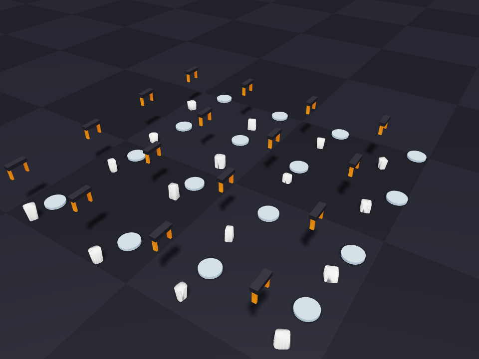

*Sixteen of the 2048 Steel worlds at rest, laid out by viewer offsets (the physics keeps every world at the
origin). Each has its own cup: round to boxy, straight or tapered, short or tall. Each also has its own
hidden mass, friction, restitution, grip force and contact noise. Stepping 2048 of them takes 37 ms per
10 Hz control step (24 Steel substeps) on one A100, 55k world-steps/s.*

The toy demo has a distinctive style on purpose: it reaches in a high arc, hovers above the cup, descends
straight down, closes slowly, lifts vertically, carries in a high arc and lowers gently onto the saucer.
That makes the style measurable. The randomisation is wide enough that replaying this style fails in
many worlds. Heavy cups on low friction slip out of the demo's squeeze: replay succeeds 94 % / 80 % / 44 % from
the lightest to the heaviest third of the cups. Bouncy saucers and boxy cups turned away from the demo's yaw
fail too.

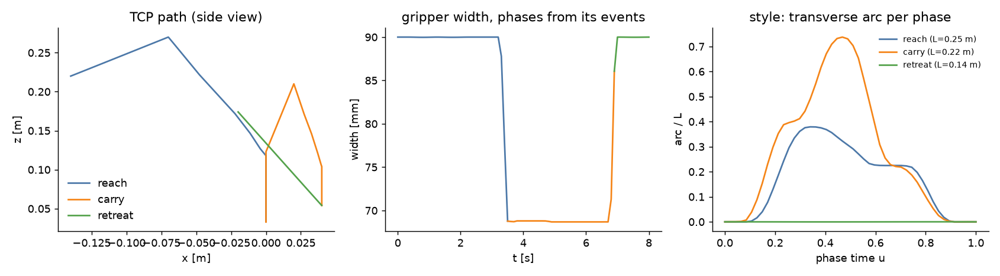

*The scripted demo split by its gripper events, and the style the extractor keeps: each phase's
transverse arc, normalised by the phase length. Retargeted to the demo's own scene, the reference
reproduces the demo to 2.9 mm (DTW). Replayed in the nominal Steel world, it tracks the demo to 0.6 mm.*

**The real demo goes through the same extractor.** UMI demo 0 (real2sim's MoGe scene, in the table frame)
gives grasp and release at frames 279 and 394, matching real2sim's 279 and 393. Its style is a human's: a
low, sliding approach, a carry arc 0.78 × its 11 cm length (the cup is lifted about 9 cm to move it 11 cm), and an up-and-back
retreat.

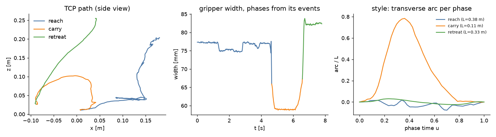

### The 2D world: testing the theory fast

To test whether the theory stands before paying for 3D contact, the same nodes run on a **2D world**
(`backend: planar2d`, the vertical x–z plane, pure torch: 2048 worlds step in about 1 s per episode). It is
not a different method. The style extractor, the dreamer and the agent are the same code, with the same
observation layout (y = 0). It keeps the physics the method has to handle:

| effect | 2D model |
|---|---|
| grip force | the fingers close until they meet the cup; $F = \min(k_f\,(w_{\text{obj}} - w_{\text{cmd}})/2,\ F_{\max})$ per finger |
| slip | the cup follows the fingers only while the impulse needed stays in the friction cone, $\lvert J\rvert \le 2\mu F\,\Delta t$ |
| shape | half-width, height, taper (width varies with height) and width noise; squeezing a tapered cup pushes it along its axis, $2F\,\mathrm{d}r/\mathrm{d}z$ |
| contact noise | restitution on landing, table friction, a random wrench on the cup each control step |
| collisions | fingers closed narrower than the cup land on its top; a finger sweeping into the cup pushes it |

In 2D, grasping is easier than in 3D: no pivoting or tilting in the grasp. The 2D demonstrator therefore grips
gently, commanding 4 mm under the cup's width instead of 12 mm, and the mass range is wider (× 0.4–5). That
brings replay success to 71 %, about the same as Steel's 73 %, with the same failure pattern (heavy cups:
30 % in the heaviest third). The grip command is also made part of the style ($\sigma_{\text{cmd}}$ in
`StyleParams`). Squeezing harder than the demonstrator costs style, so the best policy squeezes harder *only
where the hidden mass and friction need it*. Telling those worlds apart is exactly what the dreamer's belief
state is for.

## 7. Evaluation and the phase B benchmark

Every method is scored on **held-out worlds** (new shapes, new physics draws) and on an
**out-of-distribution** set with wider mass, friction and noise ranges:

| method | what learns | dreams | RL on actual rollouts |
|---|---|---|---|
| retarget-and-replay ($\pi_{\text{style}}$ alone) | nothing | – | – |
| PPO only | $\pi_\theta$ | – | ✓ |
| dreams only | $\pi_\theta$ | ✓ (from actual states) | – |
| **dreams + RL grounding** (phase A) | $\pi_\theta$ | ✓ | ✓ |
| dreams + RL, **dreamer trained too** (phase B, later) | $\pi_\theta$ and $M_\psi$ | ✓ | ✓ |

Metrics: success rate with a Wilson 95 % interval; success per physics bin (mass, friction, shape
family); style distance $D_{\text{style}}$ (mm) and tempo ratio; dream fidelity (open-loop prediction
error against horizon); and sample efficiency (simulated steps to reach a success level).

**Phase B** keeps everything and also updates $\psi$ on the policy's new actual data every iteration,
as Dreamer normally does [[23](#ref-23), [25](#ref-25)]. The question for the benchmark: does adapting
the dreamer to the policy's own state distribution beat a frozen dreamer plus RL grounding, and at what
cost in style?

## 8. From the policy to the VLA

The toy policy sees privileged state. The VLA sees camera images and an instruction. The standard route
is **teacher → student** [[41](#ref-41), [42](#ref-42)]:

1. roll the trained policy out in the randomised worlds, render the cameras in Newton, and write a
   dataset in this repo's format;
2. distil it into the VLA (`vla/train`, flow-matching head) with DAgger-style relabelling on the
   student's own states [[43](#ref-43)];
3. refine the VLA with RL in the same worlds: `rl/dsrl` steers its noise [[46](#ref-46)]. A
   flow-matching head with a fixed number of integration steps, $a = \Phi_\theta(\epsilon; o)$, is
   reparameterised, so it can also take the dream's pathwise gradient directly.

## Run it

On a Linux machine with an NVIDIA GPU (checked on a GCP `a2-highgpu-1g`, one A100 40 GB):

```bash
scripts/dream/setup_env.sh
```

```bash
.venv-steel/bin/vlab run style_dream_toy
```

```bash
.venv-steel/bin/vlab run style_dream_2d
```

`setup_env.sh` builds `.venv-steel` with Newton (the skild-ai fork the Steel examples pin), warp 1.18, CUDA torch,
and vlab installed without its own pins (Newton's fork needs numpy ≥ 2.3). `scripts/dream/run_toy.sh` runs the
toy's three policies concurrently once the dreamer is trained. The nodes:

| node | what it does | output |
|---|---|---|
| `data/toy_demo` | the scripted demo in the nominal world, UMI format | `bundle/{trajectory.npz, demo.json}` |
| `data/demo_style` | the style; a real2sim UMI demo works too (pass `scene:`) | `style.json`, `style.png` |
| `data/scenario_bank` | training, held-out and OOD world configs; a still, a clip and a USD of 16 worlds | `scenarios.json`, `worlds.{png,mp4,usd}` |
| `rl/dream_world_model` | the dreamer: style prior + exploration in every world, RSSM training, open-loop error | `world_model.pt`, `open_loop_error.json` |
| `rl/style_dream` | phase A training (`agent.mode`: `dream_rl`, `rl`, `dream`); held-out eval; rollout video + USD | `policy.pt`, `history.json`, `rollout.{mp4,usd}` |
| `eval/style_dream` | every policy and retarget-and-replay on held-out and OOD worlds | `report.json`, `comparison.png`, per-method videos |

Overrides work as for every pipeline, e.g. `vlab run style_dream_toy policy.agent.iterations=200
worlds.env.worlds=4096`. `policy.agent.train_world_model=true` is phase B.
`python scripts/dream/plot_results.py OUT steel=runs/style_dream_toy 2d=runs/style_dream_2d` makes the
plots and the table below.

The trained models of both runs (the dreamer and every policy, with their style and world configs) are on Google
Drive: `python scripts/checkpoints_drive.py fetch style_dream_toy style_dream_2d` puts them in
`checkpoints/` ([how to use them](../checkpoints/README.md)).

## Results

Phase A, the dreamer frozen. Every method is scored by `eval/style_dream` on the **same** worlds: 2048 held-out
and 2048 out-of-distribution worlds for Steel, 4096 of each for 2D. Each world gets new cup shapes and new physics
draws, and the policy runs deterministically. Out of distribution means cups 2.5–4.5× heavier than nominal (5–8×
in 2D), friction 0.2–0.4 (0.15–0.3), stronger contact-wrench noise and bouncier contacts, all outside the training
ranges. Steel is one seed per method; 2D is three seeds per method (the ± is the spread over seeds).

**Newton + Steel (3D)**: 2048 training worlds per policy, 120 iterations (24.6 M simulated steps). The dreamer's
object error is 4.8 mm one step ahead and 11.8 mm after 1 s of dreaming.

| method | held-out success (95 % CI) | OOD success (95 % CI) | style distance (mm) | tempo | success, heaviest third |
|---|---|---|---|---|---|
| retarget + replay (no learning) | 72.6 % [70.6, 74.4] | 5.5 % [4.6, 6.5] | 2.5 | 1.00 | 44 % |
| RL only (PPO) | 95.8 % [94.9, 96.6] | 44.5 % [42.3, 46.6] | 3.0 | 0.97 | 91 % |
| dreams only | 54.4 % [52.3, 56.6] | 10.4 % [9.2, 11.8] | 4.4 | 0.98 | 41 % |
| **dreams + RL grounding** | **96.3 %** [95.4, 97.0] | **49.1 %** [47.0, 51.3] | 3.7 | 1.00 | 92 % |

**2D world**: 1024 training worlds per policy, 80 iterations (8.2 M simulated steps), grip strength part of the
style. The dreamer's object error is 1.5 mm one step ahead and 7.0 mm after 1 s.

| method | held-out success (95 % CI) | OOD success (95 % CI) | style distance (mm) | tempo | success, heaviest third |
|---|---|---|---|---|---|
| retarget + replay (no learning) | 71.0 % [69.6, 72.3] | 0.1 % [0.0, 0.3] | 3.5 | 1.00 | 30 % |
| RL only (PPO) | **95.3 %** [94.9, 95.7] ± 0.6 | **21.5 %** [20.7, 22.2] | 3.6 | 0.99 | 86 % |
| dreams only | 88.3 % [87.7, 88.8] ± 2.0 | 4.8 % [4.4, 5.2] | 5.3 | 0.99 | 70 % |
| dreams + RL grounding | 93.5 % [93.0, 93.9] ± 1.0 | 12.8 % [12.3, 13.4] | 3.4 | 0.99 | 81 % |

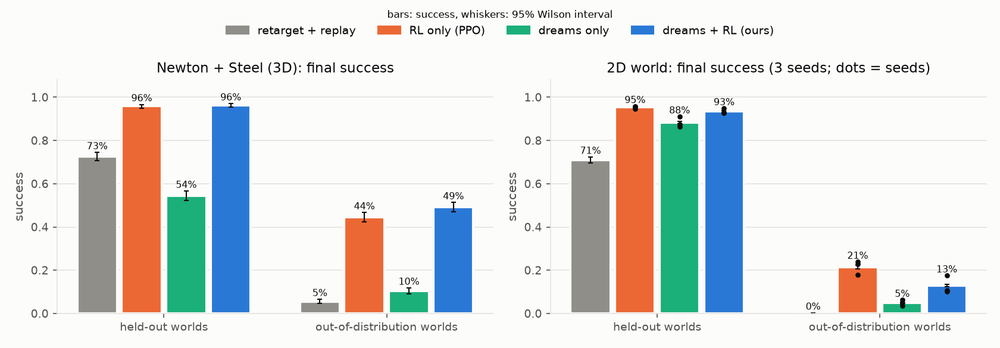

**What holds in both worlds**

- **Learning from the one demo's style fixes where replaying it fails.** Both RL-grounded policies lift success from
  about 72 % to 93–96 %. Most of the gain is on the cups the demo's gentle squeeze cannot hold: on the heaviest third
  of the held-out cups, 44 → 92 % in Steel and 30 → 81–86 % in 2D. Mass is never observed. The policies squeeze
  harder where the cup turns out to be heavy (the success-by-mass plot below).
- **The style is kept.** RL-grounded policies stay within 3.0–3.7 mm (DTW) of the retargeted demo, against
  2.5–3.5 mm for replay itself, and keep its tempo (0.97–1.00).
- **RL grounding is necessary.** Trained through the frozen dreamer alone, the policy exploits the dreamer's errors.
  In Steel it reaches about 85 % on the training worlds within 4–7 M steps, then collapses again and again, and
  ends below replay (54 %). In 2D, one seed dropped to 0 % before recovering. In both worlds it drifts furthest from the
  style (4.4–5.3 mm). This is the model-error term of §5 made visible. The PPO term and the critic anchored on real
  returns remove it.

**What is not settled: do dreams add anything beyond RL?**

- In **Steel**, dreams + RL matches PPO in distribution (96.3 % vs 95.8 %, overlapping intervals). It is ahead out of
  distribution: **49.1 % vs 44.5 %**, with non-overlapping 95 % intervals over 2048 worlds, and 92 % vs 91 % on the
  heaviest cups. That is the generalisation the dreamer's belief is meant to buy, but it is one seed.
- In **2D**, PPO is ahead: 95.3 % vs 93.5 % held-out (seed ranges 94.5–95.8 % vs 92.7–94.8 %, overlapping slightly), and
  21.5 % vs 12.8 % out of distribution, where every PPO seed beats every dreams + RL seed (closest: 17.8 % vs 17.5 %).
- **Sample efficiency**: the learning curves overlap. Dreams + RL is marginally ahead in Steel between 3 M and 9 M steps.
  In 2D, PPO is marginally ahead after 3 M steps. At these budgets the dreams give no clear speed-up.

So the theory's core mechanism holds: a frozen style-conserving dreamer plus RL grounding learns a robust,
style-faithful policy from one demo, and the grounding is what makes dream-trained policies usable. The stronger
claim, that dreams generalise better than RL alone, is supported in Steel and contradicted in 2D. The next runs that
decide it: Steel with 3+ seeds; and phase B, where the dreamer keeps learning on the policy's own states (its
1-second error, 7–12 mm, is the limit here).

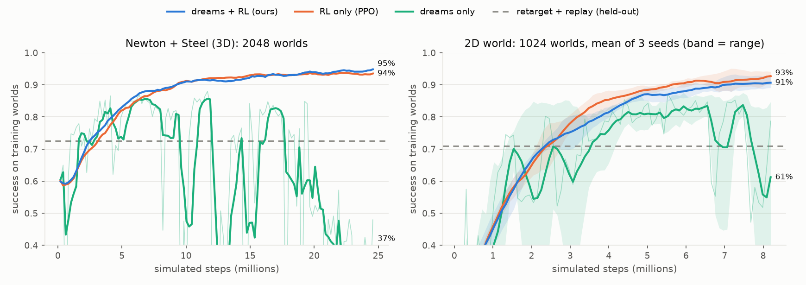

*Success on the training worlds during training (with exploration noise; 5-iteration moving average; the faint
line is dreams-only's raw value). The dashed line is retarget-and-replay on the held-out worlds.*

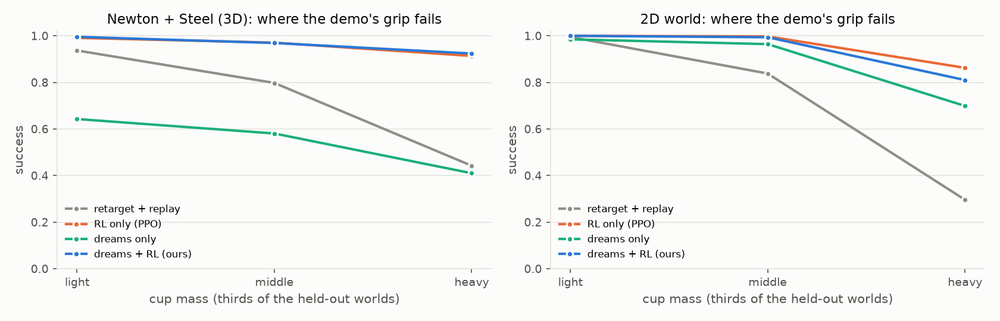

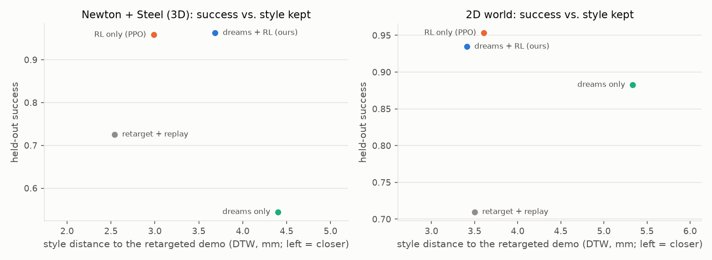

**Videos.** The same nine held-out Steel worlds, rendered from the evaluated policies:

| retarget + replay (no learning) | dreams + RL grounding |
|---|---|
| 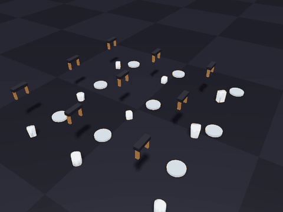 | 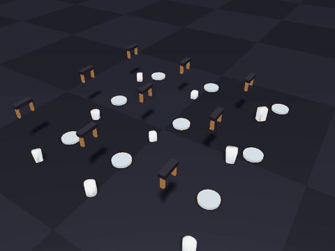 |

| RL only (PPO), mid-carry | dreams only, mid-carry |
|---|---|
| 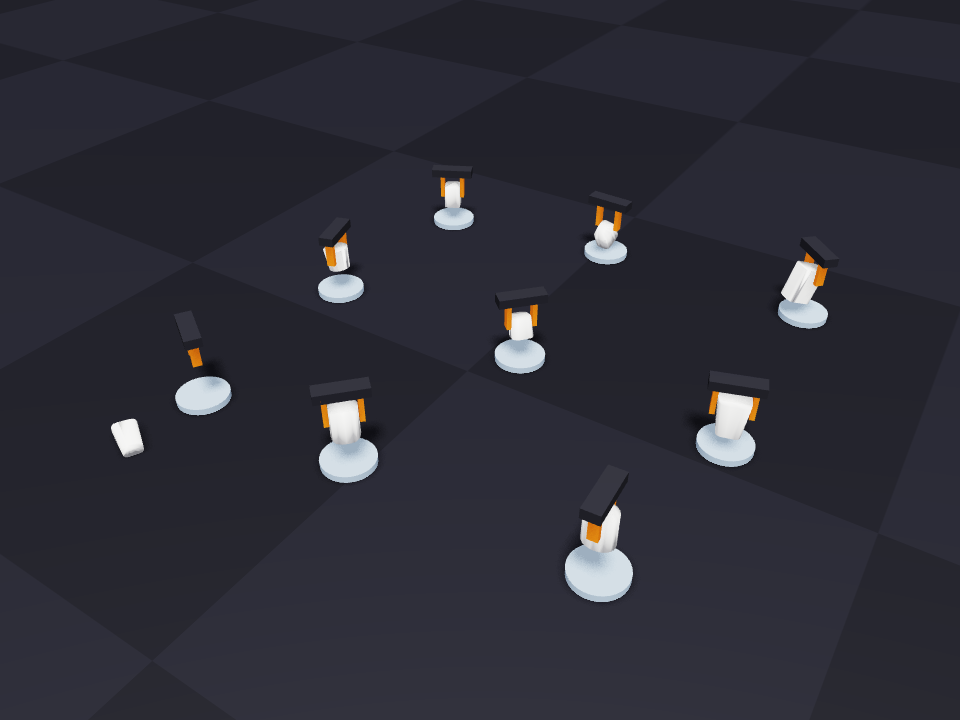 | 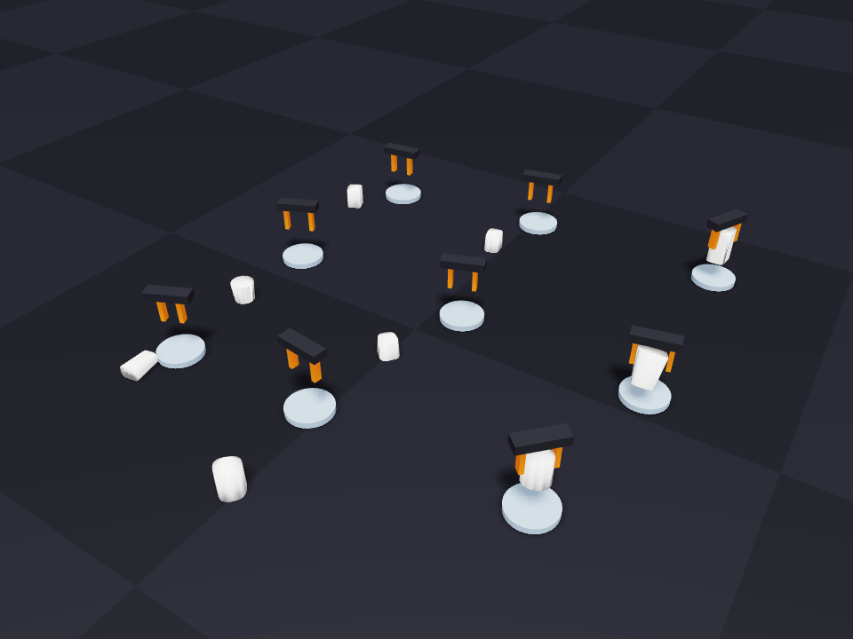 |

MP4s of all four: [replay](images/style_dream/steel_retarget_and_replay.mp4) ·
[dreams + RL](images/style_dream/steel_dream_rl.mp4) · [PPO](images/style_dream/steel_rl.mp4) ·
[dreams only](images/style_dream/steel_dream.mp4). In 2D (side view, 3 × 3 worlds, each labelled with its hidden
mass, friction and grip limit): [replay](images/style_dream/2d_retarget_and_replay.mp4) ·
[dreams + RL](images/style_dream/2d_dream_rl_s0.mp4) · [PPO](images/style_dream/2d_rl_s0.mp4) ·
[dreams only](images/style_dream/2d_dream_s0.mp4).

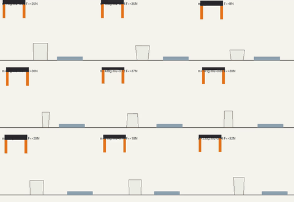

The eval node also writes each Steel rollout as USD (`runs/style_dream_toy/eval/*.usd`), which opens in Isaac Sim
or usdview. The numbers are in [results.json](images/style_dream/results.json) (summary, per-seed values, learning
curves).

**Reproduce.** Both runs were on one A100 40 GB (GCP `a2-highgpu-1g`). The Steel toy took 8.7 min for the dreamer
and 40–90 min per policy (dreams-only is the slowest), with the three policies concurrent and sharing the GPU.
2D took about 10 min for the dreamer and 10–40 min per policy. Plots and table: `python scripts/dream/plot_results.py OUT steel=runs/style_dream_toy
2d=runs/style_dream_2d`.

## References

1. <a id="ref-1"></a>C. Chi, Z. Xu, C. Pan, et al. *Universal Manipulation Interface: In-The-Wild Robot Teaching Without In-The-Wild Robots.* RSS 2024. [arXiv:2402.10329](https://arxiv.org/abs/2402.10329)
2. <a id="ref-2"></a>Skild AI and NVIDIA. *Steel: Scaling Simulation Across Robots, Tasks, and Worlds.* 2026. [skild.ai/blogs/steel](https://www.skild.ai/blogs/steel), [github.com/skild-ai/steel](https://github.com/skild-ai/steel)
3. <a id="ref-3"></a>The Newton Developers. *Newton: GPU-accelerated physics simulation for robotics.* Linux Foundation, 2025–26. [github.com/newton-physics/newton](https://github.com/newton-physics/newton)
4. <a id="ref-4"></a>J. Tobin, R. Fong, A. Ray, J. Schneider, W. Zaremba, P. Abbeel. *Domain Randomization for Transferring Deep Neural Networks from Simulation to the Real World.* IROS 2017. [arXiv:1703.06907](https://arxiv.org/abs/1703.06907)
5. <a id="ref-5"></a>X. B. Peng, M. Andrychowicz, W. Zaremba, P. Abbeel. *Sim-to-Real Transfer of Robotic Control with Dynamics Randomization.* ICRA 2018. [arXiv:1710.06537](https://arxiv.org/abs/1710.06537)
6. <a id="ref-6"></a>OpenAI, I. Akkaya, M. Andrychowicz, et al. *Solving Rubik's Cube with a Robot Hand.* 2019. [arXiv:1910.07113](https://arxiv.org/abs/1910.07113)
7. <a id="ref-7"></a>F. Muratore, F. Ramos, G. Turk, W. Yu, M. Gienger, J. Peters. *Robot Learning from Randomized Simulations: A Review.* Frontiers in Robotics and AI 2022. [arXiv:2111.00956](https://arxiv.org/abs/2111.00956)
8. <a id="ref-8"></a>A. Handa, A. Allshire, V. Makoviychuk, et al. *DeXtreme: Transfer of Agile In-hand Manipulation from Simulation to Reality.* ICRA 2023. [arXiv:2210.13702](https://arxiv.org/abs/2210.13702)
9. <a id="ref-9"></a>J. Tobin, L. Biewald, R. Duan, et al. *Domain Randomization and Generative Models for Robotic Grasping.* IROS 2018. [arXiv:1710.06425](https://arxiv.org/abs/1710.06425)
10. <a id="ref-10"></a>L. Zintgraf, K. Shiarlis, M. Igl, et al. *VariBAD: A Very Good Method for Bayes-Adaptive Deep RL via Meta-Learning.* ICLR 2020. [arXiv:1910.08348](https://arxiv.org/abs/1910.08348)
11. <a id="ref-11"></a>A. Kumar, Z. Fu, D. Pathak, J. Malik. *RMA: Rapid Motor Adaptation for Legged Robots.* RSS 2021. [arXiv:2107.04034](https://arxiv.org/abs/2107.04034)
12. <a id="ref-12"></a>A. J. Ijspeert, J. Nakanishi, H. Hoffmann, P. Pastor, S. Schaal. *Dynamical Movement Primitives: Learning Attractor Models for Motor Behaviors.* Neural Computation 25(2), 2013. [doi:10.1162/NECO_a_00393](https://doi.org/10.1162/NECO_a_00393)
13. <a id="ref-13"></a>L. Koutras, Z. Doulgeri. *A Novel DMP Formulation for Global and Frame Independent Spatial Scaling in the Task Space.* IEEE RO-MAN 2020. [doi:10.1109/RO-MAN47096.2020.9223500](https://doi.org/10.1109/RO-MAN47096.2020.9223500)
14. <a id="ref-14"></a>S. Calinon. *A Tutorial on Task-Parameterized Movement Learning and Retrieval.* Intelligent Service Robotics 9(1), 2016. [doi:10.1007/s11370-015-0187-9](https://doi.org/10.1007/s11370-015-0187-9)
15. <a id="ref-15"></a>A. Mandlekar, S. Nasiriany, B. Wen, et al. *MimicGen: A Data Generation System for Scalable Robot Learning using Human Demonstrations.* CoRL 2023. [arXiv:2310.17596](https://arxiv.org/abs/2310.17596)
16. <a id="ref-16"></a>K. Lin, V. Ragunath, A. McAlinden, et al. *Constraint-Preserving Data Generation for Visuomotor Policy Learning.* CoRL 2025. [arXiv:2508.03944](https://arxiv.org/abs/2508.03944)
17. <a id="ref-17"></a>X. B. Peng, P. Abbeel, S. Levine, M. van de Panne. *DeepMimic: Example-Guided Deep Reinforcement Learning of Physics-Based Character Skills.* SIGGRAPH 2018. [arXiv:1804.02717](https://arxiv.org/abs/1804.02717)
18. <a id="ref-18"></a>X. B. Peng, Z. Ma, P. Abbeel, S. Levine, A. Kanazawa. *AMP: Adversarial Motion Priors for Stylized Physics-Based Character Control.* SIGGRAPH 2021. [arXiv:2104.02180](https://arxiv.org/abs/2104.02180)
19. <a id="ref-19"></a>T. Z. Zhao, V. Kumar, S. Levine, C. Finn. *Learning Fine-Grained Bimanual Manipulation with Low-Cost Hardware (ACT).* RSS 2023. [arXiv:2304.13705](https://arxiv.org/abs/2304.13705)
20. <a id="ref-20"></a>H. Sakoe, S. Chiba. *Dynamic Programming Algorithm Optimization for Spoken Word Recognition.* IEEE TASSP 26(1), 1978. [doi:10.1109/TASSP.1978.1163055](https://doi.org/10.1109/TASSP.1978.1163055)
21. <a id="ref-21"></a>D. Ha, J. Schmidhuber. *World Models.* NeurIPS 2018. [arXiv:1803.10122](https://arxiv.org/abs/1803.10122)
22. <a id="ref-22"></a>D. Hafner, T. Lillicrap, I. Fischer, et al. *Learning Latent Dynamics for Planning from Pixels (PlaNet).* ICML 2019. [arXiv:1811.04551](https://arxiv.org/abs/1811.04551)
23. <a id="ref-23"></a>D. Hafner, T. Lillicrap, J. Ba, M. Norouzi. *Dream to Control: Learning Behaviors by Latent Imagination (Dreamer).* ICLR 2020. [arXiv:1912.01603](https://arxiv.org/abs/1912.01603)
24. <a id="ref-24"></a>D. Hafner, T. Lillicrap, M. Norouzi, J. Ba. *Mastering Atari with Discrete World Models (DreamerV2).* ICLR 2021. [arXiv:2010.02193](https://arxiv.org/abs/2010.02193)
25. <a id="ref-25"></a>D. Hafner, J. Pasukonis, J. Ba, T. Lillicrap. *Mastering Diverse Control Tasks through World Models (DreamerV3).* Nature 640, 2025. [doi:10.1038/s41586-025-08744-2](https://doi.org/10.1038/s41586-025-08744-2), [arXiv:2301.04104](https://arxiv.org/abs/2301.04104)
26. <a id="ref-26"></a>P. Wu, A. Escontrela, D. Hafner, P. Abbeel, K. Goldberg. *DayDreamer: World Models for Physical Robot Learning.* CoRL 2022. [arXiv:2206.14176](https://arxiv.org/abs/2206.14176)
27. <a id="ref-27"></a>R. S. Sutton. *Dyna, an Integrated Architecture for Learning, Planning, and Reacting.* ACM SIGART Bulletin 2(4), 1991. [doi:10.1145/122344.122377](https://doi.org/10.1145/122344.122377)
28. <a id="ref-28"></a>M. Janner, J. Fu, M. Zhang, S. Levine. *When to Trust Your Model: Model-Based Policy Optimization (MBPO).* NeurIPS 2019. [arXiv:1906.08253](https://arxiv.org/abs/1906.08253)
29. <a id="ref-29"></a>N. Heess, G. Wayne, D. Silver, T. Lillicrap, Y. Tassa, T. Erez. *Learning Continuous Control Policies by Stochastic Value Gradients.* NeurIPS 2015. [arXiv:1510.09142](https://arxiv.org/abs/1510.09142)
30. <a id="ref-30"></a>I. Clavera, V. Fu, P. Abbeel. *Model-Augmented Actor-Critic: Backpropagating through Paths.* ICLR 2020. [arXiv:2005.08068](https://arxiv.org/abs/2005.08068)
31. <a id="ref-31"></a>J. Schulman, F. Wolski, P. Dhariwal, A. Radford, O. Klimov. *Proximal Policy Optimization Algorithms.* 2017. [arXiv:1707.06347](https://arxiv.org/abs/1707.06347)
32. <a id="ref-32"></a>J. Schulman, P. Moritz, S. Levine, M. Jordan, P. Abbeel. *High-Dimensional Continuous Control Using Generalized Advantage Estimation.* ICLR 2016. [arXiv:1506.02438](https://arxiv.org/abs/1506.02438)
33. <a id="ref-33"></a>A. Y. Ng, D. Harada, S. Russell. *Policy Invariance under Reward Transformations: Theory and Application to Reward Shaping.* ICML 1999. [pdf](https://people.eecs.berkeley.edu/~russell/papers/icml99-shaping.pdf)
34. <a id="ref-34"></a>T. Johannink, S. Bahl, A. Nair, et al. *Residual Reinforcement Learning for Robot Control.* ICRA 2019. [arXiv:1812.03201](https://arxiv.org/abs/1812.03201)
35. <a id="ref-35"></a>T. Silver, K. Allen, J. Tenenbaum, L. Kaelbling. *Residual Policy Learning.* 2018. [arXiv:1812.06298](https://arxiv.org/abs/1812.06298)
36. <a id="ref-36"></a>D. Tirumala, A. Galashov, H. Noh, et al. *Behavior Priors for Efficient Reinforcement Learning.* JMLR 2022. [arXiv:2010.14274](https://arxiv.org/abs/2010.14274)
37. <a id="ref-37"></a>N. Hansen, Y. Lin, H. Su, X. Wang, V. Kumar, A. Rajeswaran. *MoDem: Accelerating Visual Model-Based Reinforcement Learning with Demonstrations.* ICLR 2023. [arXiv:2212.05698](https://arxiv.org/abs/2212.05698)
38. <a id="ref-38"></a>R. Rafailov, T. Yu, A. Rajeswaran, C. Finn. *Visual Adversarial Imitation Learning using Variational Models (V-MAIL).* NeurIPS 2021. [arXiv:2107.08829](https://arxiv.org/abs/2107.08829)
39. <a id="ref-39"></a>N. Hansen, H. Su, X. Wang. *TD-MPC2: Scalable, Robust World Models for Continuous Control.* ICLR 2024. [arXiv:2310.16828](https://arxiv.org/abs/2310.16828)
40. <a id="ref-40"></a>N. Rudin, D. Hoeller, P. Reist, M. Hutter. *Learning to Walk in Minutes Using Massively Parallel Deep Reinforcement Learning.* CoRL 2021. [arXiv:2109.11978](https://arxiv.org/abs/2109.11978)
41. <a id="ref-41"></a>J. Lee, J. Hwangbo, L. Wellhausen, V. Koltun, M. Hutter. *Learning Quadrupedal Locomotion over Challenging Terrain.* Science Robotics 5(47), 2020. [arXiv:2010.11251](https://arxiv.org/abs/2010.11251)
42. <a id="ref-42"></a>D. Chen, B. Zhou, V. Koltun, P. Krähenbühl. *Learning by Cheating.* CoRL 2019. [arXiv:1912.12294](https://arxiv.org/abs/1912.12294)
43. <a id="ref-43"></a>S. Ross, G. Gordon, J. A. Bagnell. *A Reduction of Imitation Learning and Structured Prediction to No-Regret Online Learning (DAgger).* AISTATS 2011. [arXiv:1011.0686](https://arxiv.org/abs/1011.0686)
44. <a id="ref-44"></a>H. J. T. Suh, M. Simchowitz, K. Zhang, R. Tedrake. *Do Differentiable Simulators Give Better Policy Gradients?* ICML 2022. [arXiv:2202.00817](https://arxiv.org/abs/2202.00817)
45. <a id="ref-45"></a>B. Mehta, M. Diaz, F. Golemo, C. Pal, L. Paull. *Active Domain Randomization.* CoRL 2019. [arXiv:1904.04762](https://arxiv.org/abs/1904.04762)
46. <a id="ref-46"></a>A. Wagenmaker, M. Nakamoto, Y. Zhang, et al. *Steering Your Diffusion Policy with Latent Space Reinforcement Learning (DSRL).* 2025. [arXiv:2506.15799](https://arxiv.org/abs/2506.15799)
