# A new UMI scene, end to end: rebuilt in Steel, randomised 2048 ways, its style learned with dreams + RL

[← README](../README.md) · method: [style dream](style_dream.md) · reconstruction: [real-to-sim](real2sim.md)

The [style-dream toy](style_dream.md) learned a cup-to-saucer pick-and-place from one scripted demo in procedural
worlds. This page runs the whole chain on a **new, real environment**: one human UMI demonstration recorded in the
wild, its scene rebuilt in NVIDIA Newton with Skild AI's Steel solver from SAM 3D reconstructions and matched
masses, 2048 randomised copies of that scene, and the same style-conserving dreamer and policies. One pipeline,
`configs/pipeline/umi_style_dream.yaml`.

> **Results.** Replaying the human's style with the Franka hand succeeds in **46.0 %** of 2048 held-out worlds
> and 0.5 % out of distribution. A residual policy learned on top lifts that to **97.6 % / 52.3 %** with PPO and
> **95.8 % / 39.6 %** with dreams + RL grounding, staying within 5-6 mm of the demo's path. Mass is never observed,
> yet the heaviest third of the mice goes from 25 % to 93-97 %. Unlike the toy, the dreams did not help here: PPO is
> ahead by 1.8 points held-out and 13 points out of distribution, and dreams alone collapse (0.2 %).
> [Details](#5-results); every model is [downloadable](../checkpoints/README.md).

```
 UMI GoPro videos ─► SLAM (UMI) ─► one demo ─► SAM 3 masks ─► SAM 3D objects ─► masses (YCB / ABO)
                                                                                      │
 ┌────────────────────────────────────────────────────────────────────────────────────┘
 ▼
 Steel scene (rest poses, flat objects, table under everything) + FR3 replaying the demo
 │
 ├─► style (TCP depth, tempo, gripper offset calibrated on the demo itself)
 └─► 2048 worlds: geometry variants of the SAM 3D mesh, physics noise written into Steel ─► dreamer ─► policies
```

## 1. The environment: Data Scaling Laws, "arrange mouse", environment 17

[Data Scaling Laws in Imitation Learning](https://arxiv.org/abs/2410.18647) (Lin et al., ICLR 2025) released the
raw GoPro videos of their UMI data: four tasks, 32 environments each, every environment a mapping video, a gripper
calibration video and 60-120 demos ([MIT licence](https://huggingface.co/datasets/Fanqi-Lin/GoPro-Raw-Videos)).
Environment 17 of *arrange mouse* is a bright office table: a blue mouse to be picked up and put on a pink mouse
pad, with a water bottle, a cracker box, two shampoo bottles, a jar and a plant behind them. `data/umi_demo` fetches
it with `url: hf://datasets/Fanqi-Lin/GoPro-Raw-Videos/pick_place_mouse/env_17/object_1` (mapping, calibration and
the first 24 demos, 1.2 GB) and runs UMI's own SLAM pipeline (steps 00-06) on it.

| step | result |
|---|---|
| ORB-SLAM3 map + localisation | 26 of 26 videos tracked; the table tag found, σ ≤ 0.21 cm |
| gripper calibration | finger tags in 74 % of the calibration frames, under UMI's 80 % gate: rerun at 70 % (`GRIPPER_TAG_THRESHOLD`); its range, 42-129 mm between the tags, matches the UMI authors' own gripper |
| dataset plan | 98 % of the raw data used, 23 single-gripper demos with one clean grasp, 0 dropped |
| the demo | **demo 15** (median length): 3.7 s, 224 frames, grasp at frame 85, release at 157; the scene is rebuilt from frame 40 (0.75 s before the grasp) |

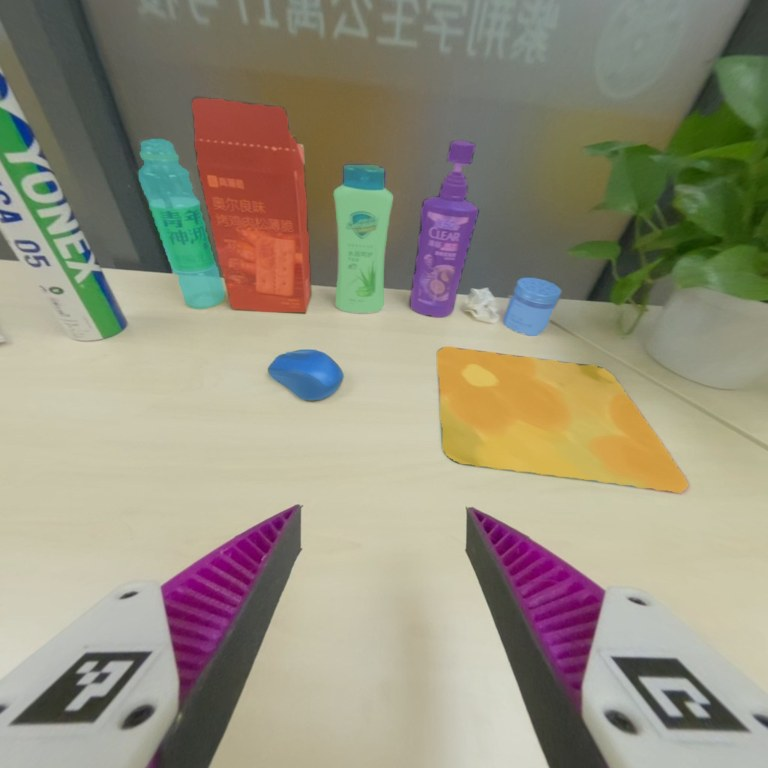

*Frame 40, rectified to a 100° pinhole view, and SAM 3's masks: mouse 0.97, mouse pad 0.99, three bottles
0.97-0.98, box 0.94, jar 0.94. The demo itself, as the GoPro saw it: [demo_gopro.mp4](images/style_dream_umi/demo_gopro.mp4).*

## 2. The Steel scene

SAM 3D Objects rebuilds the seven objects (4 min on an A100), the metric scale from the SLAM camera height (0.28 m)
and the table plane (3.1° off the tag's plane, corrected by expressing everything in the table frame). Masses come
from a one-to-one match to a database object (CLIP + size, [real2sim](real2sim.md#mass-one-to-one-match-to-a-public-database)):

| object | mass | from | collider |
|---|---|---|---|
| mouse | **68 g** | ABO "Ergonomic Wireless PC Mouse" (score 0.90; 105 × 74 × 38 mm) | CoACD, 8 parts |
| mouse pad | **86 g**, 2.3 mm thick | flat-object rule (below) | 1 part |
| water bottle | 177 g | ABO sunscreen bottle (0.74) | 3 parts |
| white shampoo | 1131 g | YCB bleach cleanser (0.98, measured) | 3 parts |
| blue shampoo | 430 g | ABO glass water bottle (0.86) | 3 parts |
| cracker box | 1306 g | ABO "Corn Oil" (0.67): wrong, a cracker box is ~0.3 kg; it is a background obstacle | 16 parts |
| jar | 118 g | ABO steel tumbler (0.70) | 16 parts |

Three geometry problems showed up in this scene that the cup scene did not have, each fixed in
`data/steel_scene` (`robot_replay.py`) by a rule rather than by hand:

* **Objects in a photo are at rest.** SAM 3D's layout left every object 4-15° off the table (a 25 cm bottle 15°
  off stands on an edge); in Steel the two shampoo bottles and the box fell over while the scene settled
  (89-415 mm). Each mesh is now turned about its CoM by the smallest rotation that lays a face of its convex hull
  flat on the table, among the faces (coplanar facets merged, ≥ 2 % of the hull's area, ≤ 25° away) whose support
  polygon contains the CoM's projection.
* **Flat objects.** The pad came out as a 1 mm sheet tilted 7° (35 mm tall), and no database entry matched it
  confidently (best 0.28), so its mass was the density rule on that volume, 255 g. One view cannot measure the
  thickness of a mat, but it measures its footprint. When the top-5 candidates are flat (median thickness under
  1 cm, footprint over 10 × that), the object becomes its footprint extruded to the candidates' median thickness
  (2.3 mm) and its mass their median **areal density** × the measured footprint: 1.41 kg/m² × 613 cm² = **86 g**
  (a 25 cm pad weighs 80-120 g). CoM and inertia are the plate's.
* **The table extends under everything on it.** The plane fit sees the table only up to the objects at its back
  edge; the bottles stood half off it. The table now covers every object's footprint + 6 cm.

After the fixes all seven objects settle within 0.4 mm. An FR3 (Franka hand) mounted on the table plays the demo as
joint angles from IK (TCP error 0.001 mm; open loop at 60 fps × 4 substeps) and, unlike on the cup demo,
**picks the mouse up**: it lifts 164 mm and moves 265 mm (TCP within 30 mm of the demo, median; the demo is fast).

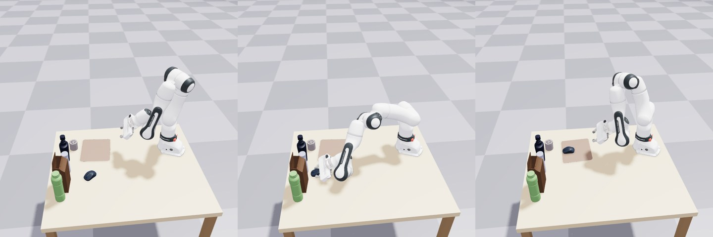

*Newton + Steel: SAM 3D's objects with their matched masses, and the FR3 playing UMI demo 15 as joint angles.
Start, mid-carry, end. [Side](images/style_dream_umi/fr3_replay_side.mp4) and
[wrist](images/style_dream_umi/fr3_replay_wrist.mp4) videos.*

## 3. 2048 worlds around the reconstruction

`data/scenario_bank` with `backend: scene` (`src/vlalab/dream/scene_env.py`) builds the worlds from the Steel
scene itself (`sim/rollout/env.json` + meshes). The gripper is the **Franka hand from Steel's library**
(newton-assets' `fr3_franka_hand.urdf`, the hand of Steel's Franka examples and of the FR3 above): hand mesh,
Franka's four collision boxes per finger, 2 × 40 mm stroke, TCP 103.4 mm from the flange, read from the URDF and
mounted on an x / y / z / yaw gantry (the toy's action space). Every world holds:

* **the object** (the mouse), in its principal-axis frame (x the long side, y the side the gripper closes across,
  origin at the centre of its footprint), as one of 2048 **geometry variants** of the SAM 3D mesh (variant 0 is the
  reconstruction). With u the point normalised by the half extents and ζ its height fraction,

  $$x' = S\,\big(1 + \tau(\zeta - \tfrac12)\big)\,x \;+\; \epsilon\,h\!\sum_{k=1}^{3} a_k \sin(\omega_k \cdot u + \varphi_k)\,e_{i_k},
  \qquad S = s\,(1 + \mathrm{diag}(d)),$$

  a size factor s ∈ [0.85, 1.15] (SAM 3D's extents were within 10-15 % of the measured ones on the cup demo),
  aspect jitter |d| ≤ 8 %, height × [0.9, 1.1], taper τ ∈ [-0.12, 0.12] and three low-frequency bumps up to 3 % of
  the half extents; the base stays flat. The collider is re-hulled after the map (≤ 96 vertices, extreme points
  kept), and mass, CoM and inertia are the hull's at the sampled mass, so they agree with what Steel collides. The
  variants are Newton body variants, re-dealt every episode with `select_body_variants`;
* **the target** (the pad) as one of 64 variants: footprint × [0.85, 1.15], thickness × [0.8, 1.25];
* **the obstacles**: the five other objects, free bodies with their matched masses;
* **a table** per world (a static box at the measured plane), so its friction differs per world.

Everything the randomisation touches is written into the Newton model that SolverSteel steps, per world, on the GPU,
followed by `notify_model_changed`:

| what | Newton / Steel array | sampled (train) |
|---|---|---|
| geometry | shape rows of the object and target (`select_body_variants`) | a variant per world |
| mass, CoM, inertia | `body_mass`, `body_inv_mass`, `body_com`, `body_inertia`, `body_inv_inertia` | mouse 68 g × log-U[0.4, 3]; CoM ± 15 % of the half extents; pad × [0.8, 1.2]; obstacles × [0.7, 1.4] |
| friction | `shape_material_mu`, `shape_material_mu_torsional` | mouse, pad, obstacles × [0.5, 1.6] of the matched material's (rubber 0.9, paper 0.5, ...); table U[0.3, 0.9]; fingers U[0.6, 1.2] |
| restitution, contact gap | `shape_material_restitution`, `shape_gap` | U[0, 0.3], U[0.5, 3] mm |
| grip force, drives | `joint_effort_limit`, `joint_target_ke` | 8-40 N per finger, finger stiffness 600-1500 N/m, arm × [0.7, 1.3] |
| contact noise | `state.body_f` of the mouse, every substep | σ up to 8 % of its weight, redrawn every 0.1 s |
| poses | free joints | mouse ± 6 cm, yaw ± 90°; pad ± 5 cm, yaw ± 29°; footprints kept apart (2D oriented-box test against each other and every obstacle) |

The out-of-distribution set uses mice 2.5-4.5 × heavier, friction × [0.3, 0.5], stronger contact noise and bouncier
contacts. Stepping 2048 worlds takes 70 ms per 10 Hz control step (24 substeps; 29k world-steps/s on an A100).

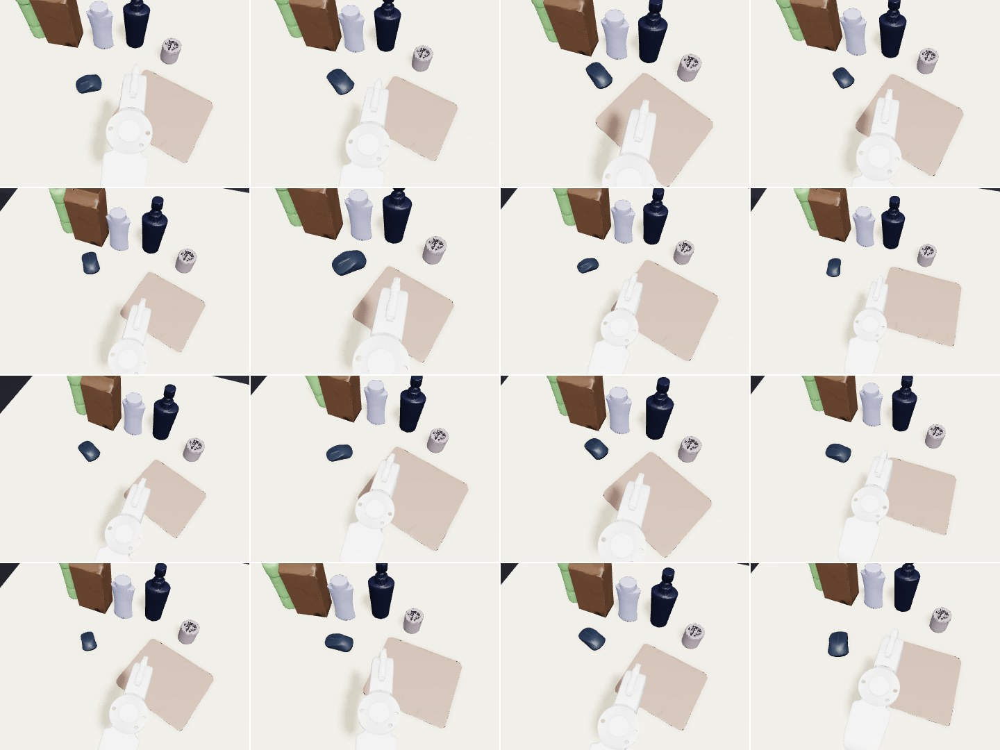

*Sixteen of the worlds, each from its own camera: different mice (size, proportions, bumps), pads and poses; hidden
masses, friction and grip forces. The Franka hand waits where the demo started.*

**Does Steel feel the noise?** `scripts/dream/check_scene_physics.py` measures each world's physics back from the
motion it causes, in 512 worlds: the mouse lifted into free air and pushed up with a known force (mass = F / (a + g)),
twisted with a known torque (yaw inertia), and pushed slowly along the table at its base plane until it slides
(friction = F / mg, against Steel's average of the mouse's and the table's coefficients).

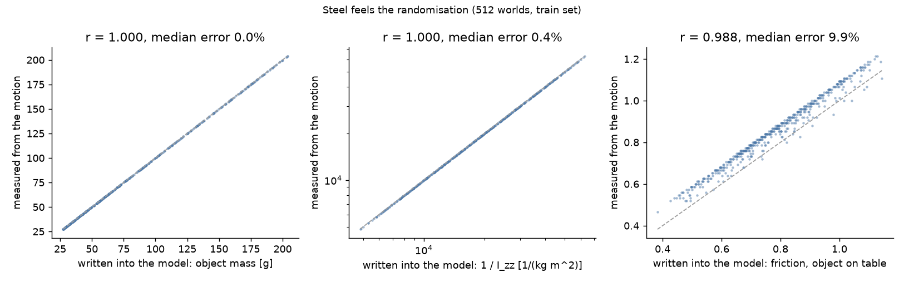

*Mass: r = 1.000 (exact). Yaw inertia: r = 1.000, 0.4 % error. Friction: r = 0.988, reading ~10 % high
(slip is detected after 2 mm of motion on a rising force).*

## 4. The style of a human demo, made executable

A human's demo is not a robot's: the hand-held UMI gripper has soft fin-ray fingers that open ~105 mm, wrap a mouse
from its top and slide in low. `data/demo_style` takes what is style from it and calibrates the rest on the demo
itself:

| quantity | value | why |
|---|---|---|
| tempo | × 2.39 slower (3.7 s → 8.9 s) | the human's TCP peaks at 0.88 m/s; scaled until the 95th-percentile speed is 0.35 m/s (`time_scale: auto`); the policy can still change it ± 42 % |
| TCP depth | 8.5 cm back along the approach axis | UMI's TCP is the fingertip; the mouse is held deeper between the fingers. The depth that puts the grasp TCP nearest the mouse's centre (residual 2.4 cm) also brings the release to 1.2 cm from the pad's centre, from 5.3 cm |
| gripper width | − 1.9 cm | UMI measures between the finger tags: offset so the closed width equals the mouse's width at the grasp |
| grasp height | 77 % → 35 % of the height | soft fingers hold a dome near its top; rigid ones must reach its widest band (the demo's value is kept in `style.json`) |
| approach clearance | 2 cm over the object | within reach of the mouse the reference keeps its path but passes over the mouse's top, blending down to the grasp point (smoothstep over 1.5 cm → half the diagonal); same when leaving it. A human slides in low; rigid fingertips 9.5 mm below the TCP would sweep the mouse away |
| finger pads | spin friction, r = 6 mm | Steel's contact torsion (`steel:min_torsional_patch_radius`, 2/3 of a 9 mm rubber tip): without it a two-point grasp lets the mouse pivot out |

Kept as demoed: the phases, the path shape (a low reach, a carry arc 0.8 × its 27 cm length, a lift-and-back
retreat), the grasp point along the mouse and the grasp yaw (33° off the mouse's short axis: the human's straddle),
the gripper profile and the release point on the pad.

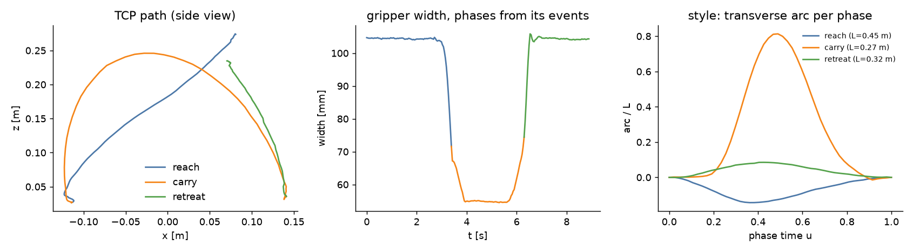

**Retarget-and-replay** (the style alone, no learning) with the Franka hand: 96.4 % of the worlds with the
reconstruction's physics (shapes still varied), 44.8 % with everything randomised, 0.4 % out of distribution
(1024 worlds each; on the evaluation's 2048 worlds below, 46.0 % and 0.5 %).

## 5. Results

Phase A (the dreamer frozen), one seed per method, 120 iterations each (≈ 32 M simulated steps). Every method is
scored by `eval/style_dream` on the **same** 2048 held-out worlds (new mouse shapes, pads, poses and physics draws)
and 2048 out-of-distribution worlds (mice 2.5-4.5 × heavier, friction × 0.3-0.5, stronger pushes, bouncier
contacts):

| method | held-out success (95 % CI) | OOD success (95 % CI) | style distance (mm) | tempo | success, heaviest third |
|---|---|---|---|---|---|
| retarget + replay (the style alone) | 46.0 % [43.9, 48.2] | 0.5 % [0.3, 0.9] | 3.8 | 1.00 | 25 % |
| RL only (PPO) | **97.6 %** [96.9, 98.2] | **52.3 %** [50.1, 54.5] | 4.9 | 1.02 | **97 %** |
| dreams only (15 iterations) | 0.2 % [0.1, 0.6] | 0.0 % [0.0, 0.2] | 10.8 | 0.98 | 0 % |
| dreams + RL grounding | 95.8 % [94.8, 96.5] | 39.6 % [37.5, 41.7] | 5.9 | 1.02 | 93 % |

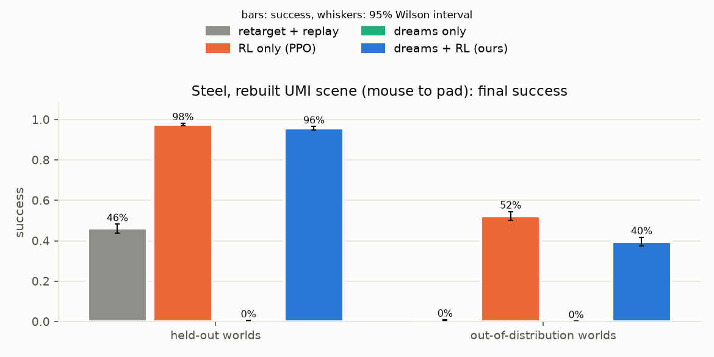

| retarget + replay | dreams + RL grounding | PPO |
|---|---|---|
| 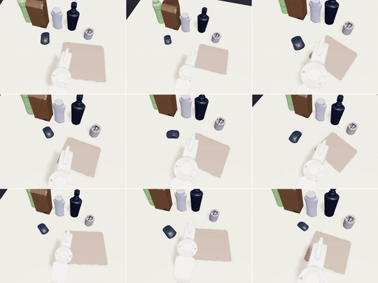 | 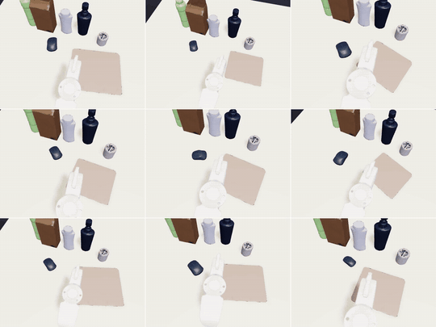 | 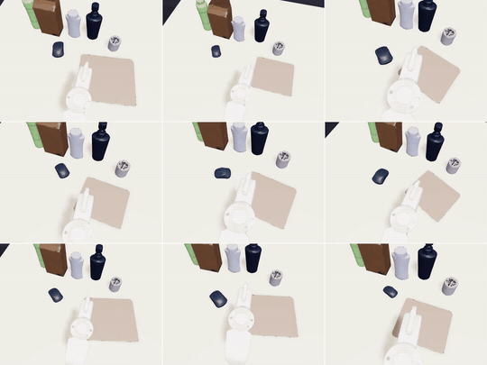 |

*The same nine held-out worlds, 13 s each ([replay](images/style_dream_umi/umi_replay.mp4),
[dreams + RL](images/style_dream_umi/umi_dream_rl.mp4), [PPO](images/style_dream_umi/umi_rl.mp4),
[dreams only](images/style_dream_umi/umi_dream.mp4)). Replaying the demo drops two of the nine mice beside the pad;
both learned policies put all nine on it. One world up close:
[dreams + RL](images/style_dream_umi/umi_dream_rl_hero.mp4), [PPO](images/style_dream_umi/umi_rl_hero.mp4),
[replay](images/style_dream_umi/umi_replay_hero.mp4).*

* **What the learning fixes is the grip.** The demo's style alone succeeds in 63 % of the lightest third of the
  held-out mice and 25 % of the heaviest: the heavier the mouse, the more often the demo's grasp loses it on the
  way. Both learned policies hold 93-98 % across all three thirds, without ever observing the mass (only how the
  mouse moves).

  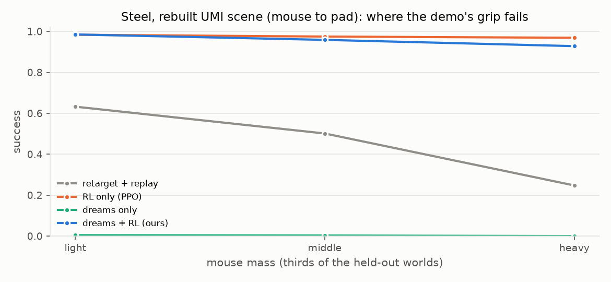

* **The style is kept.** The policies are residuals on the retargeted demo: their paths stay within 4.9 mm (PPO) and
  5.9 mm (dreams + RL) of it (DTW, against 3.8 mm for the replay itself, which still deviates by what the physics
  does to it), at the demo's tempo (1.02).

  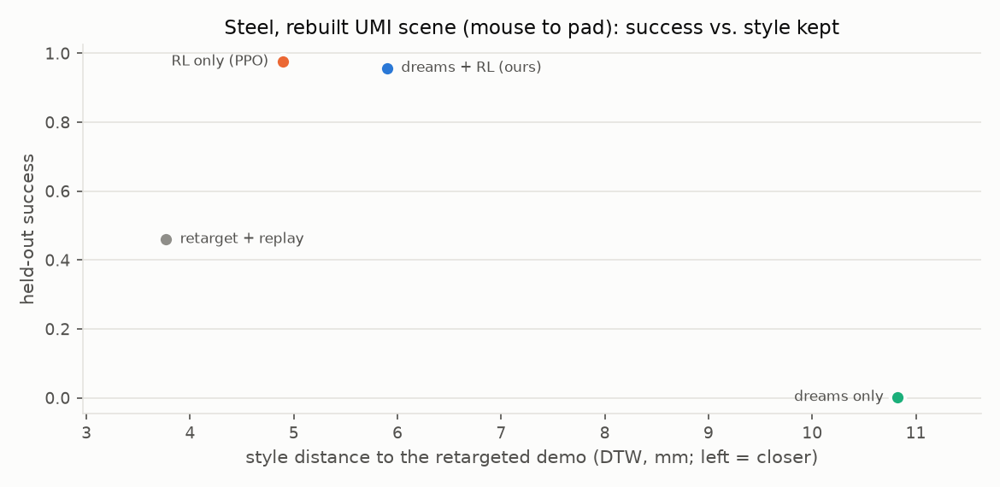

* **PPO beats dreams + RL on this scene, at every point of training.** On 1024 held-out worlds evaluated during
  training, PPO leads at iteration 25 (87.3 % vs 82.3 %), 50 (93.6 vs 92.5) and 120 (97.1 vs 96.4), so the dreams
  did not buy sample efficiency either; out of distribution the gap is 13 points. On the toy, one seed had dreams + RL
  ahead (96.3 vs 95.8 % held-out, 49.1 vs 44.5 % OOD), but the three-seed 2D replication had PPO ahead, so this
  run agrees with the replication: the dream term does not help reliably. A likely reason, not tested here: the
  dreamer predicts this scene worse than the toy's (object error 7.0 mm at 1 step and **20.3 mm at 10 steps**, against
  4.8 and 11.8 mm for the cup), and whether a 68 g mouse between two rigid fingers holds or slips is decided at
  the contacts, the hardest part to predict.

  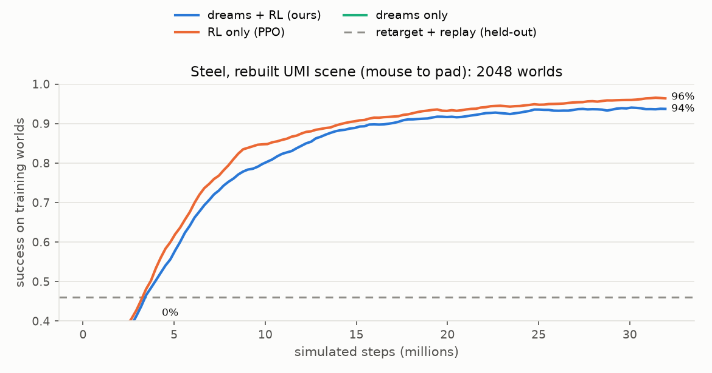

* **Dreams alone collapse.** The first rollout is the retargeted demo (28 % on the training worlds); after one
  update on dreams only, 0.5 %, then 0 %. Meanwhile the return the policy earns in the dreamer rises (0.85 → 1.34):
  it exploits the model, and the hand arrives at the pad without the mouse
  ([video](images/style_dream_umi/umi_dream.mp4)). This run was stopped at 15 iterations (a 120-iteration run
  showed the same 0 % at 14 and was stopped early to get the results sooner).

**The trained models.** The dreamer, the three policies, the style, the world configs and the Steel scene they need
are one 28 MB archive on Google Drive: `python scripts/checkpoints_drive.py fetch umi_style_dream` (see
[checkpoints](../checkpoints/README.md)). Loaded back from the archive, dreams + RL places the mouse in 63 of 64
held-out worlds and PPO in 61.

## Reproduce

On one GPU machine with the real2sim envs (`scripts/real2sim/setup_*.sh`) and the style-dream env
(`scripts/dream/setup_env.sh`):

```bash
scripts/dream/run_umi.sh
```

```bash
python scripts/dream/check_scene_physics.py runs/umi_style_dream/physics runs/umi_style_dream/worlds/scenarios.json
```

```bash
python scripts/dream/plot_results.py docs/images/style_dream_umi mouse=runs/umi_style_dream
```

`run_umi.sh` runs real2sim's nodes with the real2sim venv (`R2S_VLAB`), then style, worlds and dreamer with
`.venv-steel` (`VLAB`), the three policies concurrently, then the evaluation. On one A100: SAM 3D 4 min, the FR3 replay 1 min, the worlds 25 s, the dreamer 11.5 min, the three policies
concurrently 1.6 h (dreams + RL 96 min and PPO 87 min for 120 iterations; dreams only 30 min for 15), the
evaluation 20 min.

## References

1. F. Lin, Y. Hu, P. Sheng, C. Wen, J. You, and Y. Gao. *Data Scaling Laws in Imitation Learning for Robotic Manipulation.* ICLR 2025. [arXiv:2410.18647](https://arxiv.org/abs/2410.18647), [raw videos](https://huggingface.co/datasets/Fanqi-Lin/GoPro-Raw-Videos)
2. C. Chi, Z. Xu, C. Pan, et al. *Universal Manipulation Interface: In-The-Wild Robot Teaching Without In-The-Wild Robots.* RSS 2024. [arXiv:2402.10329](https://arxiv.org/abs/2402.10329)
3. SAM 3D Team, X. Chen, F.-J. Chu, et al. *SAM 3D: 3Dfy Anything in Images.* 2025. [arXiv:2511.16624](https://arxiv.org/abs/2511.16624)
4. N. Carion, L. Gustafson, et al. *SAM 3: Segment Anything with Concepts.* 2025. [arXiv:2511.16719](https://arxiv.org/abs/2511.16719)
5. B. Calli, A. Walsman, A. Singh, et al. *The YCB Object and Model Set.* IEEE RAM 2015. [arXiv:1502.03143](https://arxiv.org/abs/1502.03143)
6. J. Collins, S. Goel, K. Deng, et al. *ABO: Dataset and Benchmarks for Real-World 3D Object Understanding.* CVPR 2022. [arXiv:2110.06199](https://arxiv.org/abs/2110.06199)
7. Skild AI and NVIDIA. *Steel: Scaling Simulation Across Robots, Tasks, and Worlds.* 2026. [skild.ai/blogs/steel](https://www.skild.ai/blogs/steel), [github.com/skild-ai/steel](https://github.com/skild-ai/steel)
8. NVIDIA, Google DeepMind, Disney Research. *Newton physics engine* and *newton-assets* (Franka FR3 + hand URDF). [github.com/newton-physics/newton](https://github.com/newton-physics/newton)
9. A. Mandlekar, S. Nasiriany, B. Wen, et al. *MimicGen: A Data Generation System for Scalable Robot Learning using Human Demonstrations.* CoRL 2023. [arXiv:2310.17596](https://arxiv.org/abs/2310.17596)
10. L. Koutras, Z. Doulgeri. *A Novel DMP Formulation for Global and Frame Independent Spatial Scaling in the Task Space.* IEEE RO-MAN 2020. [doi:10.1109/RO-MAN47096.2020.9223500](https://doi.org/10.1109/RO-MAN47096.2020.9223500)
11. J. Tobin, R. Fong, A. Ray, et al. *Domain Randomization for Transferring Deep Neural Networks from Simulation to the Real World.* IROS 2017. [arXiv:1703.06907](https://arxiv.org/abs/1703.06907)
12. D. Hafner, J. Pasukonis, J. Ba, T. Lillicrap. *Mastering Diverse Control Tasks through World Models* (DreamerV3). Nature 2025. [arXiv:2301.04104](https://arxiv.org/abs/2301.04104)
